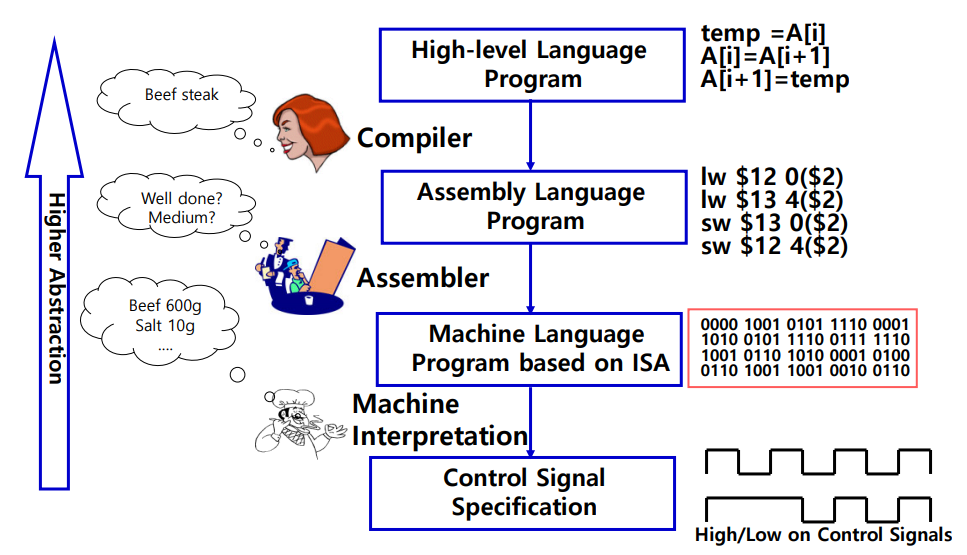

운영체제(Operating system)는 다음과 같은 두 가지 사항을 제공하는 장치이다.

1. 사용자가 하드웨어를 쉽게 사용할 수 있게 해주는 추상화(Abstraction)를 제공하는 장치이다.
2. 컴퓨팅 자원의 공유 및 분배를 위한 정책(Policy)이 제공되는 장치이다.

하드웨어를 다루기 위한 추상화는 왜 존재하는가? 우리가 컴퓨터의 하드웨어 자원을 직접적으로 다루는 것은 매우 어려운 일이다. 아래의 그림은 현재 우리가 작성하는 소스 코드가 컴파일 되어 프로그램이 만들어지는 과정을 보여준다.

[](/assets/images/operating-system/01/figure-01.png)

**컴파일 과정과 추상화 수준**

```text
High-level Language Program
    │ Compiler
    ▼
Assembly Language Program
    │ Assembler
    ▼
Machine Language Program (ISA)
    │ Machine Interpretation
    ▼
Control Signal Specification → High / Low 제어 신호

위로 갈수록 추상화 수준이 높아진다 ↑
```
위 그림에서 우리가 흔히 '고급 언어 (프로그래밍 언어)'를 통해 하나의 소스 코드를 작성하고 컴파일을 수행하게 되면, 컴파일러는 해당 소스 코드를 어셈블리어로 변환하고 어셈블러는 다시 기계어로 변환하는 작업을 수행한다. 또, 이러한 기계어 형태가 되면 그 때부턴 하나의 프로그램이 만들어지게 된다.

이렇게 만들어진 프로그램은 운영체제에 의해 필요한 자원을 할당 받아 하나의 작업 단위인 'Process'가 되어 사용자가 작성한 동작들을 수행하게 된다. 여기서 중요한 것은 컴퓨터에게 하나의 작업을 지시하려면 소스 코드를 작성하여 하나의 프로그램을 만들고 운영체제의 도움을 받아 프로그램을 프로세스의 형태로 만들어 동작 시켜야 한다는 점이다.

우리가 직접 기계어를 작성하여 컴퓨터에게 작업을 지시할 수도 있지만, 사람이 직접 기계어를 작성하는 것은 매우 어려운 일에 가깝다. 특히, 컴퓨팅 자원을 효율적으로 사용할 수 있도록 기계어를 작성하는 것은 더더욱 어려운 일이라고 할 수 있다.

이러한 어려운 일을 보다 쉽게 처리하기 위해, 사용자와 하드웨어 사이에서 중간 제어를 담당하는 것이 '운영체제'이며, 사용자가 하드웨어 장치를 호출하는 방식이나 기기 명령어에 의한 내부적인 동작을 몰라도, 운영체제가 제공하는 추상화 개념들만 정확히 알고 있다면 사용자가 보다 쉽고 효율적으로 하드웨어 장치들을 다루게 되는 것이다.

&lt;OS가 제공하는 Abstraction의 종류&gt;

- Abstraction - Process :

    프로세스란 프로그램이 운영체제 위에서 실행 중인 형태를 말한다. 또, 프로그램이란 특정 목적을 갖고 결과를 내기 위해 컴퓨터의 연산을 순차적으로 작성한 일종의 명령어 모음이며, 컴퓨터 시스템의 Disk와 같은 보조 기억 장치에 이진(Binary) 형태로 저장된 것을 말한다.

    컴퓨터 시스템에서 각 프로세스는 서로 독립적으로 실행될 수 있어야 한다. 그래야만 각 프로세스가 서로 상호 작용하며 주어진 문제를 해결하기 위한 효율적인 결과를 낼 수 있기 때문이다. 다르게 이야기하면 프로세스는 OS가 사용자가 컴퓨팅 자원을 독립적으로 이용하게끔 하여 결과를 제공 받도록 하는 추상화이다.


- Abstraction -  Address Space :

    주소 공간(Address Space)이란 프로세스가 위치하게 되는 메모리 공간을 이야기한다. 앞서 이야기한 프로세스의 독립적인 실행을 위해 존재하는 추상화이며, 다른 프로세스의 공간을 침범할 수 없도록 하기 위해 존재한다. 또, 메모리의 특정 공간에서 입출력 장치를 관리할 수 있도록 하기도 한다.


- Abstraction - File :

    파일이란 프로세스가 읽고 쓸 수 있는 영구적인 저장 장소(Persistent Storage)이다. 프로세스의 수행 결과를 영구적으로 저장하고, 필요에 따라 읽어오는 등의 목적으로 존재하는 추상화이다.


- Abstraction - Port :

    컴퓨터 시스템 간의 메시지를 주고 받기 위한 종점(End Point)이다. Network 상에서 하나의 프로세스가 다른 컴퓨터 시스템의 프로세스와 메시지를 주고받기 위해 존재한다.


정책(Policy)을 제공해야 하는 이유 :

앞에서 운영체제에 대해 이야기할 때, 컴퓨팅 자원의 공유 및 분배를 위한 정책을 제공한다고 하였다. 여기서 말하는 정책이란 컴퓨팅 자원에 대한 통제, 관리, 감시 등의 활동을 말한다. 정책은 컴퓨팅 자원에 대해 어떤 것을 중점으로 사용할 것인 지에  따라 결정된다.

예를 들면, 일반 Personal Computer, Server에서 쓰이는 컴퓨팅 자원은 성능을 중점으로 사용하므로, 단위 시간당 처리량을 최우선으로 하는 정책을 채택하게 될 것이고, Smartphone에서 쓰이는 컴퓨팅자원은 배터리 소모를 최소화하는 것을 목표로 정책을 채택할 수도 있다. (PC나 Server는 늘 전원을 연결하여 사용하지만, 스마트 폰은 항상 전원을 연결하며 사용하지는 않으므로.)
