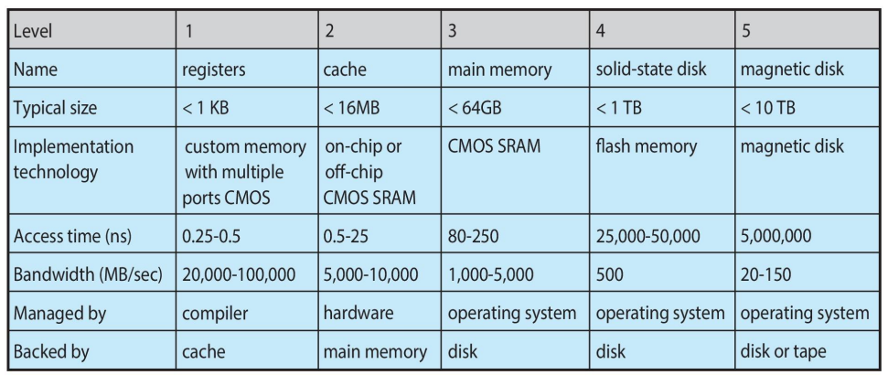
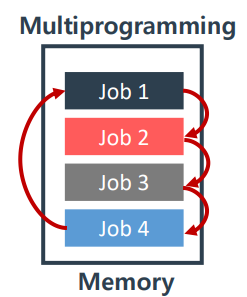
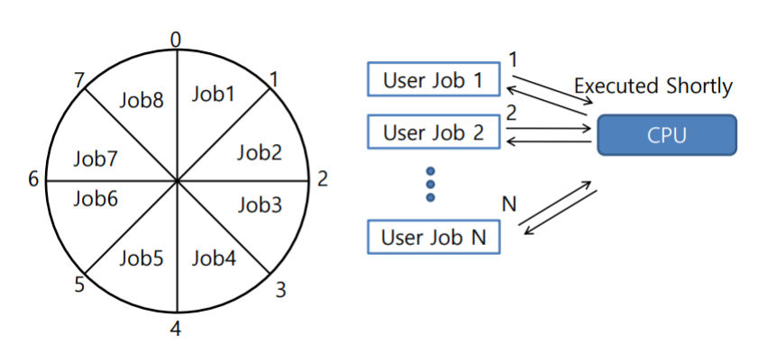
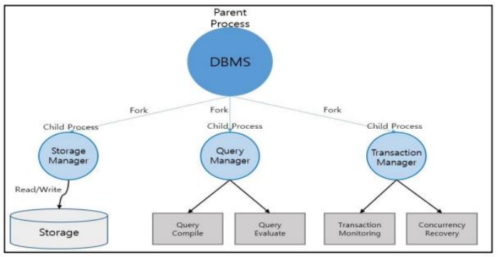

> 본문과 예제는 원문을 보존했다. 그림은 누르면 원본 크기로 볼 수 있으며, **화살표로 읽기**는 구조와 흐름을 풀어 쓴 보충 도식이다.

1950년대 ~ 1960년대의 컴퓨터는 매우 원시적인 형태였다. 기계적인 스위치를 이용하여 1bit 단위 (0과 1의 두 가지 신호)로 컴퓨터에 입력하여 다루었다. 이후 기계어가 등장하고, 펀치 카드(사전에 입력을 완성시킨 프로그램과 유사함.)로 컴퓨터를 구동 시키는 방식으로 발전하게 된다.

이 시절 컴퓨터의 고질적인 문제는 CPU와 I/O 장치 사이의 속도 차이에 의해, CPU가 자주 Idle 상태로 전환된다는 것이었다. (입출력 장치의 속도가 현저히 느려서, CPU가 연산을 끝내고 긴 시간동안 대기하는 상태가 되어버리는 것.)

즉, 하나의 작업을 끝내고 다음 작업을 동작시키는 과정에서 CPU가 대기하는 시간이 길었다는 의미이다.

다음과 같은 표를 보자.

[](/assets/images/operating-system/02/figure-01.png)
CPU의 연산이 ms(마이크로 초) 단위인 것과 아래의 표에서 Access time이 ns 단위이고, 각각의 메모리 공간마다 Access time이 엄청난 차이를 보이는 것을 봤을 때, 메모리 공간 대비 CPU의 연산 시간과 I/O 시간이 엄청난 차이가 있음을 알 수 있다. 이러한 문제를 해결하기 위해 다음과 같은 프로세스 관리 기법(Scheduling)들이 등장했다.

- Multi programming

가장 간단한 아이디어로, 여러 프로세스를 하나의 메모리에 적재해두고, 순차적으로 수행해나가는 방법이다.

[](/assets/images/operating-system/02/figure-02.png)

**화살표로 읽기 — 메모리 안의 작업 순환**

```text
Memory: [Job 1] → [Job 2] → [Job 3] → [Job 4]
           ↑                              │
           └──────────────────────────────┘
```
이러한 기법은 확실히 CPU의 Idle Time이 감소시키긴 하였으나, 사용자가 Dynamic하게 실행 순서를 바꿀 수 없다는 단점이 존재한다. (Job 1을 수행하고 나서 바로 Job 4를 바로 수행한다던가 하는 것이 불가능.)

이는 프로세스를 수행하는 과정에서 공평성과 우선순위를 보장할 수 없다는 문제가 있다. 공평성이란 모든 프로세스가 동일한 시간동안 CPU 자원을 사용해야 함을 의미하고,  우선순위란 필요에 따라 특정 프로세스가 먼저 수행될 수도 있음을 의미한다.

- Time sharing

또 다른 프로세스 관리 기법은 Time sharing이다.

[](/assets/images/operating-system/02/figure-03.png)

**화살표로 읽기 — 시간을 나누어 CPU 사용**

```text
시간 → 0     1     2     3     4     5     6     7     8
       Job1  Job2  Job3  Job4  Job5  Job6  Job7  Job8

User Job 1 ─┐
User Job 2 ─┼→ CPU를 짧은 시간씩 번갈아 사용
User Job N ─┘
```
위와 같은 그림처럼 각 프로세스를 공평한 시간 동안 수행하는 것을 말한다. 구체적으로는 일정 시간 주기로 CPU의 사용을 각 프로세스들끼리 번갈아가며 사용하는 것이다. 이를 위해서는 프로세스의 상태(Context)를 교체(Switching)하는 별도의 작업이 필요로 하게 되었다.

- Multi tasking

여러 개의 태스크(Task)들이 CPU와 같은 자원을 공유하도록 하는 방법이다. 이 기법의 핵심 아이디어는 하나의 작업을 동시에 실행할 수 있는 태스크(Task)로 나누어서 실행한다는 것이다. (ex : Unix의 fork 시스템 콜을 통한 여러 개의 자식 프로세스 생성)

Multi tasking은 사용자가 하나의 작업을 여러 개의 프로그램으로 나누어 실행하도록 하는 것으로, CPU가 Idle 상태일 때는 Background 형태의 작업을 실행 가능하도록 하는 기법이다.

Multi tasking의 좋은 예시는 다음과 같은 DBMS(Database management system)이다.

[](/assets/images/operating-system/02/figure-04.png)

**화살표로 읽기 — DBMS의 작업 분담**

```text
DBMS (Parent Process)
 ├─ fork → Storage Manager → Read / Write → Storage
 ├─ fork → Query Manager
 │          ├→ Query Compile
 │          └→ Query Evaluate
 └─ fork → Transaction Manager
            ├→ Transaction Monitoring
            └→ Concurrency Recovery
```
DBMS는 한 번 수행될 때 Disk와의 I/O 작업을 담당할 프로세스, 사용자가 요청한 Query를 처리할 프로세스, 트랜잭션 관리를 담당할 프로세스 등의 여러 자식 프로세스를 두고 서로 협력하는 방법으로 동작한다.

이러한 Multi tasking은 다음과 같은 Issue가 존재한다.

- 파생된 task끼리 메모리 공간을 공유한다는 것은 동시에 여러 프로그램이 하나의 메모리 공간에 적재된 것이기 때문에 메모리 관리와 보호가 어느 정도는 보장되어야 한다.

- 파생된 모든 자식 프로세스들을 메모리에 적재할 수 없는 경우가 존재하므로, Disk와 메모리 간의 Swap이 일어날 수도 있다.

- 적절한 CPU 스케줄링 기법이 없다면 동시성에 의한 예외가 발생할 수도 있으며, 순차적인 수행을 보장해야할 수도 있다. (교착상태, 동기화 등을 고려.)
