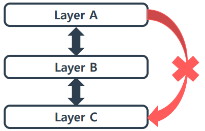
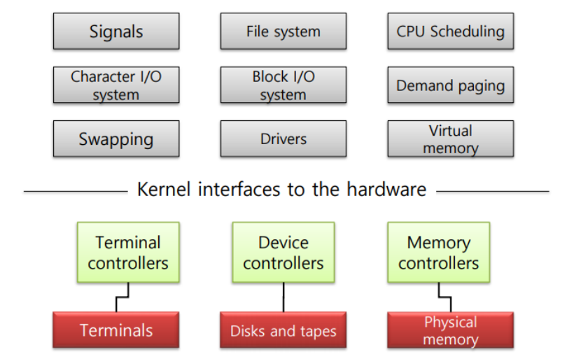
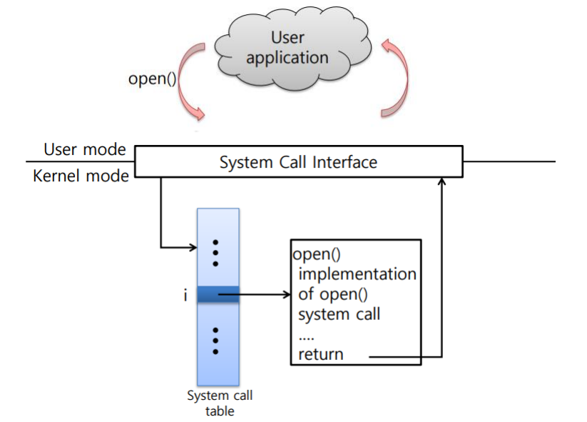
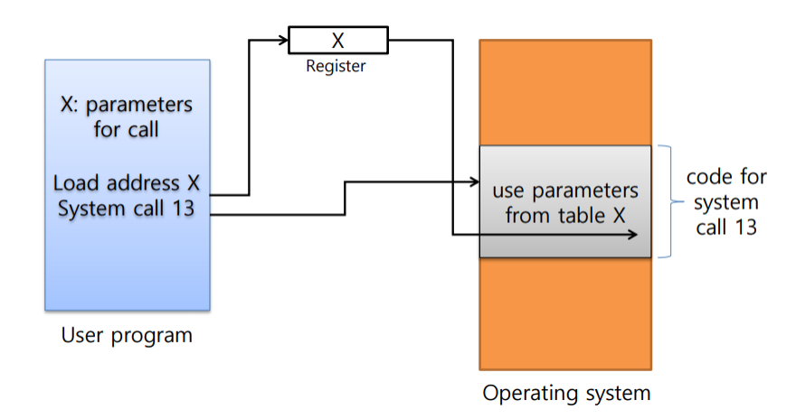
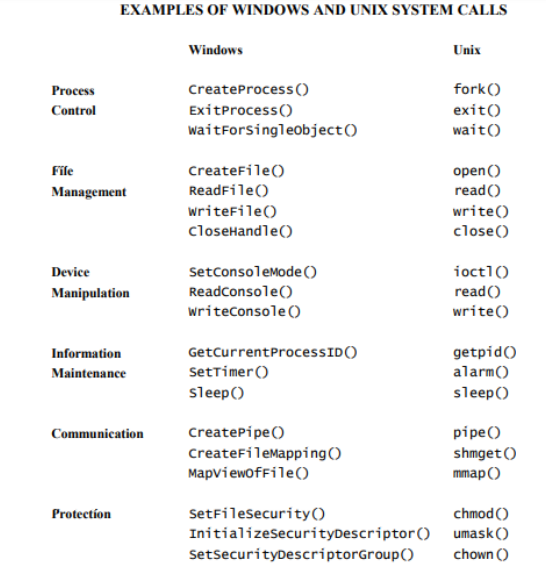
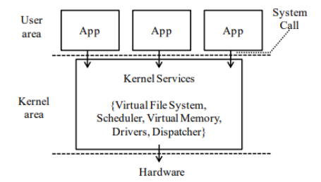
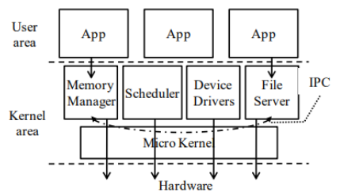
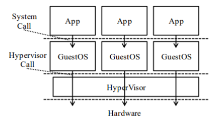

운영체제는 규모가 매우 크고 복잡한 소프트웨어이다. 그러므로 개발, 수정 및 디버깅, 유지 보수, 확장 등을 고려하여 신중하게 설계되어야 한다. 운영체제의 설계 원칙은 'Policy', 'Mechanism'을 중점적으로 분리하는 것이다. Policy는 '무엇'이 되게 할 지에 대한 정책이고, Mechanism은 무엇을 '어떻게' 구현할 것인지에 대한 동작 방식을 말한다.

이러한 설계 원칙을 준수할 수 있는 방법으로는 'Layering'이 존재한다. 각 모듈을 계층으로 나누어 구현하고, 통신하도록 하는 것이다. 각 모듈은 정의된 정책에 따라 구현되고, 모듈 간의 계층을 두어 위와 아래로 인접한 Layer끼리 통신하도록 하는 것이다.  즉, 다음 그림과 같이 하나의 레이어가 위, 아래로 인접한 레이어를 건너뛰어 통신하는 것을 허용하지 않는다.

[](/assets/images/operating-system/03/figure-01.png)

**인접 계층 사이의 통신**

```text
[Layer A]
    ↕
[Layer B]
    ↕
[Layer C]

Layer A ↛ Layer C : 중간 계층을 건너뛰는 직접 통신은 금지
```
Layering의 장점은 구현의 복잡도를 낮출 수 있고, Layer 간의 독립성을 보장하므로 Layer 단위의 유지보수가 가능하다는 점이 있지만,

Layering의 단점으로는 Overhead가 발생한다는 점이 있다. 구체적 말하자면 특정 Layer와 통신하기 위해 많은 호출이 있어야 한다는 점이나 추가적인 데이터가 요구될 수도 있다는 것이다. (OSI 7계층을 떠올리면 이해하기 쉽다.)

다음 그림은 Layering이 적용된 리눅스 커널의 모습을 보여준다.

[](/assets/images/operating-system/03/figure-02.png)

**커널 기능과 하드웨어 인터페이스**

```text
Kernel 기능
 ├─ Signals / Character I/O system / Swapping
 ├─ File system / Block I/O system / Drivers
 └─ CPU Scheduling / Demand paging / Virtual memory
                         │
                         ▼
             Kernel interfaces to the hardware
               ├→ Terminal controllers → Terminals
               ├→ Device controllers   → Disks and tapes
               └→ Memory controllers   → Physical memory
```
이러한 구조에서 사용자가 H/W 자원을 다루려면 Application(User process)과 가까운 계층의 Layer들을 통해 Kernel에게 특정 요청을 보내면 Kernel은 알맞는 Layer를 통해 요청받은 작업을 수행하게 될 것이다.

그렇다면, Application과 가까운 계층에서는 어떻게 커널에게 요청을 보내는 것일까. 이를 알기 위해서는 Kernel mode와 User mode에 대한 이해가 필요하다.

Kernel mode는 모든 권한을 가진 실행 모드로, 오직 Kernel mode만이 H/W 자원을 직접적으로 다룰 수 있다. User mode는 Kernel 모드보다는 비교적 낮은 실행 권한을 갖는 실행 모드로, 커널에 의존적인 모드이다.

즉, User mode에서는 필요에 따라 Kernel에 요청하여 H/W 자원에 접근해야 한다는 것인데 이를 위한 Kernel 요청 수단을 'System call' 이라고 한다. 시스템 콜의 동작을 도식화하면 다음과 같다.

[](/assets/images/operating-system/03/figure-03.png)

**시스템 콜 요청과 반환**

```text
User application
    │ open()
    ▼
System Call Interface      [User mode → Kernel mode]
    │ 시스템 콜 번호 i
    ▼
System call table[i] → open() 구현 실행
                           │ return
                           ▼
User application ← System Call Interface
```
시스템 콜은 커널에 의해 사전에 정의되어 있으며, 이를 정의해둔 테이블이 'System call table'이다. System call interface를 통해 User application의 요청이 오면, 테이블을 탐색하여 시스템 콜을 찾아 해당 시스템 콜의 동작을 수행하고, 그 결과를 다시 User application에 반환한다.

[](/assets/images/operating-system/03/figure-04.png)

**매개인자 테이블의 주소 전달**

```text
User program: 매개인자 테이블 X
    ├─ Load address X → Register에 X의 주소 저장
    └─ System call 13 → OS의 system call 13 코드
                              │
Register의 X 주소 ────────────→ 테이블 X의 매개인자 사용
```
User application에서 시스템 콜이 호출될 때, 매개인자가 필요로 한다면 해당 매개인자는 레지스터를 통해 전달된다. 왜냐하면 User application과 Kernel은 메모리를 공유하지 않기 때문이다.

다음은 많이 사용되는 시스템 콜들을 정리해둔 것이다.

[](/assets/images/operating-system/03/figure-05.png)
한편, 커널은 구현 방법에 따라 다음과 같은 세 가지 방식이 존재한다.

- Monolithic Kernel

    [](/assets/images/operating-system/03/figure-06.png)

    **Monolithic Kernel 구조**

    ```text
    User area:   [App]        [App]        [App]
                    └──────────┼────────────┘
                               │ System Call
                               ▼
    Kernel area: [Kernel Services — 같은 커널 주소 공간]
                 Virtual File System / Scheduler
                 Virtual Memory / Drivers / Dispatcher
                               │
                               ▼
                            Hardware
    ```
    커널의 모든 서비스가 같은 주소 공간에 위치하도록 하는 구현 방법이다. Application은 자신의 주소 공간에 커널 코드 영역을 매핑하여 커널의 서비스를 이용한다.

    응용 프로그램과 모든 커널 서비스가 하나의 주소 공간에 위치하기 때문에 시스템 콜 호출과 커널 서비스 간의 데이터 전달 시에 Overhead가 적다는 장점이 있으나, 모든 커널 서비스가 하나의 바이너리로 이루어지기 때문에 일부의 수정 및 문제가 발생하면 시스템 전체에 영향을 끼친다는 단점이 있다.

- Micro Kernel

    [](/assets/images/operating-system/03/figure-07.png)

    **Micro Kernel 구조**

    ```text
    Applications
        │ 요청
        ▼
    [Memory Manager] [Scheduler] [Device Drivers] [File Server]
           ↕             ↕             ↕              ↕
           └─────────────┴──── IPC ────┴──────────────┘
                               ↕
                          Micro Kernel
                               ↕
                            Hardware
    ```
    커널의 서비스를 기능에 따라 모듈화하여 각각 독립된 주소 공간에서 동작하도록 하는 방식이다. 장점으로는 각 서비스들이 서로 간의 의존성이 낮다는 점이다. 이는 하나의 서비스에서 문제가 발생해도 시스템 전체에 영향을 끼칠 수 없어 안정적인 동작을 보장한다. 단점으로는 각 서비스들이 독립적으로 떨어져 있기 때문에 각 서비스들끼리의 통신 및 Context switching이 발생한다.

- Hypervisor

    [](/assets/images/operating-system/03/figure-08.png)

    **Hypervisor 구조**

    ```text
    [App]             [App]             [App]
      │ System Call     │ System Call     │ System Call
      ▼                 ▼                 ▼
    [Guest OS]        [Guest OS]        [Guest OS]
      └─────────────────┼─────────────────┘
                        │ Hypervisor Call
                        ▼
                   [Hypervisor]
                        │
                        ▼
                    [Hardware]
    ```
    'Hypervisor'라는 관리 계층을 두어, 가상화된 컴퓨터에 H/W 자원을 제공하는 방식을 말한다. Guest OS들은 Hypervisor를 통해 H/W 자원을 접근하고, Hypervisor는 다수의 Guest OS에 대한 CPU, 메모리 등의 시스템 자원을 분배하는 역할을 수행한다.

    이러한 방식의 장점은 하나의 물리적인 컴퓨터에서 다양한 종류의 OS를 운용하는 것이 가능하다는것이고, 실제 컴퓨터가 제공하는 것과는 다른 형태의 ISA(Instruction Set Architecture)를 제공 한다는 점이다. 단점으로는 H/W를 직접적으로 사용하는 다른 운영체제에 비해 성능이 떨어진다는 점이다.
