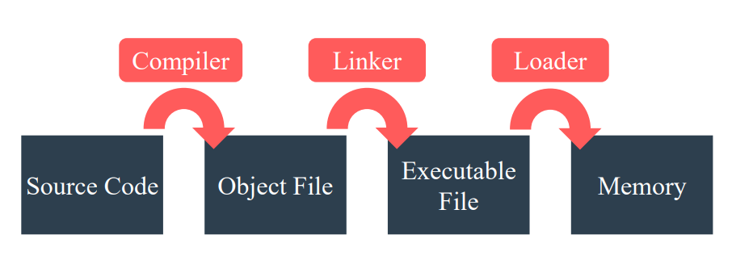
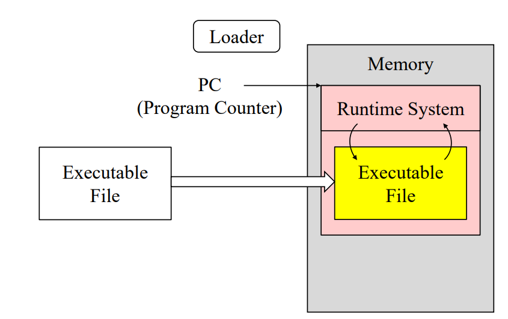
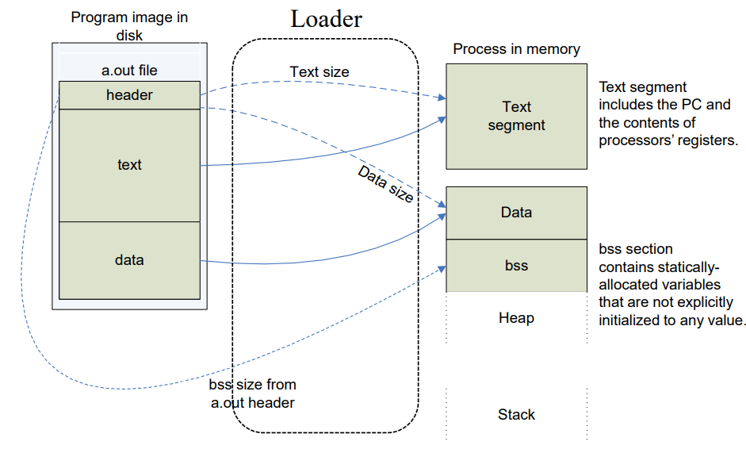
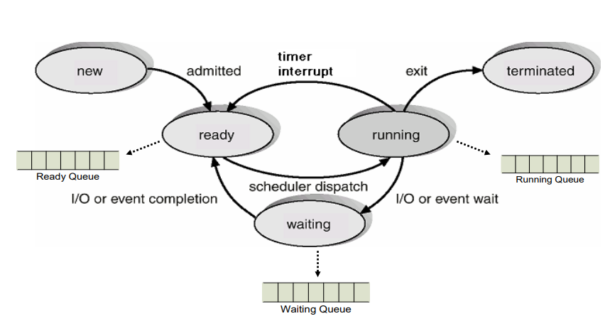
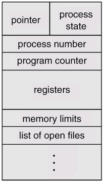
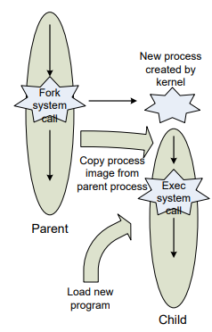
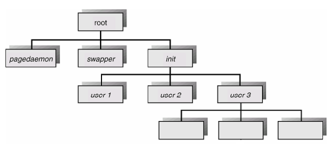

<!-- section -->

## 1. Process의 생성 과정

앞선 내용에서 프로세스는 프로그램이 운영체제에 의해 자원을 할당받아 실행중인 형태라고 말한 바 있다. 또, 프로그램은 다음과 같은 과정을 거쳐 만들어진다.

[](/assets/images/operating-system/04/figure-01.png)

**소스 코드에서 메모리 적재까지**

```text
Source Code ──Compiler──→ Object File
Object File ──Linker────→ Executable File
Executable File ──Loader──→ Memory
```
- Compiler : 사용자가 고급 언어(프로그래밍 언어)로 작성한 소스 코드를 컴퓨터가 이해할 수 있는기계어로 작성된 목적 파일(Object file)로 변환해주는 역할을 한다.

Source code : 프로그램이 수행하려는 작업을 사람이 이해할 수 있는 언어인 고급 언어로 표현되어 존재하는 파일이다.

Object file(목적 파일, .o file) : 컴퓨터가 이해할 수 있는 기계어로 구성된 파일을 말한다. 혼자서는 수행이 불가능하며, 프로세스로 변환되기 위한 정보를 필요로 한다. 또, 소스 코드 내에서 작성한 심볼들 (변수, 함수 등)의 위치를 상대적인 값으로 표현한다. (어느 하나의 심볼의 위치에 대해 시작 주소로부터 26 Byte 떨어진 지점이라고 표현함.)

- Linker : 컴파일러에 의해 만들어진 목적파일 및 여러 라이브러리를 하나로 묶어 실행 가능한 파일(Executable file)을 만들어주는 역할을 한다.

Executable file(.exe file, a.out) : 운영체제 위에서 수행될 수 있는 파일을 말한다. 프로세스로 변환되기 위한 Header, 수행해야될 내용이 담긴 Text, 수행에 필요한 데이터가 담긴 Data 영역이 있다. 목적 파일과는 다르게 심볼들의 주소를 절대적인 주소로 표현한다.

- Loader : 실행 가능한 파일을 메모리에 적재하여 하나의 프로세스로 만들어주는 운영체제의 일부이다.


    로더는 다음과 같은 동작 과정을 거쳐 하나의 프로세스를 동작하게 한다.

    1. Executable file의 Header를 읽어서 Text와 Data 영역의 크기를 결정한다.
    2. 프로세스가 동작하기 위한 주소 공간을 생성한다. (가상 메모리 주소 공간 생성)
    3. 실행될 명령어들과 Data들을 Executable file의 내용을 복사하여 이전에 생성한 주소 공간에 붙여넣는다.
    4. 프로세스 수행에 필요한 매개인자들을 Stack으로 복사한다.
    5. CPU 내의 Register를 초기화하고, Start-Routine으로 Jump한다.


Loader에 의해 프로그램이 메모리에 로드될 때, GCC는 'C Runtime System'이라고 불리는 추가적인 목적 파일을 다음 그림과 같이 메모리에 적재한다.

[](/assets/images/operating-system/04/figure-02.png)

**실행 파일과 런타임 시작 흐름**

```text
Executable File ──Loader──→ Memory 안의 실행 파일
                                ↕
                         C Runtime System
                                ↑
                         PC가 시작 지점을 가리킴

_start → C 라이브러리·쓰레드 환경 초기화 → main()
```
 C Runtime System을 적재하게 되면, 기본 라이브러리들도 동적으로 연결되며, Runtime System에는 프로세스를 시작하기 위한 _start 함수가 존재하는데, 커널은 프로세스를 시작하기 위해 PC의 위치를 해당 함수의 위치로 지정한다. 또, _start 함수는 동적으로 링크된 C 라이브러리 및 쓰레드 환경을 초기화하기 위해 _libc*_*start_main 함수를 호출한다. 라이브러리 초기화까지 진행되면 그제서야 Application의 main 함수가 호출된다.

앞서 말한 내용을 다시 정리하여 도식화하면 다음 그림과 같다.

[](/assets/images/operating-system/04/figure-03.png)

**실행 파일과 프로세스 메모리의 대응**

```text
Disk: a.out                     Memory: Process
 header ──text size────────────→ Text 영역 크기 결정
        ├─data size────────────→ Data 영역 크기 결정
        └─bss size─────────────→ BSS 영역 크기 결정
 text ────────────────────────→ Text segment
 data ────────────────────────→ Data
                                BSS
                                Heap
                                ⋮
                                Stack
```
디스크에 저장된 프로그램이 Compiler, Linker, Loader에 의해 실행 가능한 파일이 되면, 로더는 해당 파일에 담긴 header를 읽어서 메모리의 Text와 Data 영역의 크기를 할당하고, 실행 파일의 text, data를 읽고나서 메모리의 Data, Text 영역에 실행파일의 내용을 복사하여 붙여넣게 된다.

또, 추가적으로 header에는 초기화가 되지 않은 전역 변수에 대한 내용이 있기도 한데, 로더는 이를 메모리의 BSS 영역에 저장한다.

<!-- section -->

## 2. Process State

프로세스는 Scheduling을 위해 다음과 같은 State를 갖는다.

- New : 프로세스가 생성된 상태.
- Running : 프로세스가 명령어들을 실행중인 상태.
- Waiting : 프로세스가 특정 이벤트를 대기중인 상태.
- Ready : 프로세서의 지시를 기다리는 상태. (즉각적인 실행이 되도록 대기하는 상태)
- Terminated : 프로세스가 종료된 상태.

프로세스는 다음 그림과 같이 커널 내에서 Ready Queue, Waiting Queue, Running Queue를 두고 프로세스들의 상태를 관리한다.

[](/assets/images/operating-system/04/figure-04.png)

**프로세스 상태 전이**

```text
New ──admitted──→ Ready ──scheduler dispatch──→ Running
                   ↑                            │
                   ├────timer interrupt─────────┤
                   │                            ├─exit──→ Terminated
                   │                            │
                   │                   I/O or event wait
                   │                            ▼
                   └──I/O or event completion─ Waiting

Ready → Ready Queue    Waiting → Waiting Queue
```
커널이 프로세스의 상태를 관리한다는 것은, 메모리에 프로세스에 대한 데이터를 적재하고, 필요에 따라 적절히 참조하며 Scheduling을 한다는 뜻이다. 메모리에 적재되는 프로세스에 대한 정보를 Process Control Block이라 부르며, 일부 생략되기는 하였으나 다음과 정보를 담아 구조체 형태로 구현되어 있다.

[](/assets/images/operating-system/04/figure-05.png)
프로세스가 커널에 의해 Context Switching이 되어야 할 때는 위와 같은 PCB를 통해 프로세스를 교체하면서 프로세스 간의 전환이 일어나게 된다. 이러한 프로세스 전환은 프로세서(Processor)의 구조에 따라 차이를 보인다.

- CISC : 명령어의 구조를 복잡하게 구성하는 프로세서 구조이다. 명령어의 구조가 복잡하니 회로의 구성도 복잡해지고, 그만큼 레지스터가 갖게 되는 용량이 낮다보니 프로세스의 전환이 발생할 때마다 채워야할 레지스터의 수가 적다. 그러므로 Context Switch의 속도가 빠른 프로세서 구조이다.


- RISC : 명령어의 구조를 간단하게 구성하는 프로세서 구조이다. 명령어의 구조가 단순하니 회로의 구성도 단순해지고, 그만큼 레지스터가 갖게되는 용량이 많아지므로 프로세스의 전환이 발생할 때마다 채워야 할 레지스터의 수가 많다. 그러므로 Context Switch의 속도가 느린 프로세서 구조이다.

<!-- section -->

## 3. Process Creation

프로세스는 때때로 사용자에 의해 Dynamic하게 생성되거나 종료될 필요가 있다. 커널은 이러한 요구를 충족시키기 위해 Unix를 기준으로 다음과 같은 Mechanisms이 존재한다.

[](/assets/images/operating-system/04/figure-06.png)

**fork와 exec의 흐름**

```text
Parent ──fork()──┬→ Parent 계속 실행
                └→ Child 생성 (부모의 프로세스 이미지 복사)
                         │ exec()
                         ▼
                  새로운 프로그램 적재·실행
```
먼저, 모든 프로세스는 fork 시스템 콜에 의해 생성된다. 어떤 프로세스가 fork 시스템 콜을 호출하면 자신의 PCB 내용을 모두 파생될 새로운 프로세스에게 복사한다. 이는 두 개의 프로세스가 메모리를 공유하는 것이 되는데, 이렇게 자신의 프로세스(Parent)의 내용을 새롭게 파생될 프로세스(Child)에게 복사하는 이유는 새롭게 메모리에 내용을 적재하는 것보다 훨씬 효율적이기 때문이다.

위의 같은 내용을 소스 코드로 표현하면 다음과 같다.

```c
#include <stdio.h>
#include <stdlib.h>
#include <errno.h>
#include <unistd.h>

int main(int argc, char* argv[]){
int counter = 0;
pid_t pid;
printf("Creating Child Process\n");
pid = fork();

if(pid < 0){ // Error in fork
    fprintf(stderr, "fork faild, errno: %d\n", errno);
    exit(EXIT_FAILURE);
}

else if(pid > 0){ // This is Parents Process
    int i;
    printf("Parents(%d) made Child(%d)\n", getpid(), pid);
    for(i=0; i<10; i++){
        printf("Counter: %d\n", counter++);
    }
}

else if(pid == 0){ // This is Child Process
    int i;
    printf("I am Child Process %d!\n", getpid());
    execl("/bin/ls", "ls", "-l", NULL); // Run 'ls -l' at /bin/ls

    for(i=0; i<10; i++){ // Cannot be run
        printf("Counter: %d\n", counter++);
    }
}

wait(NULL);
return EXIT_SUCCESS;
}
```

위와 같은 내용을 정리하면, 하나의 프로세스는 어떤 프로세스에 의해 파생되어 생성된다는 것이다. 그렇다면 최초의 프로세스는 어떻게 생성되는 것인가? 이는 Unix 시스템의 계층적인 구조를 보면 알 수 있다.

[](/assets/images/operating-system/04/figure-07.png)

**프로세스 계층**

```text
root
 ├→ pagedaemon
 ├→ swapper
 └→ init
     ├→ user 1
     ├→ user 2
     └→ user 3
         ├→ 자식 프로세스
         ├→ 자식 프로세스
         └→ 자식 프로세스
```

<!-- section -->

## 4. Process Termination

프로세스가 완전히 종료되는 경우는 다음과 같은 경우들이 존재한다.

- exit 시스템 콜이 호출되는 경우 : 정상적으로 프로세스를 종료하는 경우이며, 프로세스의 자원은 운영체제가 알아서 할당을 해제한다. 또, wait 시스템 콜과 함께 사용하게 되면 파생시킨 자식 프로세스의 종료와 결과를 대기하게 된다.


- abort() 함수가 호출되는 경우 : 비정상적으로 프로세스를 종료하는 경우이며, 함수를 호출한 프로세스에게 SIGABRT 시그널을 보내고, 프로세스가 어떠한 문제로 종료 되었는 지를 나타내기 위해 Core dump를 생성한다.
