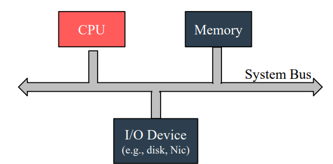
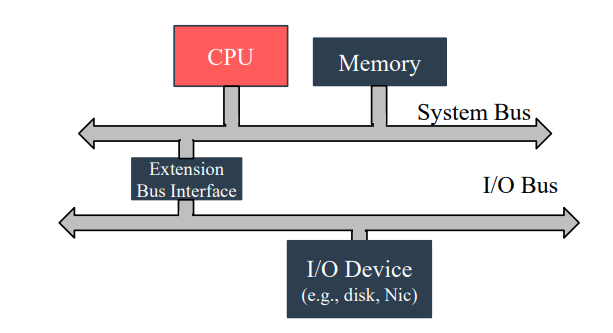
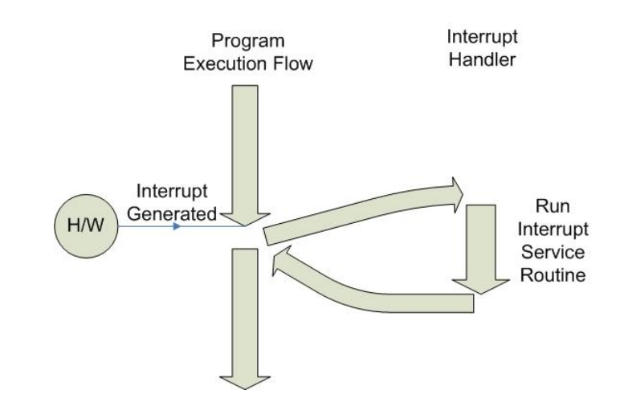
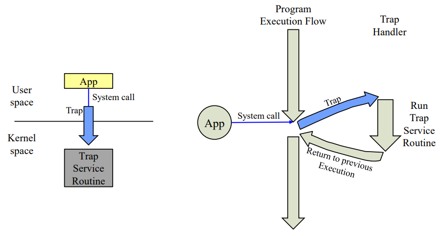
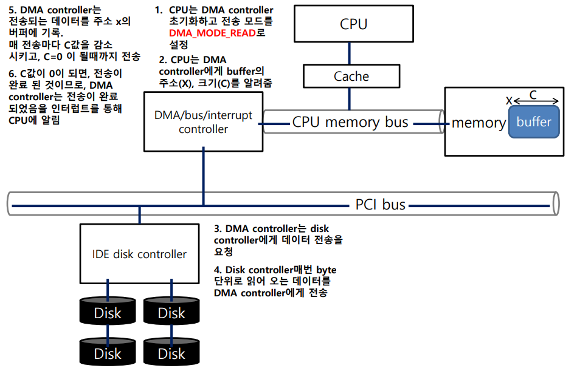
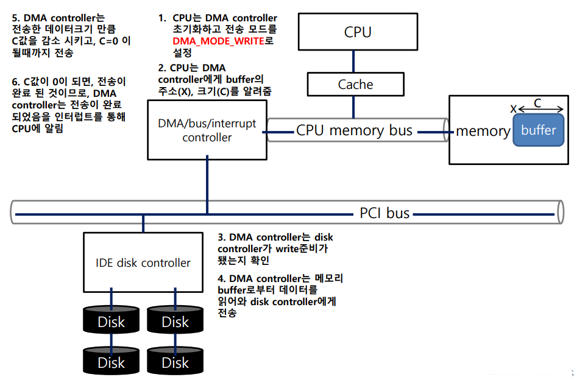

<!-- section -->

## 1. Bus

[](/assets/images/operating-system/05/figure-01.png)

**단일 시스템 버스 연결**

```text
CPU ↔ System Bus ↔ Memory
          ↕
     I/O Device (Disk, NIC 등)
```
Bus란 CPU, RAM, I/O 장치 간의 데이터가 전송되는 통로를 의미한다. 이 때, 장치끼리 주고 받는 데이터는 Data일 수도 있고, Address일 수도 있다. 하나의 통로를 통해 여러 가지 모듈이 연결되어 있다보니, 여러 장치들 간의 속도 격차가 존재하기 시작하면서 문제가 되었다.

쉽게 예를 들자면, CPU는 초당 5 단위의 일을 처리하고 메모리는 초당 3단위의 일을 전달할 수 있다고 가정하자. 이런 경우에 두 장치의 작업은 초당 2 단위의 손실이 나게 된다.  두 장치 간의 작업 속도가 메모리의 처리 속도에 결정되는 것인데, 이를 '병목현상' (Bottleneck)이라고 한다.

CPU와 메모리 사이의 속도 격차뿐만 아니라 메모리와 Disk, Disk와 네트워크 장치, 기타 I/O 장치들과 속도 차이를 보이게 되자, 다음과 같이 속도에 맞는 장치끼리 버스를 연결하는 계층적인 구조로 발전하게 된다.

[](/assets/images/operating-system/05/figure-02.png)

**계층형 버스 연결**

```text
CPU ↔ System Bus ↔ Memory
          ↕
  Extension Bus Interface
          ↕
        I/O Bus ↔ I/O Device (Disk, NIC 등)
```

<!-- section -->

## 2. Event handling

컴퓨터 시스템을 사용하다 보면, 특정한 상황(Event)에 대한 처리(Handling)가 필요할 수도 있다. 운영체제에서는 이를 Interrupt, Trap으로 나누어 각 상황에 맞게 관리한다.

- Interrupt : 비동기적 이벤트(사용자의 키보드 입력, 네트워크 패킷의 도착과 같이 언제 등장할 지 모르는)를 처리하기 위한 기법이다.


    Interrupt handling

    1. 인터럽트의 발생을 감지. (인터럽트는 한 번에 하나만 처리하도록 한다.)
    2. 현재 실행 상태를 저장. (커널에서 처리되고 다시 복귀하기 때문에 현재의 상태를

        저장해두었다가 처리를 끝낸 뒤에 다시 복귀하기 위해 저장.)

    3. ISR(Interrupt Service Routine)으로 Jump하여 발생한 Event에 대해 처리.
    4. 저장한 실행 상태를 복원.
    5. 인터럽트에 의해 중단된 지점에서부터 다시 시작.

    &lt;인터럽트 유의사항, 알아두면 좋은 것들&gt;

    - Handling 과정에서 또 다른 인터럽트가 발생했었다면, 이는 다시 커널에게 전달된다.
    - 인터럽트에는 우선 순위가 존재하며, H/W 장치마다 다르게 설정된다.
    - ISR은 최소한의 시간으로 동작해야 다른 인터럽트가 빠르게 처리될 수 있다.
    - Time Sharing 기법은 Timer Interrupt의 도움을 받아 가능한 기술이다.

다음은 실행중인 프로그램에서 인터럽트가 감지되었을 때의 처리 과정을 도식화한 것이다.

[](/assets/images/operating-system/05/figure-03.png)

**하드웨어 인터럽트 처리와 복귀**

```text
프로그램 실행
    │ ← H/W의 Interrupt 발생
    ▼
현재 실행 상태 저장 → Interrupt Handler
                         │ ISR 실행
                         ▼
프로그램 실행 재개 ← 저장한 상태 복원
```
인터럽트가 비동기적인 이벤트를 처리하기 위한 기법이라면, 동기적인 이벤트(Divied by Zero와 같은 Application에서 발생하는 이벤트)를 처리하기 위한 기법을 Trap이라고 한다.

Trap Handler에 의해 처리된다. Trap Handler는 발생한 트랩에 대하여 처리하는 Trap Service Routine이 존재하여 인터럽트와 유사하게 처리되는 것처럼 보여지지만, 별도로 실행 상태를 저장했다가 복원하는 일은 하지 않는다. 특히, System call이 Trap에 해당한다.

트랩이 처리되는 과정은 다음과 같이 도식화 할 수 있다.

[](/assets/images/operating-system/05/figure-04.png)

**시스템 콜에 따른 트랩 처리**

```text
User space:   App 실행 ──System call──┐
                                    │ Trap
                                    ▼
Kernel space:                Trap Service Routine
                                    │ 반환
                                    ▼
User space:                   이전 실행 흐름으로 복귀
```

<!-- section -->

## 3. I/O Device Handling

I/O 장치를 처리하기 위해 (I/O 장치에 접근하기 위해) 사용되는 레지스터는 다음과 같이 네 종류가 존재한다.

- Control
- Status
- Input
- Output

위와 같은 네 가지 레지스터들은 메인 메모리의 일부에 매핑되는데, 이를 다르게 말하면 CPU가 매핑된 주소만 알고 있으면 I/O 장치를 접근할 수 있게 되는 것이다.

또, CPU가 직접 I/O 장치에게 직접적으로 명령을 내리는 시간을 줄이기 위해, I/O Controller이라는 하드웨어 장치가 존재하는데, I/O Controller은 주기적으로 I/O 장치와 관련된 레지스터들을 관찰하며 레지스터에 변경이 있을 때마다, 레지스터 내용을 참고하여 해당 장치에 접근 후 동작을 수행한다.

이러한 처리 기법을 Polling이라고 하며, I/O의 수행 결과를 빠르게 레지스터에 쓸 수 있다면 가장 적절한 I/O Event Handling이라고 할 수 있다. 만약 그렇지 않다면 CPU가 그만큼 대기하는 시간이 길어지게 된다. Polling은 흔히 Programmed I/O라고 불린다.

Polling의 경우, 모든 I/O 연산은 CPU에 의해 진행된다. CPU가 레지스터에 데이터를 쓰면 I/O Controller이 주기적으로 레지스터를 읽어서 I/O Device를 동작시키는 방식이었으나, 주고 받을 데이터의 크기에 따라 CPU가 I/O 작업에 사용하는 시간이 길어진다는 문제가 발생한다.

이러한 문제를 해결하기 위해 등장한 I/O Handling 기법이 DMA(Direct Memory Access)이다. DMA 방식은 I/O 작업을 전담할 별도의 프로세서를 두고, I/O Device와 Main memory 사이의 데이터 입출력을 수행한다. 즉, CPU가 간단한 요청만 하면 (Device의 레지스터에 쓰거나 하는 행위 없이, DMA Controller에게 메인 메모리의 어느 부분에 대한 입출력 요청만 하면) 알아서 메인 메모리와 I/O Device 간의 입출력을 처리하고, 그 결과를 CPU에게 알려주는 것이다.

다음은 CPU가 Disk에 저장된 데이터를 읽어오기 위해 DMA에게 요청하는 과정을 나타낸다.

[](/assets/images/operating-system/05/figure-05.png)

**DMA 읽기 — Disk에서 Memory로**

```text
① CPU → DMA Controller: READ 모드, buffer 주소 X, 크기 C 설정
② DMA Controller → Disk Controller: 데이터 전송 요청
③ Disk → Disk Controller → DMA Controller → Memory buffer[X]
④ 전송할 때마다 C 감소 → C = 0이면 전송 완료
⑤ DMA Controller ──Interrupt──→ CPU에 완료 통지
```
다음은 CPU가 메인 메모리의 데이터를 Disk에 쓰기 위해 DMA에게 요청하는 과정을 나타낸다.

[](/assets/images/operating-system/05/figure-06.png)

**DMA 쓰기 — Memory에서 Disk로**

```text
① CPU → DMA Controller: WRITE 모드, buffer 주소 X, 크기 C 설정
② DMA Controller → Disk Controller: 쓰기 준비 확인
③ Memory buffer[X] → DMA Controller → Disk Controller → Disk
④ 전송할 때마다 C 감소 → C = 0이면 전송 완료
⑤ DMA Controller ──Interrupt──→ CPU에 완료 통지
```

<!-- section -->

## 4. I/O Device Access 기법

I/O Controller가 I/O 장치에 접근하기 위한 기법은 다음과 같이 두 가지 방식이 존재한다.

- I/O Instruction : 각 컨트롤러마다 Register를 할당하여 CPU가 I/O 작업에 필요한 데이터를 레지스터에 읽고 쓰면, 컨트롤러는 장치와 통신하며 레지스터의 내용대로 수행하는 방식.

    ex) Intel CPU의 in, out 명령

- Memory Mapped I/O : Device Register를 메모리 주소 공간에 Mapping하여, CPU가 메모리 주소 공간에 접근하면 실제 Device에 접근하는 것이 된다. 그러므로 CPU는 일반적인 명령어(mov, and, or, xor)를 사용하여 I/O 작업을 수행하게 된다.
