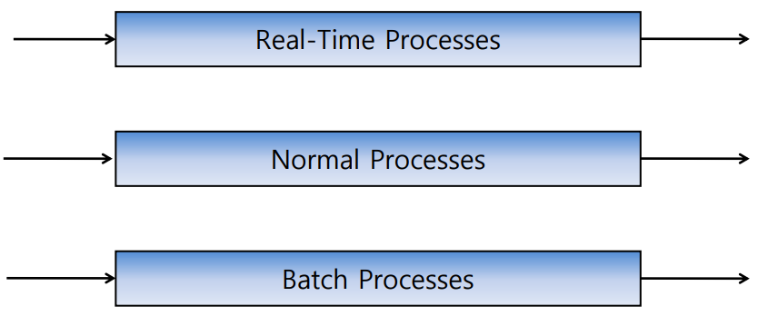
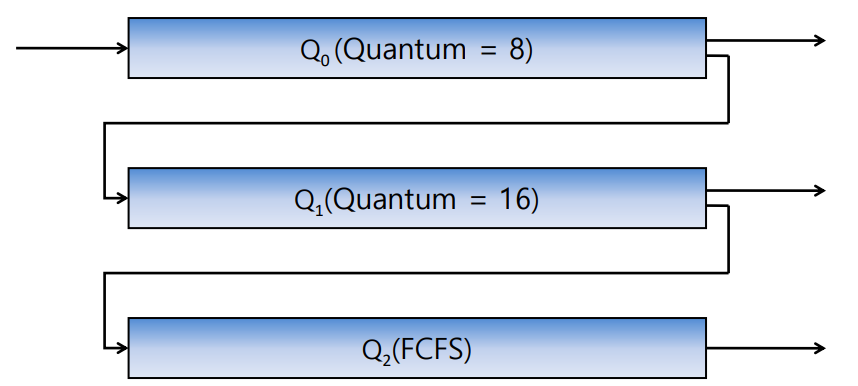

운영체제 위에서 동작하는 프로세스는 하나의 CPU에 의해 동작할 수 있다. 그러나 컴퓨터는 한 번에 하나의 작업만 수행되는 것이 아니라, 다수의 작업이 수행되는 환경이라고 앞선 내용에서 다루었다. 이런 환경에서 CPU의 수는 한정적이지만 프로세스는 CPU보다 많이 생성되어 실행이 되다보니, 이를 적절히 처리할 방법을 필요로 하게 되었다.

이러한 처리 방법을 Scheduling이라고 하며, CPU가 프로세스에게 자원사용을 어떤 기준으로 할당할 것인 지를 결정하는 Policy를 말한다. 조금 더 구체적으로는 Multi programming에 기반하여 Memory 내에 실행이 준비된(Ready state) 상태의 프로세스들 중에 하나에게 CPU 자원을 할당하는 정책이다. CPU Scheduling의 목표는 CPU가 Idle 상태에 빠지는 시간없이 단위 시간당 처리하는 작업량을 최대화하는 것으로 한다.

일반적인 프로세스는 다음과 같은 두 가지의 Burst Time을 갖는다.

- CPU Burst Time : CPU 연산을 처리하는 데에 걸리는 시간
- I/O Burst Time : I/O 작업을 처리하는 데에 걸리는 시간

그러므로 프로세스는 어떤 Burst Time을 더 많이 갖느냐에 따라 다음과 같이 나뉘기도 한다.

- CPU-Bound Process : CPU Burst Time이 긴 프로세스 (I/O 작업이 되어야 할 데이터의 양이 적고, CPU가 연산하는 시간이 긴 프로세스)
- I/O Bound Process : I/O Burst Time이 긴 프로세스 (I/O 작업이 되어야 할 데이터의 양이 많고, CPU가 연산하는 시간이 짧은 프로세스)

그러므로, 어느 컴퓨터에서 어떤 프로세스가 더 많이 수행되는 지에 따라 스케줄링 기법의 효율성이 달라지게 된다.

<!-- section -->

## 1. CPU Scheduling의 고려사항

CPU Scheduling의 결정은 다음과 같은 시점에 이루어진다.

1. 'Running' 상태에서 'Waiting' 상태로 전환될 때. (어떤 프로세스가 잠시 CPU 사용을 멈추면, 다른 프로세스를 동작시키기 위해 스케줄링 되어야 함.)


2. 'Running' 상태에서 'Ready' 상태로 전환될 때. (어떤 프로세스를 수행하는 도중에 인터럽트 및 I/O 작업 등을 하는 경우에는 해당 프로세스의 CPU 사용을 강제적으로 멈추고, 특정 프로세스를 실행한다.)

1. 수행이 종료되었을 때. (특정 프로세스가 완전히 종료되면, 또 다른 프로세스를 스케줄링한다.)

1. 'Ready' 상태에서 'Running' 상태로 전활될 때. (어떤 프로세스에서 발생한 인터럽트를 처리하고 복귀하는 경우에는 인터럽트 처리를 위한 작업이 종료 되었으므로, 다시 인터럽트가 발생한 프로세스에게 스케줄링 되어야한다.)

1번과 4번의 상황에서만 수행되는 스케줄링 기법을 비선점형(Non-preemptive) 스케줄링이라 하며, 해당 상황일 때는 운영체제가 CPU 사용을 보장해준다. (강제로 CPU의 사용을 중단 시키지 않는다.)

그 외의 상황에서 수행되는 스케줄링 기법은 선점형(Preemptive) 스케줄링이라고 한다. 비선점형과 반대로 운영체제가 CPU 사용을 강제로 중단시킬 수도 있다.

스케줄링이 결정되는 기준은 다음과 같은 사항들이 있다.

- CPU 사용률 : 전체 시스템이 동작하는 시간 중에 CPU가 작업을 처리하는 시간의 비율.
- 처리량(Throughput) : CPU가 단위 시간당 처리하는 프로세스의 개수.
- 응답 시간(Response Time) : 상호작용하는 또 다른 시스템에서 요청 후, 첫 응답이 올 때 까지 걸리는 시간.
- 대기 시간(Waiting Time) : 프로세스가 대기열(Ready Queue)에서 기다리는 시간의 합.
- Turnaround Time : 프로세스가 시작해서 끝날 때까지 걸리는 시간.

이상적인 스케줄링 기법은 위와 같은 조건에 대해 CPU 사용률이 '최대'이고, 단위 시간당 '높은' 처리량을 가지며, '최소'의 응답시간과 '최소'의 대기시간을 갖는 스케줄링 기법일 것이다. 그러나 이러한 조건을 만드는 스케줄링은 사실상 불가능에 가까운 것이라 할 수 있다.

<!-- section -->

## 2. Scheduling Algorithms

스케줄링을 위한 알고리즘으로는 다음과 같은 것들이 있다.

- FCFS(First Come, First Served) :

    FIFO Queue를 이용하여 가장 먼저 들어온 프로세스부터 순차적으로 처리하는 비선점형 스케줄링 기법이다. (하나의 프로세스가 정상적으로 종료될 때까지 온전한 CPU 시간을 가질 수 있는 스케줄링 기법이다.)

    프로세스가 어떤 순서로 들어오는 지에 따라 전체 시스템의 평균 대기 시간이 달라지게 된다는 특징이 있다.

- SJF(Shortest Job First) :

    프로세스들 간의 CPU Burst Time을 비교하여 가장 짧은 프로세스들부터 스케줄링 되는 기법이다. 선점형과 비선점형 방식이 모두 존재한다.

    선점형 방식의 경우에는 CPU를 할당받아 수행 중에 있더라도 현재 남은 시간보다 더 짧은 Burst  Time의 프로세스가 생성되면 해당 프로세스에게 CPU를 양보하는 방식이고, 비선점형 방식의 경우에는 한 번 CPU를 할당받으면 자신의 Burst Time이 끝나기 전까지 온전히 수행되도록 하는 방식이다.

- Priority :

    각 프로세스에 우선순위(Priority)를 부여하고, 우선순위에 따라 CPU를 할당하는 방식이다. 선점형 방식과 비선점형 방식이 모두 존재한다.

    선점형 방식의 경우에는 CPU를 할당받아 프로세스를 수행하는 도중에 자신보다 높은 우선순위의 프로세스가 생성되면 해당 프로세스에게 CPU 자원을 양보하는 방식이고 비선점형 방식의 경우에는 한 번 CPU를 할당 받으면 자신의 프로세스를 온전히 수행하는 방식이다.

    우선순위를 부여하는 방식은 기아(Starvation) 상태가 발생할 수도 있다는 문제점이 존재한다. 낮은 우선순위를 가진 프로세스는 전혀 수행되지 않을 수도 있는데, 이를 해결하기 위해서는 Aging 기법을 적용하여 할당을 기다리는 시간에 따라 우선순위를 증가 시켜주는 방법이다.

- Round Robin :

    CPU를 시간 단위로 할당하는 선점형 스케줄링 기법이다. 하나의 프로세스는 주어진 시간만큼 CPU를 사용하다가, 주어진 시간이 다 되면 Ready Queue의 가장 끝으로 삽입되어 다시 할당을 기다리는 방식의 스케줄링 기법이다. Context-Switching이 많은 반면에 응답 시간이 짧다는 장점이 있다.


- Multilevel Queue :

    Ready Queue를 여러 개의 Queue로 분리하여 각각에 대해 다른 스케줄링 기법을 적용하는 방식이다. 다음과 같이 3개의 Ready Queue로 분리한 다음에, 각각의 Queue에 다른 스케줄링 기법을 적용할 수 있게 되는 것이다.

    [](/assets/images/operating-system/06/figure-01.png)

    **종류별로 분리한 Ready Queue**

    ```text
    프로세스 분류
     ├→ Real-Time Processes Queue → 실행
     ├→ Normal Processes Queue    → 실행
     └→ Batch Processes Queue     → 실행
    ```
- Multilevel Feedback Queue

    앞서 본 Multilevel Queue 방식에서 프로세스들이 서로 다른 Queue로 이동할 수 있도록 하는 스케줄링 기법이다.

    예를 들면, 다음과 같이 세 개의 Queue가 존재하고 첫 번째 Queue에서는 Time quantum이 8로 적용된 Round Robin 스케줄링이 적용되고, 두 번째 Queue에서는 Time quantum이 16으로 적용된 Round Robin 스케줄링이 적용되며, 세 번째 Queue에서는 FCFS 스케줄링이 적용된다고 가정해보자.

    [](/assets/images/operating-system/06/figure-02.png)

    **Multilevel Feedback Queue 이동**

    ```text
    새 프로세스 → Q0 (Round Robin, Quantum = 8) ──완료──→ 종료
                      │ 할당 시간 안에 미완료
                      ▼
                  Q1 (Round Robin, Quantum = 16) ─완료──→ 종료
                      │ 할당 시간 안에 미완료
                      ▼
                  Q2 (FCFS) ──남은 작업 수행──→ 종료
    ```
    이러한 상황에서 어느 프로세스가 들어오면 다음과 같은 경우가 발생할 수 있다.


- 첫 번째 Queue에서 8ms 동안 작업을 수행하다가 종료되면 두 번째 Queue로 내려가서 다시 16ms 동안 작업을 수행하게 된다. 만약 그럼에도 프로세스의 작업이 종료되지 않았다면 마지막으로 세 번째 Queue로 내려가서 남은 작업을 마무리 하게 된다.

즉, 위와 같은 경우 총 24ms 동안 종료되지 않은 프로세스는 보다 더 많은 CPU Burst Time이 필요로 하게 되고, 이를 최종적으로 FCFS 스케줄링이 적용된 마지막 큐에서 처리하여 충분한 CPU Burst Time을 제공하는 스케줄링 기법이 되는 것이다.
