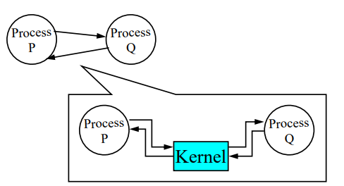
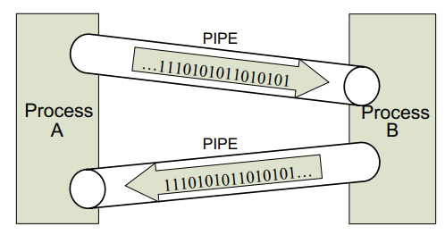
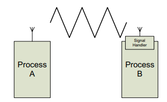
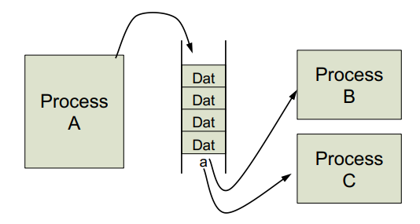
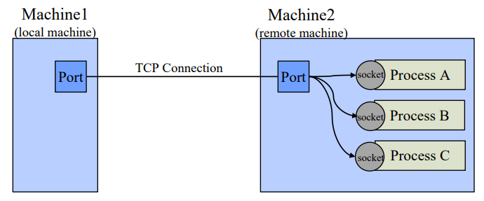

> 본문과 예제는 원문을 보존했다. 그림은 누르면 원본 크기로 볼 수 있으며, **화살표로 읽기**는 구조와 흐름을 풀어 쓴 보충 도식이다.

IPC(Inter Process Communication)이란 프로세스들 간의 데이터 및 정보를 주고 받기 위한 통신 수단을 말한다. 커널은 System call의 형태로 다양한 IPC들을 제공한다. 이를 통해 다수의 프로세스와 협력(Cooperating)하는 것이 가능하다.

<!-- section -->

## 1. Shared Memory

프로세스의 특정 메모리 영역을 다른 프로세스와 공유하는 IPC 기법으로, 공유한 메모리 영역에 read/write 연산을 수행하며 통신하는 것이다. 공유 메모리를 생성하기 위해 커널의 도움을 받는 것을 제외하고 순수한 통신의 측면에서 봤을 때, 커널의 도움을 전혀 받지 않고 프로세스들끼리 통신하는 방식이다.

메모리를 직접적으로 사용하여 빠르고 자유로운 통신이 가능하지만, 둘 이상의 프로세스가 동시에 메모리를 변경하지 않도록 프로세스 간의 동기화가 필요하다.

Example)

```c
#include <stdio.h>
#include <stdlib.h>
#include <string.h>
#include <sys/types.h>
#include <unistd.h>
#include <sys/ipc.h>
#include <sys/shm.h>
#include <sys/wait.h>
#define SHM_SIZE 1024

void ChildRun(int shmid);
int main(int argc, char **argv){
int shmId, pid;
char *ptrShm;

if ( (shmId = shmget(IPC_PRIVATE, SHM_SIZE, SHM_R | SHM_W)) < 0 ) {
    perror("shmget error");
    exit(-1);
}

if ( (ptrShm = shmat(shmId, 0, 0)) == (void *)-1 ) {
    perror("shmat error");
    exit(-1);
}

ptrShm[0] = 11;
ptrShm[1] = 22;

printf("Parent : %d, %d\n", ptrShm[0], ptrShm[1]);
switch ( pid = fork() ){
    case 0: ChildRun(shmId); return 0;
    case -1: perror("fork error"); exit(-1);
    default: break;
}

waitpid(pid, NULL, 0);
printf("Parent : %d, %d\n", ptrShm[0], ptrShm[1]);

if ( shmdt(ptrShm) < 0 ) {
    perror("shmctl error");
    exit(-1);
}

if ( shmctl(shmId, IPC_RMID, 0) < 0 ) {
    perror("shmctl error");
    exit(-1);
}

return 0;
}

void ChildRun(int shmid){
int shmId;
char *ptrShm;
shmId = shmid;

if ( (ptrShm = shmat(shmId, 0, 0)) == (void *)-1 ) {
    perror("shmat error");
    exit(-1);
}

printf("Child : %d, %d\n", ptrShm[0], ptrShm[1]);
printf("Child : Modify value.\n");
ptrShm[0] = 33;
ptrShm[1] = 44;

if ( shmdt(ptrShm) < 0 ) {
    perror("shmctl error");
    exit(-1);
}
}
```

<!-- section -->

## 2. Message Passing

프로세스 간의 메모리 공유 없이 고정길이 혹은 가변길이의 메시지를 send/receive 연산으로 주고 받는 IPC 기법이다. 이 때, 각 프로세스들은 아래의 그림과 같이 커널을 사이에 두고 메시지를 주고 받는다. 커널이 메시지를 송수신하기 때문에 별도의 동기화 작업은 필요하지 않다.

[](/assets/images/operating-system/07/figure-01.png)

**화살표로 읽기 — 커널을 경유하는 메시지 전달**

```text
Process P ──send──→ Kernel ──receive──→ Process Q
Process P ←receive─ Kernel ←──send──── Process Q
```
다음은 Message Passing의 여러 가지 구현 방식을 정리하였다.

- Pipe : 프로세스끼리 단방향성을 가진 통로를 연결하여 통신하는 방식이다.

    [](/assets/images/operating-system/07/figure-02.png)

    **화살표로 읽기 — 두 파이프로 양방향 통신**

    ```text
    Process A ─────Pipe 1────→ Process B
    Process A ←────Pipe 2───── Process B

    각 Pipe의 데이터 흐름은 단방향이다.
    ```
    하나의 파이프는 단방향으로만 데이터를 전송하기 때문에 위 그림과 같이 서로가 서로에게 보내는 파이프로 연결하면 양방향성 통신이 가능하다. 파이프는 보내진 순서대로만 받으며, 용량의 제한이 있기 때문에 가득차면 더 이상 쓸 수 없게 된다.


Example)

```c
#include <stdio.h>
#include <unistd.h>
#include <sys/types.h>
#define MAXLINE 4096
int main(void){
int n, fd[2];
pid_t pid;
char line[MAXLINE];

if (pipe(fd) < 0) {
    perror("pipe error");
    exit(-1);
}

if ( (pid = fork()) < 0) {
    perror("fork error");
    exit(-1);
}

else if (pid > 0) { /* parent */
    close(fd[0]);
    write(fd[1], "hello, world.\n", 14);
}

else { /* child */
    close(fd[1]);
    n = read(fd[0], line, MAXLINE);
    write(STDOUT_FILENO, line, n);
    waitpid(pid, NULL, NULL);
}

exit(0);
}
```

- Signal : 특정 프로세스에게 커널을 통해 사전에 정의된 Event를 전달하는 방법.

송신 Process : 여러 시그널 중에 하나의 시그널을 수신 Process의 상태에 무관하게 전송한다.

수신 Process : 신호의 종류에 따라 미리 정의한 처리 방법으로 Handling 하거나, 무시 및 신호를 붙잡아두는 행위가 가능하다.

프로세스 A가 프로세스 B에게 송신을 하더라도, 프로세스 B가 스케줄링된 상태여야만 처리가 가능하다는 점에서 비동기적인 IPC 기법이라 할 수 있다.

[](/assets/images/operating-system/07/figure-03.png)

**화살표로 읽기 — Signal 전달**

```text
Process A ──Signal 전송──→ Kernel ──Signal 전달──→ Process B
                                                   │
                                                   ▼
                                             Signal Handler
```
Example)

```c
#include <stdio.h>
#include <stdbool.h>
#include <stdlib.h>
#include <signal.h>
#include <unistd.h>
#include <sys/types.h>
#include <sys/wait.h>

void SignalHandlerChild(int signo){
    printf("signal handler\n");
    fflush(stdout);
}

int main(void){
pid_t pid;
struct sigaction act_child;
act_child.sa_handler = SignalHandlerChild;
act_child.sa_flags = 0;
sigemptyset( &act_child.sa_mask );
sigaction( SIGUSR1, &act_child, 0 );

switch ( pid = fork() ){
    case -1: perror("fork failed "); exit(-1);
    case 0: sigpause(SIGUSR1); return 0;
    default: sleep(3); kill(pid, SIGUSR1); waitpid(pid, 0, 0);
}

return 0;
}
```

- Message Queue

    사용자가 고정된 크기를 갖는 Message를 사전에 정의하고, 프로세스들이 동작할 때 메시지를 전달해야할 때마다 연결 리스트에 넣어서 프로세스들끼리 통신하는 방법이다. 하나의 연결 리스트를 여러 프로세스가 동시에 접근할 수도 있다보니 동기화가 필요하다.

    [](/assets/images/operating-system/07/figure-04.png)

    **화살표로 읽기 — Message Queue**

    ```text
    Process A ──메시지 삽입──→ [Message Queue]
                                    ├──메시지 수신──→ Process B
                                    └──메시지 수신──→ Process C
    ```
    Example)

    ```c
    #include <stdio.h>
    #include <string.h>
    #include <stdlib.h>
    #include <stdbool.h>
    #include <errno.h>
    #include <unistd.h>
    #include <sys/types.h>
    #include <sys/ipc.h>
    #include <sys/msg.h>
    #include <sys/wait.h>

    typedef struct _MSG {
        long type;
        char message[256];
    } MSG, *PMSG, **PPMSG;

    #define MSG_ sizeof(MSG)

    int main(void){
    pid_t pid;
    key_t msg_id;
    MSG msg;

    if ( -1 == (msg_id = msgget(IPC_PRIVATE, 0660 | IPC_CREAT)) ) {
        perror( "msgget failed" );
        exit(1);
    }

    switch ( pid = fork() ){
        case -1: perror( "fork failed " ); exit(-1);
        case 0: msg.type = 1;
                        strcpy( msg.message, "Hello, world.");
                        msgsnd( msg_id, &msg, MSG_-sizeof(long), 0 );
                        return 0;
    default: waitpid(pid, 0, 0);
                     memset( &msg, 0, MSG_ );
                     msgrcv( msg_id, &msg, MSG_-sizeof(long), 1, 0 );
                     printf("PARENT - message from child : %s\n", msg.message);
                     fflush(stdout);
    }

    if ( -1 == msgctl(msg_id, IPC_RMID, 0) ) {
        perror( "msgctl failed" );
        exit(-1);
    }

    return 0;
    }
    ```

- Socket :  프로세스 간의 End Point인 Port를 두고, 네트워크를 사이에 두고 통신하는 방식이다. 다른 IPC와는 다르게 Process의 위치에 독립적이다. 즉, 통신하려는 또 다른 프로세스가 Local에 있다면 Port 번호를 통해 어떤 Process 인 지를 식별할 수 있고, 통신하려는 또 다른 Remote에 있다면 IP 주소 + Port 번호를 통해 어떤 Process인 지를 식별할 수 있다.

    [](/assets/images/operating-system/07/figure-05.png)

    **화살표로 읽기 — 네트워크를 통한 Socket 통신**

    ```text
    Machine 1 (local)             Machine 2 (remote)
    Port ─────TCP Connection───── Port
                                  ├→ Socket → Process A
                                  ├→ Socket → Process B
                                  └→ Socket → Process C
    ```
Example)

```c
#include <sys/types.h>
#include <sys/stat.h>
#include <sys/socket.h>
#include <unistd.h>
#include <netinet/in.h>
#include <arpa/inet.h>
#include <stdio.h>
#include <stdlib.h>
#include <string.h>
#include <pthread.h>

void ErrorHandling(char* message);

int main(void){
int port = 9999, acceptState, hServSock, hClntSock;
struct sockaddr_in servAddr, clntAddr;
char buffer[20], message[20] = "message from server";
socklen_t szClntAddr;
pid_t pid;

switch (pid = fork()) {
    case -1: perror("fork failed ");
                     exit (-1);

    case 0: sleep (1);
                  hClntSock = socket(AF_INET, SOCK_STREAM, 0);
                  clntAddr.sin_family = AF_INET;
                    clntAddr.sin_addr.s_addr = inet_addr("127.0.0.1");
                    clntAddr.sin_port = htons(port);
                    szClntAddr = sizeof(clntAddr);

                    if (connect(hClntSock, (struct sockaddr *)&clntAddr, szClntAddr) < 0){
                        perror("<Child> Connect error: ");
                        break;
                    }

                    printf("<Child> connect port: %d!\n", port);
                    recv(hClntSock, buffer, 20, 0);
                    printf ("<Child> %s\n", buffer);
                    close(hClntSock);
                    break;

    default: printf("<Parent> binding port: %d...\n", port);
                     hServSock = socket(PF_INET, SOCK_STREAM, 0);

                     if (hServSock == -1) ErrorHandling("<Parent> socket() error");
                     memset(&servAddr, 0x00, sizeof(servAddr));
                     servAddr.sin_family = AF_INET;
                     servAddr.sin_addr.s_addr = htonl(INADDR_ANY);
               servAddr.sin_port = htons(port);

                     if (bind(hServSock, (struct sockaddr*)&servAddr, sizeof(servAddr)) < 0 )
                            ErrorHandling("<Parent> bind() error");

                     printf("<Parent> listening port: %d...\n", port);

                     if (listen(hServSock, 1) < 0) ErrorHandling("<Parent> listen() error");

                     printf("<Parent> accepting...\n");

                     while (1) {
                        szClntAddr = sizeof(clntAddr);
                        hClntSock = accept(hServSock, (struct sockaddr*)&clntAddr, &szClntAddr);

                        if (hClntSock <0) continue;
                        printf("<Parent> accept port: %d!\n", port);
                        acceptState = 1; //connected;
                        if (acceptState == 1) break;
                    }

    send(hClntSock, message, strlen(message)+1, 0);
    sleep (1);
    close(hServSock);
}

return 0;
}

void ErrorHandling(char* message){
    fputs(message, stderr);
    fputc('\n', stderr);
    exit(1);
}

```
