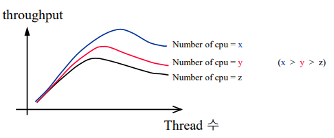
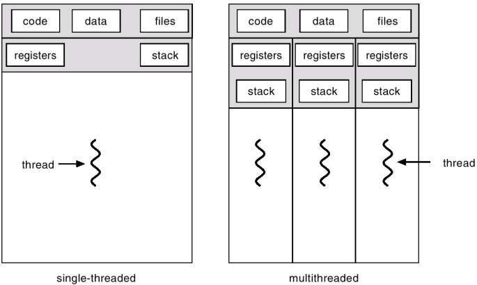
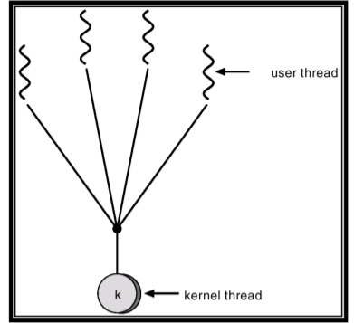
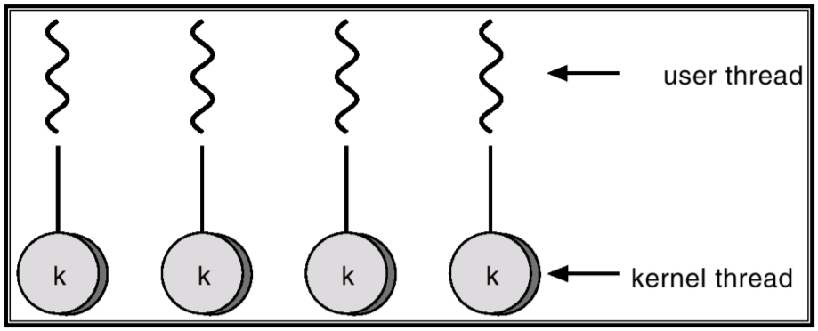
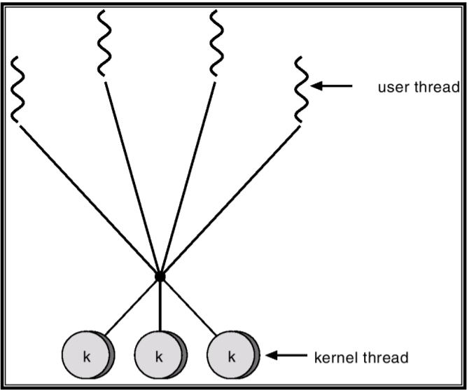
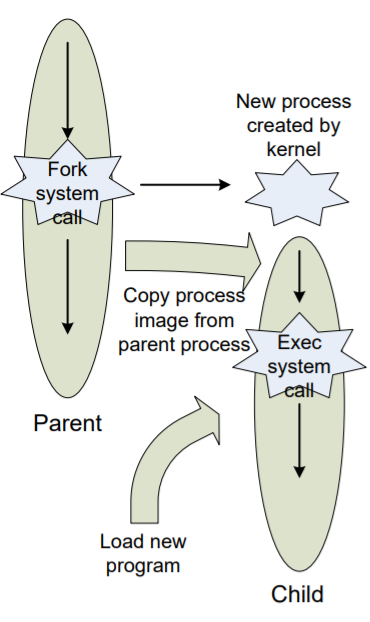

> 본문과 예제는 원문을 보존했다. 그림은 누르면 원본 크기로 볼 수 있으며, **화살표로 읽기**는 구조와 흐름을 풀어 쓴 보충 도식이다.

<!-- section -->

## 1. Thread 개념

앞선 내용에서 보았던 Process는 운영체제로부터 자원에 대한 보호를 받는 하나의 실행의 단위였다.그러나, 하나의 프로세스에서는 하나의 실행 흐름만 존재하기 때문에 한 번에 하나의 일만을 수행 할 수 있다. 프로세스의 내부에서도 여러 개의 실행 흐름을 필요로 하게 되었는데, 이러한 배경으로 생겨난 것이 Thread이다.

쓰레드는 프로세스와 같은 하나의 실행 단위로, 프로세스 내에서의 실행 흐름이므로 프로세스보다는작은 실행 흐름이라 할 수 있다. 지금껏 살펴본 프로세스들은 다수 개가 서로 협력하는 형태로 쓰이는 경우를 보았는데, 이를 쓰레드로 처리하면 IPC, Context-Switching과 같은 비용 없이도 협력 가능한 여러 개의 실행 흐름을 만들어 낼 수 있는 것이다.

[](/assets/images/operating-system/08/figure-01.png)
위 그래프는 CPU의 수에 따라 쓰레드가 많아질수록 처리량이 얼마나 높아지는 지를 보여준다. 그래프를 보면 쓰레드의 수가 증가할 수록 처리량이 특정 구간까지는 높게 올라가다가 내려가는 결과를 보이는데, 이는 Thread Switching 비용이 증가함에 따른 결과이다. 즉, CPU의 수가 많다면 하나의 프로세스에서 적당한 쓰레드를 병렬적으로 실행하는 것이 좋은 효율을 보인다는 의미가 된다.

Thread는 하나의 프로세스 안에서 동작하므로, 소속된 프로세스의 Code 영역과 Data 영역은 쓰레드끼리 공유되며, (Stack과 Heap은 공유되지 않는다.) 쓰레드들은 하나의 프로세스 안의 메모리를 사용하는 것이므로, 쓰레드 간의 Switching 비용은 프로세스의 Switching에 비하면 적은 편이다.

쓰레드도 하나의 실행흐름이므로, 실행과 관련된 자료 구조를 가져야 한다. 해당 자료 구조의 멤버는 다음과 같다.

- Thread ID : 쓰레드 식별자.
- Program Counter : 현재 실행중인 Instruction의 주소. (쓰레드 수행 이후, 복귀할 주소)
- Register Set : CPU의 Register 값들.
- Stack : 쓰레드 내부에서 사용할 변수들의 저장 공간.

실제 데이터보다 간략하게 작성하였으나, 확실히 프로세스보다는 적은 수의 데이터를 갖는다. 이러한 점 때문에 쓰레드의 Switching 비용이 적다는 것이다. (복원해야할 데이터의 수가 프로세스보다 적기 때문이다.)

또, 하나의 프로세스(단일 쓰레드)와 여러 개의 쓰레드의 메모리 공간은 차이점은 다음과 같이 도식화하여 나타낼 수 있다.

[](/assets/images/operating-system/08/figure-02.png)

**화살표로 읽기 — 단일 쓰레드와 다중 쓰레드의 구성**

```text
Single-threaded Process
 [code / data / files] → Thread [registers / stack]

Multithreaded Process
 [공유: code / data / files]
    ├→ Thread 1 [registers 1 / stack 1]
    ├→ Thread 2 [registers 2 / stack 2]
    └→ Thread 3 [registers 3 / stack 3]
```
이를 조금 자세히 살펴보면, 여러 개의 쓰레드가 포함된 프로세스는 Code, Data 영역을 함께 사용하는 것을 볼 수 있다.

다수 개의 쓰레드를 사용하는 Multi-Threaded Program의 장점은 다음과 같다.

- Responsiveness : 프로그램의 특정 부분을 담당하는 쓰레드가 Block이 되거나, 수행 시간이 조금오래 걸리더라도, 다른 쓰레드들이 실행되는 것에는 지장이 없으므로 User의 입장에서는 해당 프로그램이 서로 상호작용을 잘하며 수행되는 것처럼 여겨진다. (응답 능력이 좋다고 여겨진다.)


- Resource Sharing : 쓰레드들 간에는 프로세스의 메모리와 자원을 공유한다.

- Economy : 쓰레드들은 하나의 프로세스 메모리 영역에서 실행되기 때문에 커널의 입장에서는 새로운 프로세스를 생성되는 것보다는 여러 개의 쓰레드를 생성하는 것이 더 적은 비용을 소모하는 것이 된다.


- Scalability : 여러 개의 쓰레드를 서로 다른 프로세서에서 동작하도록 할 수 있다. 이는 Multi-core Programming을 보다 더 효율적이게 한다.

<!-- section -->

## 2. 쓰레드의 구분 및 매핑 방식

쓰레드는 어느 메모리 영역에서 동작 하는 지에 따라 User Thread, Kernel Thread 로  나뉠 수 있다.

- User Thread : 커널의 도움을 받아 수행되며, 일반적인 User Level의 라이브러리를 통해 구현된다.라이브러리를 통해 쓰레드를 생성하고, 스케줄링이 되는 것이다. (단, 실제 동작은 커널의 도움을받아 이루어진다.)


    소속된 프로세스와 동일한 메모리 영역에서 쓰레드가 생성 및 관리되므로 접근이 빠르다는 장점이 있지만 여려 개의 User Thread 중에서 하나의 Thread가 System Call 요청으로 Block이 되면, 나머지 모든 Thread도 모두 Block이 된다. 커널은 User Thread도 하나의 프로세스로 간주하기 때문이다.


- Kernel Thread : Kernel 영역에서 생성되고 스케줄링 되는 쓰레드이다. User Thread 와는 다르게System Call에 의해 호출되어도, Blocking 없이 수행된다. Multi Processor 환경에서 커널이 여러 개의 쓰레드를 다른 프로세서에 할당 할 수 있다는 장점이 있으나, User Thread 보다는 생성 및 관리가 느린 편이다.

앞서 본 대로, User Thread 의 관리는 User Level에서 이루어지지만 실제 동작은 Kernel의 도움을 받아서 동작한다. 그러므로 하나의 User Thread는 커널과 매핑 되어야 할 필요가 있는데 이와 관련하여 다음과 같은 매핑 방법들이 존재한다.

- Many To One : 다수의 쓰레드와 단일 커널의 관계로 매핑되는 것이다. 한 번에 하나의 쓰레드만커널에 접근하는 방식으로, 하나의 쓰레드가 커널에 시스템 콜에 의해 접근하면, 나머지 쓰레드들은 대기 상태에 있어야 한다. 이는 동시에 여러 개가 시스템 콜의 사용이 불가능하므로, Concurrency는 없다고 볼 수 있다.  (여러 개의 프로세서가 존재하는 시스템이라도 여러 개의 쓰레드는 결국 하나의 프로세스이기 때문에, 여러 개의 프로세서에서 동시에 수행하는 것은 불가능하다.)

    [](/assets/images/operating-system/08/figure-03.png)

    **화살표로 읽기 — Many To One 매핑**

    ```text
    User Thread 1 ─┐
    User Thread 2 ─┼→ Kernel Thread 1
    User Thread 3 ─┤
    User Thread 4 ─┘
    ```
- One To One : 각각의 User Thread를 대응 할 수 있는 Kernel Thread를 생성하는 방식이다. 이러한 방식은 Many To One에서 문제가 되었던, 하나의 쓰레드가 시스템 콜 호출될 때 다른 쓰레드들이Block이 되는 문제를 해결할 수 있다. 그러나 Kernel Thread도 한정된 자원이므로 무한하게 생성할 수는 없다.

    [](/assets/images/operating-system/08/figure-04.png)

    **화살표로 읽기 — One To One 매핑**

    ```text
    User Thread 1 → Kernel Thread 1
    User Thread 2 → Kernel Thread 2
    User Thread 3 → Kernel Thread 3
    User Thread 4 → Kernel Thread 4
    ```
- Many To Many : 여러 개의 User Thread 를 여러 개의 Kernel Thread 로 매핑 시키는 방식이다. 이 때, Kernel Thread 의 수는 User Thread 의 수와 같거나, 적은 수 만큼 적절히 생성되어 스케줄링 하도록 한다.

    [](/assets/images/operating-system/08/figure-05.png)

    **화살표로 읽기 — Many To Many 매핑**

    ```text
    [User Thread 1 / 2 / 3 / 4]
                   │ 여러 쓰레드를 매핑
                   ▼
    [Kernel Thread 1 / 2 / 3]
    ```

<!-- section -->

## 3. 프로세스 기반 운영체제의 변화

쓰레드의 등장으로 인하여, 프로세스를 기반으로 하는 기존의 운영체제는 쓰레드를 고려하여 여러 변화가 일어나게 되었다.

Multi-Thread 환경에서 하나의 프로세스 안에서 동작하는 여러 쓰레드를 종료하거나, 프로세스 자체를 종료하는 일은 쓰레드를 고려해서 조금 복잡한 문제가 되어 버렸다. 왜냐하면 쓰레드들은 가상 메모리 자원을 프로세스와 공유하기 때문에, 모든 쓰레드가 종료되기 전까지는 프로세스의 자원이 반납 되어서는 안되기 때문이다.

또, Multi Thread 환경을 위해 다음과 같은 것들도 생각해야 했다.

- Thread Scheduling
- Thread 간의 통신
- Thread가 사용할 메모리 공간의 할당 방식

이러한 고려 사항은 fork(), exec()와 같은 함수들의 의미를 바꾸게 하였다.

- fork() : 하나의 프로그램 안에 여러 쓰레드가 존재할 때, 쓰레드 내부에서 fork를 호출하면 모든 쓰레드를 복사한 프로세스를 만들어야 할 지와 fork를 호출한 쓰레드만을 복사하여 프로세스를 만들어야 할 지가 선택되어야 했다. Linux에서는 두 가지의 경우를 모두 고려하여 각각의 경우를처리하도록 하였다.


- exec() : 일반적으로 exec 함수는 fork를 통해 생성된 새로운 프로세스를 다른 프로그램으로 교체해야 할 때 사용한다. 또, 앞서 fork는 두 가지의 버전이 존재한다고 하였다.

모든 쓰레드를 복사하고 나서, 새롭게 생성된 프로세스에서 exec를 호출하면 복사한 쓰레드들이 모두 메모리 상에서 사라지게 되고, 이는 불필요한 행동을 하게 된 것이므로 fork를 하고 나서 exec를 수행하는 프로세스라면 fork를 요청한 쓰레드만 복사 되도록 하는 것이 바람직하고, fork를 하고 나서 exec를 수행하지 않는 프로세스라면 모든 쓰레드를 복사하는 것이 바람직하다.

다음은 Unix에서 하나의 프로세스가 fork 되는 것을 도식화한 것이다.

[](/assets/images/operating-system/08/figure-06.png)

**화살표로 읽기 — 자식 프로세스 생성과 프로그램 교체**

```text
Parent ──fork()──┬→ Parent 계속 실행
                └→ Child (부모의 프로세스 이미지 복사)
                          │ exec()
                          ▼
                   새로운 프로그램 적재
```
먼저, 부모 프로세스에서 fork가 호출되면 부모 프로세스의 내용을 복사하여 새로운 프로세스를생성한다. 새롭게 생성된 자식 프로세스에서는 exec 함수를 통해 부모 프로세스를 호출하여 똑같이 동작하도록 한다.

<!-- section -->

## 4. Thread Issues

- Cancellation : 쓰레드의 작업이 끝나기 전에 외부에서 작업을 중지 시키는 경우이다. 하나의 쓰레드가 수행되다가 중지 명령이 온다면, 시스템의 자원을 사용하고 있는 쓰레드가 중지 되는 경우이므로 할당된 자원을 함부로 해제할 수 없다. 왜냐하면 다른 쓰레드가 해당 자원을 사용하고 있을 지도 모르기 때문이다.

- Thread Pool : 쓰레드는 시스템의 자원을 할당 받아 사용하기 때문에, 원활한 시스템의 동작을 위해서는 적당한 쓰레드가 할당되어야 한다. 이를 위해 정해진 수 만큼의 쓰레드를 만든 후에 할당하기 위한 방식인 Thread Pool 개념이 생겨났다. 이 때, Pool에 보관할 쓰레드의 수는 통계적으로 결정한다.


- Thread IPC : 쓰레드 간의 통신을 위해서는 공유 메모리가 가장 효율적인 방식이다. 왜냐하면 쓰레드들은 같은 프로세스 내의 메모리 공간(Data 영역)을 공유하므로, 아주 쉽게 공유 메모리를 사용할 수 있다. 만약 다른 프로세스의 쓰레드와 통신하는 경우에는 공유 메모리를 사용할 수 없으므로 프로세스와 비슷한 방식으로 통신해야 한다.
