<!-- section -->

## 1. Race Condition

앞서 살펴본 Process, Thread는 하나의 실행 흐름으로, 다수 개가 모이면서 협력하는 Task를 만들 수 있다고 하였다. 그러나 다수 개의 실행 흐름이 특정 데이터를 공유한다면, 데이터의 일관성(Consistency)을 보장하지 못하는 문제가 발생할 수도 있다. 이러한 문제를 Race Condition 이라고 하며 데이터의 일관성을 유지하기 위해 다수의 실행 흐름에 대하여 순차적으로 수행하게 만들 필요가 있다.

예를 들면, 다음과 같이 은행 계좌의 입출금 기능을 담당하는 두 개의 프로세스가 있다고 가정하고 1000원의 잔고가 남은 상황에서 500원의 입금하는 프로세스와 500원을 출금하는 프로세스가 동시에 일어난다고 해보자.

[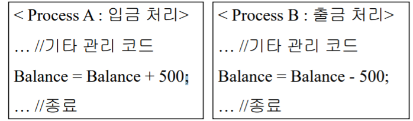](/assets/images/operating-system/09/figure-01.png)
코드 수준에서는 두 개의 프로세스가 큰 문제를 일으킬 것으로 보이지는 않는다. 그러나, 위 소스 코드를 컴파일하면 다음과 같이 바뀔 수 있다.

[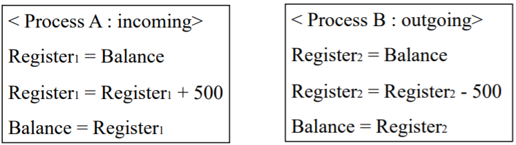](/assets/images/operating-system/09/figure-02.png)
어셈블리 수준에서 소스 코드가 위와 같이 바뀌고, 두 프로세스가 Interriving 하게 수행되면 다음과 같은 경우가 생겨날 수도 있다.

[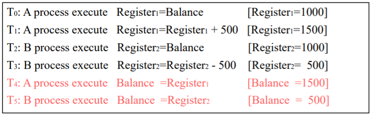](/assets/images/operating-system/09/figure-03.png)

**입출금 연산이 엇갈리는 순서**

```text
초기 Balance = 1000
T0: A가 Balance 읽기 → Register1 = 1000
T1: A가 500 더하기   → Register1 = 1500
T2: B가 Balance 읽기 → Register2 = 1000
T3: B가 500 빼기     → Register2 = 500
T4: A가 결과 저장    → Balance = 1500
T5: B가 결과 저장    → Balance = 500

A의 갱신 결과가 B의 저장으로 덮어써진다.
```
두 프로세스가 어떻게 수행될 지 모르는 상황에서, 실행 흐름의 결과로 잔고는 1500원 혹은 500원이 될 수 있는 상황들이 발생한다. 그러므로 여러 실행 흐름을 사용할 때에는 적절한 동시성 제어가 필수적이라고 할 수 있다.

<!-- section -->

## 2. Critical Section

임계 영역(Critical Section)이란 여러 프로세스들이 공유 데이터에 접근하는 코드 영역을 말한다. 동시성 제어를 위해 오직 하나의 프로세스만이 임계 영역에 접근할 필요가 있다.

하나의 임계 영역을 처리하는 알고리즘은 다음과 같은 세 가지 조건을 모두 만족해야 한다.

- Mutual Exclusion (상호 배제) : 어떤 프로세스가 임계 영역에 먼저 도달하였다면, 나머지 프로세스들은 임계 영역에 진입할 수 없어야 한다. (먼저 선점하면 끝날 때까지 진입해선 안된다.)
- Progress (진행) : 임계 영역에 진입한 프로세스가 없다면, 진입을 대기하는 프로세스 중에서 누가 진입할 지 결정될 수 있어야 한다. (결정을 무한히 연기할 수는 없다.)
- Bounded Waiting (한계 대기) : 프로세스가 임계 영역에 진입하는 데에 걸리는 시간이 제한적이어야 한다. (주어진 시간 내로 임계 영역에 접근해야 한다.)

임계 영역 도달에 관련한 알고리즘

- Shared Variable(Peterson Solution) : 프로세스끼리 하나의 정수형 공유 변수를 사용하여 임계 영역의 접근을 제어한다.

    [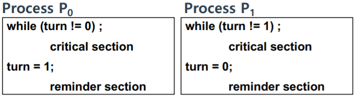](/assets/images/operating-system/09/figure-04.png)
turn이 0일 땐 프로세스 P1에서 임계 영역에 접근하고, turn이 0일 땐 프로세스 P1이 임계 영역에 접근한다. 이는 Mutual Exclusion을 만족하지만, Progress와 Bounded Waiting을 만족할 수는 없다. 왜냐하면 두 프로세스의 순서가 정해진 대로 수행되어야 하기 때문이다.

하나의 정수형 변수를 공유하는 것으로는 임계 영역의 접근을 제어하는 것이 불가능하다. 그렇다면 두 개의 공유형 변수를 사용한다면 어떻게 될까. 다음과 같이 Boolean형의 변수 두 개를 사용하여 공유하는 것도 가능하다. 두 개의 변수는 초기 값으로 false를 갖도록 한다.

[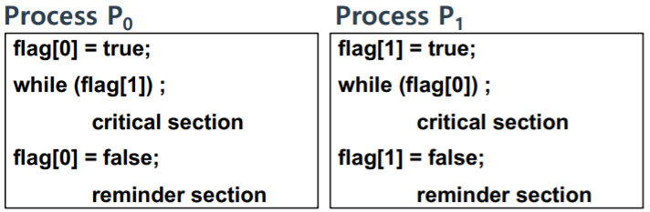](/assets/images/operating-system/09/figure-05.png)
이러한 방법도 동시성 제어를 보장해줄 것 같지만, 앞서 본 것과 마찬가지로 Mutual Exclusion만을 만족하고, Progress와 Bounded Waiting은 만족하지 않는다. 왜냐하면 두 개의 프로세스가 동시에 flag[]를 true로 바꾸는 연산이 먼저 일어날 수도 있기 때문이다.

마지막으로 하나의 정수형 변수와 두 개의 Boolean형 변수를 사용한다면 어떻게 될까. (마찬가지로 boolean형 변수 두 개의 값은 false로 초기화한다.)

[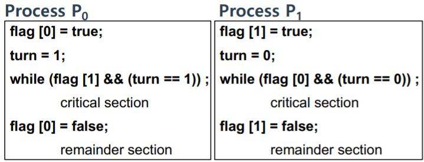](/assets/images/operating-system/09/figure-06.png)
위와 같은 두 개의 프로세스에서 임계 영역을 접근하기 위해서는 flag와 turn 값을 동시에 만족해야만 접근할 수 있도록 되어있다. 두 프로세스가 동시에 수행되더라도, (flag 값이 동시에 true로 바뀌더라도) turn 값에 의해 임계 영역 진입이 결정되는 것이다. 그 결과로 앞서 본 세 가지 조건을 모두 만족하는 임계 영역 접근 알고리즘이 된다. 이러한 알고리즘을 Peterson Solution이라 한다.

그런데 Peterson Solution에는 다음과 같은 한계점이 존재한다.

- 3개 이상의 프로세스가 사용할 수 있는가? (확장이 가능한가?)
- 확장을 하더라도, 이를 어떻게 증명할 것인가? (이러한 문제는 NP 문제에 속한다.)

이러한 점을 해결하기 위해서는 하드웨어의 도움을 빌려 간단히 해결하는 방법이 있다. 어떤 프로세스가 임계 영역에 진입하면 인터럽트를 감지하는 것인데, User Application이 인터럽트를 감지하여 Handling 하는 것보다는 운영체제의 도움을 받아 처리하는 편이 더 좋을 수 있다. 이를 위해 동기화를 위한 H/W 수준의 명령들이 도입되었다.

<!-- section -->

## 3. Synchronzation Instruction

동기화를 위한 명령어 중에서는 CPU에서 원자적(Atomically)으로 수행되는 명령어들이 존재한다. (원자적이란, 명령어가 수행되는 동안 인터럽트가 발생하지 않는 것을 의미한다.)

다음과 같은 명령어는 한번 수행될 때, 프로세스에서 원자적으로 수행됨을 보장한다.

[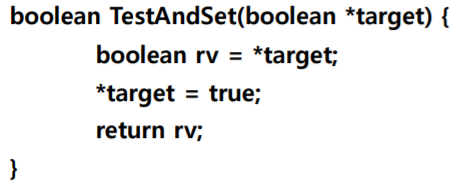](/assets/images/operating-system/09/figure-07.png)
위 명령어를 이용하여 어떤 프로세스의 임계 영역 접근을 다음과 같이 할 수 있다.

(boolean lock = false 라고 가정한다.)

[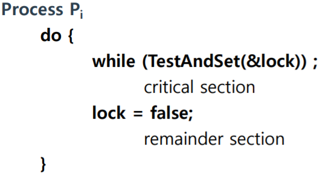](/assets/images/operating-system/09/figure-08.png)
또 다른 명령어로는 두 매개 인자 간의 값을 바꿔주는 Swap이 존재한다.

[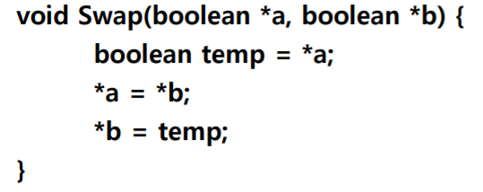](/assets/images/operating-system/09/figure-09.png)
위와 같은 명령어를 이용하여 임계 영역을 접근하는 프로세스는 다음과 같이 만들 수 있다.

- 사용되는 변수 :
    - boolean lock
    - boolean waiting[n] (n개의 프로세스 대기열)

        [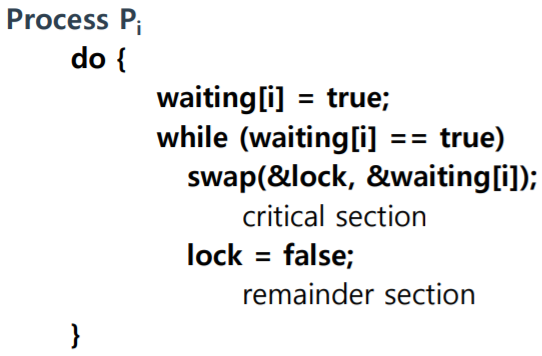](/assets/images/operating-system/09/figure-10.png)
앞서 살펴 본 명령어들을 사용하면 Mutual Exclusion은 해결할 수 있으나, Bounded Waiting 같은 조건은 User Application에서 제공해야 한다. 이를 제대로 처리하기는 조금 어려울 수 있으므로 보다 더 포괄적인 동기화 선점 명령어들이 필요하게 되었다.

<!-- section -->

## 4. Semaphores

세마포어(Semaphores)란 두 개의 원자적 연산을 가지는 정수 변수를 의미하며, 두 연산은 Wait() 또는 P(), Signal() 또는 V() 인데, 두 연산을 통해 정수 변수에 접근할 수 있도록 한다.

연산 P()는 임계 영역에 들어가기 이전에 수행되고, 연산 V()는 임계 영역을 빠져나온 뒤에 수행되는 연산이다. 두 연산은 다음과 같이 서로 독립적이며 원자적으로 수행된다.

[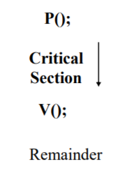](/assets/images/operating-system/09/figure-11.png)

**세마포어 진입과 해제**

```text
P() → Critical Section → V() → Remainder
```
하나의 프로세스가 P를 수행하여 세마포어 값을 수정하는 동안, 다른 프로세스에서는 P와 V를 통해 세마포어의 값을 수정하는 동작은 할 수 없다.

세마포어의 기본적인 구현 방식은 다음과 같은 것들이 있다.

- Busy Waiting

    ```c
    function P(S){
        while(S <= 0);
        S = S - 1;
    }

    function V(S){
        S = S + 1;
    }
    ```

    Busy Waiting 방식은 임계 영역에 진입할 조건이 될 때까지 Loop를 돌며 기다리게 하는 방식으로, 구현은 간단하지만 CPU Cycle을 낭비할 수 있고 대기 중엔 프로세스 중에 누가 임계 영역에 진입할 지를 결정하지 않는다는 단점이 있다.


- Sleep Queue

    ```c
    typedef struct {
        int value; // 세마포어 값
        struct process *list; // 세마포어를 대기하는 프로세스의 sleep queue
    } semaphore;

    function P(semaphore *S){
        S -> value --;
        if ( S -> value < 0) {
            add this process to Sàlist; //프로세스를 sleep queue에 삽입
            block();
        }
    }

    function V(semaphore *S){
        S -> value++;
        if (S -> value <= 0) {
            remove a process P from S -> list; // 프로세스를 sleep queue에서 꺼내온 후,
            wakeup(P); // 실행
        }
    }
    ```

    Busy Waiting 방식의 단점을 해결하기 위한 방식으로, 세마포어에 Queue를 도입하여 대기 중인 프로세스를 관리한다. 세마포어 값이 양수가 되어 임계 영역 진입이 가능하게 되면, Sleep Queue에서 대기 중인 프로세스 하나를 꺼내어 실행시키는 방식이다.


- Binary Semephore : 세마포어가 가질 수 있는 값은 오직 0과 1로 구성하는 방식이다. 바이너리 세마포어는 TestAndSet 명령어를 이용하여 다음과 같이 구현한다.

    (Semaphore S : 현재 임계 영역에 진입한 세마포어가 있는 지를 True, False로 나타냄.)

    ```c
    function P(S){
        while(TestAndSet(&S));
    }

    function V(S){
        S = false;
    }
    ```


- Counting Semaphore : 세마포어가 가질 수 있는 값의 범위를 정하지 않고, 세마포어의 초기 값으로 접근을 허용할 자원의 수로 정하는 방식이다.


    카운팅 세마포어는 바이너리 세마포어를 이용하여 다음과 같이 구현한다.

    (C = Counting Semaphore Value / S1, S2 = Binary Semaphore S1, S2는 각각 1과 0으로 초기화 )

    ```c
    funtion wait(){
        P(S1);
        C--;

        if( C < 0 ){
            V(S1);
            P(S2);
        }
        else
            V(S1);
    }

    function signal(){
        P(S1);
        C++;

        if( C <= 0 )
            V(S2);

        V(S1);
    }
    ```


한편, 세마포어의 단점으로는 Deadlock이 발생할 가능성이 있다는 것이다. P와 V 연산이 분리되어 있기 때문에 다음과 같은 경우처럼 두 연산을 잘못 사용하는 것에 대한 대책이 없다.

- P(); → Critical Section → P();
- V(); → Ciritical Section → P();

따라서, High-level 언어에서 동기화를 제공하는 방법이 필요하게 되었다.

<!-- section -->

## 5. Deadlock

둘 이상의 프로세스가 무한히 이벤트를 기다리는 상황이며, 이벤트는 프로세스가 발생시킬 수 있는 이벤트를 말한다.

[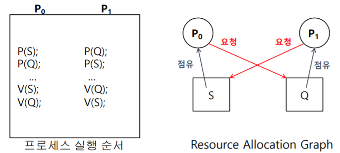](/assets/images/operating-system/09/figure-12.png)

**교착 상태의 자원 요청 방향**

```text
S ──할당──→ P0 ──요청──→ Q
↑                         │
└────요청──── P1 ←──할당───┘

P0: P(S) → P(Q)를 기다림
P1: P(Q) → P(S)를 기다림
```

<!-- section -->

## 6. Monitor

High-level인 Java에서의 동기화 방식이다. 한 순간에 하나의 프로세스만 모니터에서 활동하도록 보장해준다. 즉, Application 내부에서 세마포어와 같이 P와 V 연산에 대한 고려없이 Procedure를 호출하는 것으로 동기화를 해결한다. (프로그래머가 동기화 제약 조건을 코드에 명시적으로 나타낼 필요가 없다.)

```c
Monitor monitor-name {
    shared variable 선언
    …

    procedure body p1 (…) {
    …
    }

    procedure body p2 (…) {
    …
    }

    procedure body p3 (…) {
    …
    }

    {
        초기화 코드
    }
}
```

모니터의 동작은 아래의 그림과 같다.

[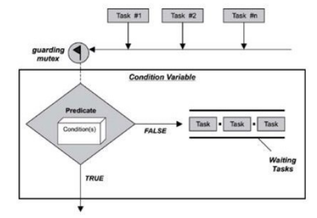](/assets/images/operating-system/09/figure-13.png)

**조건 변수와 대기열**

```text
Task 1 / Task 2 / Task n → Guarding Mutex → 조건 검사
                                            ├─TRUE──→ 진행
                                            └─FALSE─→ Waiting Tasks
```
[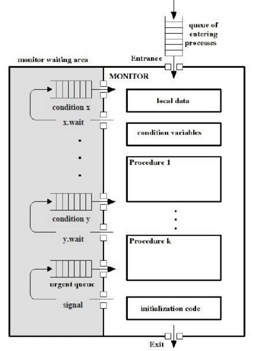](/assets/images/operating-system/09/figure-14.png)

**모니터 진입과 조건 대기**

```text
진입할 프로세스 → Entry Queue → Monitor Entrance
                                  │
                                  ▼
                        Procedure → Local data 접근
                                  │
                  ┌───────────────┼────────────────┐
                  ▼               ▼                ▼
             x.wait           y.wait              Exit
                  │               │
                  ▼               ▼
          Condition x Queue  Condition y Queue
                  └────signal로 대기 해제────→ Monitor

그림의 monitor waiting area에는 urgent queue도 포함된다.
```
Entry Queue에서는 프로세스들이 모니터 사용을 위해 대기한다. 모니터에 진입하기 위해 모니터가 제공하는 Operation들을 통해 Shared data를 접근할 수 있게 된다.
