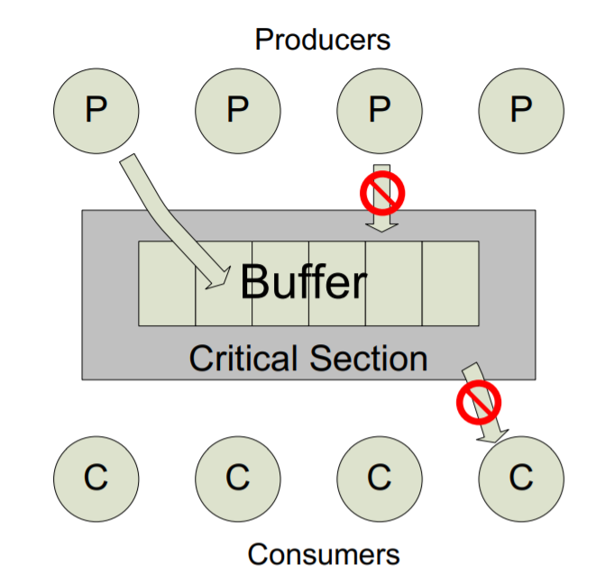
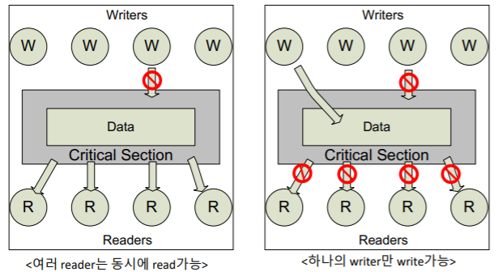
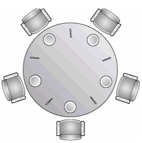
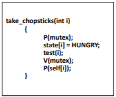
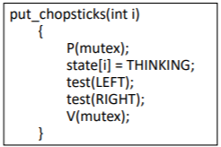
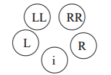

앞선 내용은 동기화를 어떻게 구현하는 지에 대한 내용이었다. 이 글에서는 동기화의 고전적인 세 가지 문제에 대해 살펴본다.

<!-- section -->

## 1. Bounded-Buffer Problem

N개의 Item을 삽입할 수 있는 Buffer에 여러 생산자와 여러 소비자가 접근 하는 동기화 문제이다.

생산자는 하나의 Item을 생성하여 버퍼에 저장하고, 소비자는 버퍼의 상태가 Empty가 아니라면 버퍼에서 Item을 가져오는 역할을 맡는다. 이런 환경에서의 Race Condition을 제어하는 것이 문제의 목표이다.

[](/assets/images/operating-system/10/figure-01.png)

**생산자와 소비자의 버퍼 접근**

```text
Producer → P(empty) → P(mutex) → Buffer에 Item 추가
                                  │
                                  └→ V(mutex) → V(full)

Consumer → P(full) → P(mutex) → Buffer에서 Item 제거
                                 │
                                 └→ V(mutex) → V(empty) → 소비

Buffer의 임계 영역에는 한 번에 하나의 실행 흐름만 진입한다.
```
위 그림처럼 생산자는 한 번에 하나만 버퍼에 접근하여 데이터를 생성하고, 소비자는 버퍼가 비어있지 않고 아무런 생산자도 동작하지 않는 경우에만 버퍼에 접근하여 데이터를 가져온다.

상세한 구현을 위한 자료 구조와 함수의 동작은 다음과 같이 한다.

- Buffer의 구현 : boolean buffer[n] 와 같이 선언하고, false(= empty)으로 초기화한다.
- 생산자 : Buffer의 배열을 탐색하여, Empty인 Index를 발견하면 true(= full)로 바꾼다.
- 소비자 : Buffer의 배열을 탐색하여, full인 Index를 발견하면 false(= empty)로 바꾼다.

- Empty : Buffer 내의 저장 공간이 있음을 표시하는 세마포어이다. (생산자의 진입 관리)
- Full : Buffer 내의 소비할 아이템이 있음을 표시하는 세마포어이다. (소비자의 진입 관리)
- Mutex : Buffer에 대한 접근을 관리하는 세마포어이다. (한 번에 하나씩 접근하도록 관리)

    생산자, 소비자가 Empty, Full 세마포어에 진입한 경우, Buffer의 상태 값을 변경하기 위한 세마포어이다.


세마포어들의 초기 값은 다음과 같다.

- Full = 0
- Empty = n (버퍼가 수용할 수 있는 원소의 수만큼 초기화)
- Mutex = 1 (현재 버퍼에 접근할 수 있는 상태)

Example)

```c
function Producers(){
    do{
        ...
        produce an item in nextp
        ...
        P(empty); //버퍼에 적어도 하나의 공간이 생기기를 기다림
        P(mutex); //critical section에 진입하기 위해 기다림
        ...
        add nextp to buffer
        ...
        V(mutex); //critical section에서 빠져 나왔음을 알림
        V(full); //버퍼에 아이템이 있음을 알림
    } while(1);
}

function Consumers(){
    do{
        P(full); //버퍼에 적어도 하나의 아이템이 들어가기를 기다림
        P(mutex);
        ...
        remove an item from buffer to nextc
        ...
        V(mutex);
        V(empty); //버퍼에 하나의 빈 공간이 생겼음을 알림
        ...
        consume the item in nextc
        ...
    } while(1);
}
```

<!-- section -->

## Readers-Writers Problem

데이터를 읽기만 하는 Reader Process와 데이터를 쓰기만 하는 Writer Process가 하나의 공유 데이터를 접근하는 문제이다.

Reader 프로세스는 여러 프로세스가 동시에 읽어도 문제 없으나,  Writer 프로세스는 오직 한 번에 하나의 프로세스만 동작하거나, 데이터를 Read 중인 Reader 프로세서가 없어야만 한다.

[](/assets/images/operating-system/10/figure-02.png)

**Reader와 Writer의 접근 조건**

```text
읽는 중:   Shared Data ──read──→ Reader 1 / 2 / 3 / 4
           Writer ↛ Shared Data

쓰는 중:   Writer 1 ──write──→ Shared Data
           다른 Writer ↛ Shared Data
           모든 Reader ↛ Shared Data
```
상세한 구현을 위해 다음과 같은 자료구조와 세마포어를 사용한다.

- int ReadCount : 현재 버퍼에 몇 개의 Reader가 접근 중인 지를 나타낸다.
- Semaphore Wrt : Writer 사이의 동기화를 담당하는 세마포어이다.
- Semaphore Mutex : ReadCount와 Wrt 간의 접근이 원자적으로 수행될 수 있도록 존재하는 세마포어이다.


위와 같은 변수와 세마포어들을 다음과 같이 초기화한다.

- Mutex = 1 (Writer가 버퍼에 접근할 수 있는 상태)
- Wrt = 1 (Writer가 동작할 수 있는 상태)
- ReadCount = 0 (초기 Reader로 동작하는 프로세스는 아무 것도 없는 상태)

Example)

```c
function writer(){
    P(Wrt);
    ... writing ...
    V(Wrt);
}

function readers(){
    P(mutex);
    readcount++;

    if (readcount == 1)
        P(wrt); //어떤 writer도 수행되고 있지 않음을 판별
        V(mutex);
        ...
        reading
        ...
        P(mutex);
        readcount--;

    if (readcount == 0){
        V(wrt);
        V(mutex);
  }
}
```

이와 같은 구현은 Writer가 기아 상태에 빠질 수도 있다. 왜냐하면, ReadCount == 0인 경우에만 V(Wrt)가 수행되어 P(Wrt)로 대기하고 있던 Writer가 수행될 수 있는데, 첫 번째 Reader가 P(Wrt)를 통과하기만 하면, 다른 Reader들은 P(mutex)만 기다리기만 하면 언제든 Read 할 수 있기 때문에  ReadCount는 0까지 떨어지지 않아서 Writer는 영원히 수행되지 않을 수도 있다.

<!-- section -->

## 3. Dining-Philosophers Problem

5명의 철학자가 아래 그림과 같은 하나의 식탁에서 함께 식사를 하는 상황에서 젓가락이 5개 (5쌍이 아님.) 뿐인 상황이다. 철학자들은 자신의 바로 옆 젓가락만 집을 수 있고, 두 젓가락을 모두 집어야 식사를 할 수 있으며 식사가 끝나면 두 젓가락을 모두 내려 놓아야 한다.

[](/assets/images/operating-system/10/figure-03.png)

**철학자의 젓가락 요청**

```text
P0 → C0, C1       P1 → C1, C2       P2 → C2, C3
P3 → C3, C4       P4 → C4, C0

Pi: Thinking → 젓가락 두 개 확보 → Eating → 두 개 반납
모두 한 개씩 점유 → 다음 젓가락을 서로 기다림 → Deadlock
```
이러한 상황에서 생각해볼 수 있는 해결책은 다음과 같다.

- 단순히 젓가락을 집는 행위에 대해 동기화를 부여하기 : 모든 철학자가 자신의 왼쪽 또는 오른쪽 젓가락부터 집도록 한다. 이를 위해 boolean waiting[n], chapsitc[5]와 같은 대기열 및 젓가락의 상태를 표시할 자료구조를 생성한다. (초기 값은 모두 1이다.)

Example)

```c
function philosophers(){
    do{
        ...
        think
        ...
        P(chopstick[i]);
        P(chopstick[(i+1) % 5]);
        ...
        eat
        ...
        V(chopstick[i]);
        V(chopstick[(i+1) % 5]);
    } while(1);
}
```

위와 같은 구현은 철학자 프로세스가 동시에 젓가락을 잡으면 deadlock이 발생하게 된다. 따라서 이를 해결하기 위해 다음과 같은 개선이 필요하다.

Solution 1)

- 한 번에 최대 4명의 철학자만 식탁에 앉도록 한다.
- 젓가락의 상태를 미리 검사하여, 양 쪽의 젓가락이 모두 사용 가능할 때 젓가락을 집도록 한다.
- 철학자에게 번호를 부여하여 홀수인 철학자에겐 왼쪽의 젓가락을, 짝수인 철학자는 오른쪽의 젓가락을 먼저 집도록 한다.

그러나, 위와 같은 개선에도 Starvation이 발생할 수 있다. 이는 철학자에게 우선권을 주는 식의 문제로 해결이 가능하다.

Solution 2)

- 젓가락의 상태를 미리 검사하여, 양 쪽의 젓가락이 모두 사용 가능할 때 한 번에 얻도록 한다. 이를 위해 다음과 같은 자료 구조와 세마포어를 사용한다.


    - State[5] : 각 철학자의 상태를 기록한다. (Thinking, Hungry, Eating)
    - Muter : 젓가락을 집거나 놓는 행동을 임계 영역으로 관리하기 위한 세마포어이다.
    - Self[5] : 철학자 각각이 젓가락 두 개를 얻기 위한 세마포어이다. (초기 값으로 모든 원소에 0을 넣어준다.) Self[i]의 의미는 철학자 i가 Hungry 상태이더라도, 젓가락 한 쌍을 모두 얻지 못하면 Waiting을 하기 위한 세마포어이다.

Example)

```c
function philosophers(){
    do{
        ...
        think
        ...
        take_chopsticks(i);
        ...
        eat
        ...
        put_chopsticks(i);
        ...
    } while(1);
}

/*
    Mutex를 통해 진입하여, test(i)를 통해 양쪽의 철학자 상태를
    검사한 후, 자신이 먹을 차례를 기다린다.
*/
function take_chopsticks(int i){
    P(mutex);
    state[i] = HUNGRY;
    test(i);
    V(mutex);
    P(self[i]);
}

/*
    Mutex를 통해 진입하여, test(LEFT), test(RIGHT)를 통해
    양쪽의 철학자 상태를 검사한후, 먹을 차례를 기다리는
    철학자에게 signal을 보내준다.
*/

function put_chopsticks(int i){
    P(mutex);
    state[i] = THINKING;
    test(LEFT);
    test(RIGHT);
    V(mutex);
}

/*
    Test를 수행한 철학자(i)가 HUNGRY 상태이고, 양쪽의 철학자가
    모두 젓가락을 집지 않은 상태 (NOT EATING)이면
    take_chopsticks()에서 wait했던 자신의 세마포어 self[i]에
    signal을 보내어 EAT으로 진행하도록 함
*/
function test(i){
    if(state[i] == HUNGRY && state[LEFT] !=
            EATING && state[RIGHT] != EATING){
        state[i] = EATING;
        V(self[i]);
}
```

위와 같은 구현의 핵심적인 전략은 철학자 i의 좌우 젓가락이 사용이 가능할 때만 젓가락을 얻는 임계 영역에 진입한다는 것이다.

즉, i번째 철학자가 식사를 하기 위해서는 i-1 (LEFT)와 i+1 (RIGHT) 철학자가 EATING 상태가 아니어야 한다.

- take_chopsticks() :

    [](/assets/images/operating-system/10/figure-04.png)
    test() 함수 안에서 검사하는 LEFT와 RIGHT의 상태가 EATING이 아니어야 젓가락을 얻는다.

    test()를 만족하면, signal(self[i])에 의해 self[i]의 값은 1이 되므로, wait(self[i])에서 block되지 않고 식사를 진행할 수 있게 된다. (이 때, self[i]의 초기 값은 0 이다.)

- put_chopsticks() :

    [](/assets/images/operating-system/10/figure-05.png)
    식사를 마치면, 좌 우 철학자의 test() 함수를 실행한다. 이 때, 철학자 L과 R은 i에 의해 test_chopstick()에서 wait()함수에 의해 대기 중이다.

    [](/assets/images/operating-system/10/figure-06.png)

    **이웃 철학자의 상태 확인**

    ```text
    LL — L — i — R — RR    (원형 식탁의 이웃 관계를 펼친 것)

    i가 식사를 마침 → test(LEFT)  → L의 이웃인 LL과 i 확인
                   → test(RIGHT) → R의 이웃인 i와 RR 확인
    조건 만족 → 해당 이웃의 self 세마포어에 signal → 식사 가능
    ```
    철학자 i에 의해 실행한 test(LEFT) : i와 LL의 상태를 확인. 철학자 i에 의해 실행한 test(RIGHT) : i와 RR의 상태를 확인.

    철학자 i가 식사중인 동안 LL 혹은 RR 철학자의 상태가 EATING으로 바뀐다 하더라도, test(LEFT)와 test(RIGHT)를 통해 signal을 수행하므로 동기화에 문제가 없다.
