> 본문과 예제는 원문을 보존했다. 그림은 누르면 원본 크기로 볼 수 있으며, **화살표로 읽기**는 구조와 흐름을 풀어 쓴 보충 도식이다.

여러 프로세스들이 동시에 메모리에 적재되어 실행되면서, 메모리를 공유해서 사용하는 것을 고려하게 되었다. 컴퓨터의 메모리는 한정적인 자원이므로 이를 적절히 관리해주어야 한다. 이번 글에서는 운영체제가 메모리를 어떻게 관리하는 지에 대해 정리한다.

<!-- section -->

## 1. Address Space

프로세스가 고유하게 갖는 주소들의 집합이다. User Application의 Thread는 프로세스의 주소 공간을 공유하여 사용한다. 주소 공간의 크기는 CPU의 주소 버스 크기에 의존한다. 예를 들면, 주소 버스의 크기가 32Bit이면 2^32개의 서로 다른 주소를 만들 수 있으므로 0부터 2^32 - 1 까지의 주소 범위를 가질 수 있다.

- Physical address : 컴퓨터의 실제 물리 메모리(메인 메모리)에 접근할 때 사용되는 주소이자 기억 장치의 주소 레지스터에 적재되는 주소를 말한다.
- Virtual address :  프로세스 관점에서 사용하는 추상화된 주소이다. 프로세스가 수행 되기 위해서는 프로그램의 모든 부분이 실제 메모리에 있을 필요는 없다. 현재 수행에만 필요한 부분만 메모리에 올라와 있다면 프로세스는 실행이 가능하다는 점이 기본적인 아이디어이다.

초창기 컴퓨터 시스템은 물리 주소만을 사용하고, 컴파일 시점에 이를 생성했다. 그러다 보니, 프로세스의 물리적인 주소를 절대적인 주소로 생성하게 되었고 시작 주소의 위치가 바뀌는 경우(프로세스를 실행할 때마다)에는 다시 컴파일 해야 하는 번거로움이 있었다.

또, 다양한 프로그램이 실행되면서 컴파일 타임에 물리 주소를 결정하는 것이 어려워져서 가상 주소가 등장하게 되었다.

[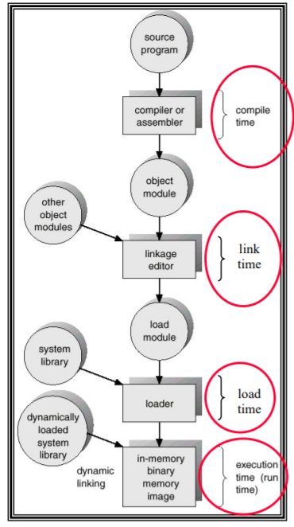](/assets/images/operating-system/11/figure-01.png)

**화살표로 읽기 — 주소가 정해지는 단계**

```text
Source program → Compiler / Assembler → Object module
                                            │
Other object modules ───────────────────────→ Linkage editor
                                            │
                                            ▼
                                        Load module
                                            │
System library ────────────────────────────→ Loader
                                            │
                                            ▼
                             In-memory binary memory image
                                            ↑
Dynamically loaded system library ──dynamic linking──┘
```
위와 같은 프로세스 수행 과정에서 각 단계를 거치며 주소가 생성되는 과정은 다음과 같다.

- Compile Time : 컴파일러가 심볼 테이블을 생성하고, 주소는 심볼 테이블에서 상대적인 주소로 이루어진다. 컴파일 과정을 거친 Object 파일은 시작 주소가 0부터 시작한다. 이는 후에 재배치를 하기 위함이다.


- Link Time : Object 파일들과 시스템에서 제공하는 라이브러리들을 묶어서 심볼 테이블에 의존적이지 않은 주소를 만들어낸다. 이렇게 묶어낸 결과로 만들어진 실행 파일에서도 주소는 0부터 시작한다.

- Load Time : 프로그램의 실행을 위해 로더는 실행 파일을 메모리에 적재한다. (이 때, 가상 주소 공간이 생겨나게 되는 것이다.) 주소 공간 전체가 메모리에 올라가게 되면 물리 주소에 대한 바인딩이 일어나게 된다. (페이지 테이블을 채움.)

- Execution : 프로세스가 실행될 때 물리 주소가 바뀌는 경우, (페이징, Swapping 등이 발생하는 경우) 물리 주소에 대한 바인딩은 프로세스가 실행될 때 일어난다. 이러한 형태의 주소 결정 방법을 사용하기 위해 MMU(Memory Management Unit)와 같은 특별한 하드웨어가 필요로 하게 된다.

<!-- section -->

## 2. Address Translate

CPU에서 물리 주소에 상대적인 주소를 사용할 경우, 프로그램 내의 명령어들이 시작 주소로부터 상대적인 offset으로 표현될 것이다. 따라서, 시작 주소가 결정되면 이후로 주소 값들은 '시작 주소 + 상대 주소'의 합으로 절대적인 주소 값을 생성할 수 있게 된다. 이러한 방식은 물리 메모리 주소들이 늘 고정적이어야 한다는 단점이 있다.

[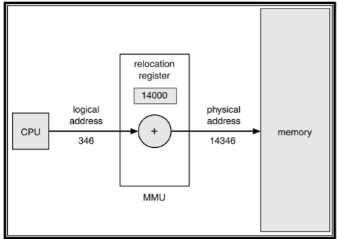](/assets/images/operating-system/11/figure-02.png)

**화살표로 읽기 — 재배치 레지스터를 이용한 주소 변환**

```text
CPU ──논리 주소 346──→ MMU: 346 + 14000 ──물리 주소 14346──→ Memory
                                  ↑
                     Relocation Register = 14000
```
반대로, CPU가 가상 주소를 사용하는 경우라면 CPU와 메모리 사이에 가상 주소를 물리 주소로 번역해주는 별도의 유닛을 통해 두 주소 체계 간의 쉬운 변환을 이끌어낼 수 있다. 이러한 방식은 번역 유닛의 속도가 가장 중요한 요소가 된다.

[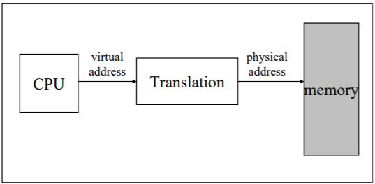](/assets/images/operating-system/11/figure-03.png)

**화살표로 읽기 — 가상 주소를 물리 주소로 번역**

```text
CPU ──Virtual address──→ Translation ──Physical address──→ Memory
```
여기서 Translation을 담당하는 Unit을 Memory Management Unit 이라고 한다.

[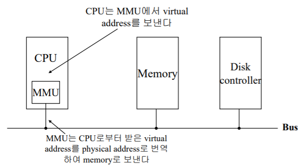](/assets/images/operating-system/11/figure-04.png)

**화살표로 읽기 — MMU와 버스 연결**

```text
CPU → MMU: 가상 주소 전달
        │ 물리 주소로 번역
        ▼
       Bus ↔ Memory
        ↕
   Disk Controller
```
가상 메모리에 대해 다시 상기하자면, 프로그램의 모든 부분을 실제 메모리에 적재하는 것이 아니라, 현재 실행되고 있는 Code 부분을 실제 메모리에 적재하여 프로세스를 동작 시키고, 가상 메모리의 남은 부분은 Disk에 적재하였다가 필요할 때 가져다 쓰는 방식이다.

[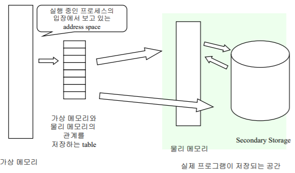](/assets/images/operating-system/11/figure-05.png)

**화살표로 읽기 — 가상 메모리와 저장 공간의 대응**

```text
프로세스의 가상 주소 공간 → 매핑 테이블
                              ├→ Physical Memory
                              └→ Secondary Storage

Physical Memory ←──필요한 페이지 이동──→ Secondary Storage
```
이러한 가상 메모리를 실제 물리 메모리에 매핑하는 방법으로는 별도의 Mapping Table을 두는 것이다. 이 때, 물리 메모리와 가상 메모리에서 쓰이는 주소 공간의 크기(한 번에 처리하는 단위)를 알아야한다. 이는 다음과 같다.

- Page : 가상 메모리에서의 크기 단위 (4KB)
- Frame : 물리 메모리에서의 크기 단위 (4KB)

그리고 이러한 크기 단위를 아래와 같은 테이블을 통하여 매핑 하는 것이다. 아래와 같은 테이블을 Page Table 이라고 한다.

가상 메모리 주소 공간과 물리 메모리 주소 공간에 연결된 상태를 보면,  0번 Page는 2번 Frame에 연결되어 있고, 매핑 테이블에도 잘 기록된 것을 볼 수 있다. 이처럼 Page와 Frame 간의 연결 상태를 기록해둔 것이 매핑 테이블이다.

[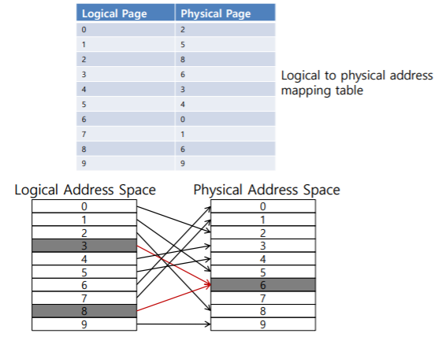](/assets/images/operating-system/11/figure-06.png)

**화살표로 읽기 — 페이지와 프레임 매핑**

```text
Logical Page → Physical Frame
 0 → 2       1 → 5       2 → 8       3 → 6       4 → 3
 5 → 4       6 → 0       7 → 1       8 → 6       9 → 9

원문 그림에서는 Page 3과 Page 8이 모두 Frame 6을 가리킨다.
```
가상 메모리 주소 공간과 물리 메모리 주소 공간에 연결된 상태를 보면,  0번 Page는 2번 Frame에 연결되어 있고, 매핑 테이블에도 잘 기록된 것을 볼 수 있다. 이처럼 Page와 Frame 간의 연결 상태를 기록해둔 것이 매핑 테이블이다.

Page가 Frame과 잘 연결되었다면, 이는 하나의 가상 메모리(Page)가 하나의 물리 메모리(Frame)에 적재된 것이며, 그렇지 않다면 하나의 가상 메모리(Page)가 Disk에 연결된 것이다. (이 때, Disk에서의 저장 단위도 Page, Frame와 같은 크기를 갖는다.)

가상 메모리를 사용한다는 것은 매핑 테이블에도 접근해야 한다는 뜻이 된다. 그렇다면 CPU가 관리하는 모든 주소는 Page 번호와 Page 내부에서의 주소를 가져야만 할 것이다.

앞선 이야기들을 종합하여, 가상 메모리와 물리 메모리 간의 변환은 다음과 같이 도식화하여 나타낼 수 있다.

- p : page의 시작 주소, page table의 Index
- d : page 내부에서 데이터가 담긴 주소
- f : frame의 시작 주소, 물리 메모리의 Index

    [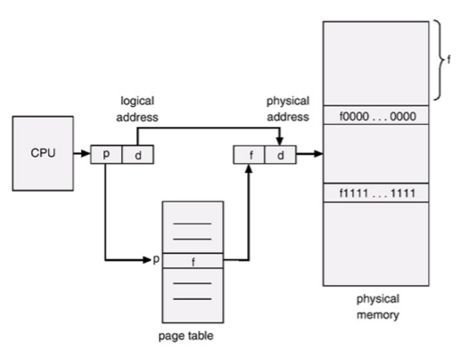](/assets/images/operating-system/11/figure-07.png)

    **화살표로 읽기 — 페이지 번호와 오프셋의 변환**

    ```text
    CPU의 논리 주소 [p | d]
                     │   │
                     ▼   │ (오프셋 d 유지)
            Page Table[p] │
                     │   │
                     ▼   ▼
    물리 주소       [f | d] → Physical Memory
    ```

<!-- section -->

## 3. Page Table

페이지 테이블은 물리 메모리에 위치하기 때문에 이를 구현하기 위해서는 다음과 같은 레지스터들이 필요하다.

- PTBR(Page Table Base Register) : 물리 메모리 내의 페이지 테이블 주소를 가리킴.
- PTLR(Page Table Length Register) : 물리 메모리 내에 저장된 페이지 테이블의 Size를 나타냄.


또, 페이지 테이블에 담기는 Record의 정보는 다음과 같다.

- Page Base Address : 해당 페이지에 할당된 Frame의 시작 주소 (이를 통해 물리 메모리에 접근한다.)
- Flag Bits
    - Accessed Bit : Page에 대한 접근이 있었는 지를 나타냄.
    - Dirty Bit : Page의 내용이 변경된 적이 있었는 지를 나타냄.
    - Present Bit : 현재 Page에 할당된 Frame이 있는 지를 나타냄.
    - Read/Write Bit : 읽기/쓰기에 대한 권한을 나타냄.
    - Etc...

지금껏 살펴본 내용에 의하면, 페이지 테이블을 이용하여 물리 메모리에 매핑하는 방법은 항상 두 번의 메모리 접근을 거쳐야 한다. (Page Table에 한번 접근하고, 물리 메모리 내의 Data에 한번 접근.) 이는 메모리 접근 속도를 크게 떨어뜨리는 행위이다.

따라서, 페이지 테이블을 이용하여 변환된 주소를 어딘가에 저장해두었다가 다음 접근 시에 사용한다면 단 한번의 접근으로 물리 메모리에 접근할 수 있다. 이 때, 페이지 테이블로 파생된 변환 주소를 저장하는 버퍼를 TLB(Translation Look-aside Buffer)라고 하며 TLB는 레지스터이기 때문에 빠른 수행이 가능하다.

이를 도식화하면 다음과 같다.

[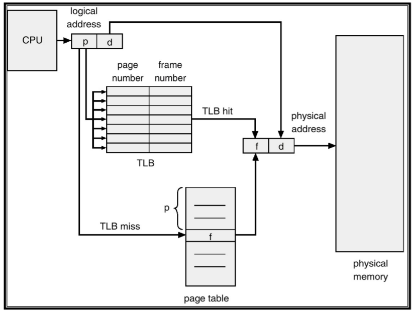](/assets/images/operating-system/11/figure-08.png)

**화살표로 읽기 — TLB 적중과 실패 경로**

```text
CPU → 논리 주소 [p | d] → TLB에서 p 검색
                              ├─hit──→ Frame f
                              └─miss─→ Page Table[p] → Frame f
                                                        │
                                  오프셋 d와 결합 ←─────┘
                                         ▼
                                 물리 주소 [f | d] → Memory
```
단, TLB에도 찾는 내용이 없다면 다시 Page Table에 접근해야 하므로, TLB에 자주 사용되는 주소를 올려두는 것이 (= TLB Hit) 중요하다.

이 외에도, 페이지 테이블의 접근 부담을 줄이기 위하여 다음과 같이 다단계로 구성된 페이지 테이블이 등장하였다. (페이지 테이블 자체를 Paging 하는 방식이다.)

[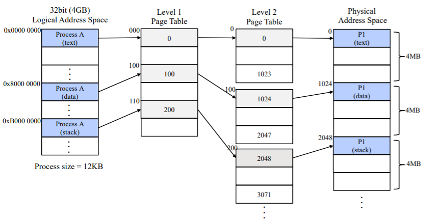](/assets/images/operating-system/11/figure-09.png)

**화살표로 읽기 — 다단계 페이지 테이블 탐색**

```text
Logical Address
    │ 상위 인덱스
    ▼
Level 1 Page Table
    │ 해당 하위 테이블 선택
    ▼
Level 2 Page Table
    │ 프레임 번호
    ▼
Physical Address Space (text / data / stack)
```
앞서 말한 내용 중에 페이지 테이블은 물리 메모리에 적재된다고 하였다. 그러므로 위와 같이 다단계의 페이지 테이블을 구성하는 것은 물리 메모리의 사용이 그만큼 늘어나는 행위이기도 하다.

이와 같이 페이지 테이블의 접근을 조금이라도 줄여보기 위한 방법들을 보았으나, 하나같이 문제점들이 있었다. 그렇다면 이제는 발상의 전환을 할 차례이다.

가상 메모리 공간이 아무리 크더라도, 물리 메모리의 크기에는 한계가 존재한다. 또, 모든 물리 메모리는 가상 메모리의 Page에 매핑 되는 것을 보았을 때 물리 메모리가 비어있는 순간은 거의 없을 것으로 보여진다.

그렇다면 물리 메모리당 하나의 페이지 테이블을 할당하는 것은 어떨까?

이런 아이디어를 바탕으로 탄생한 것이 Inverted Page Table 이다.

[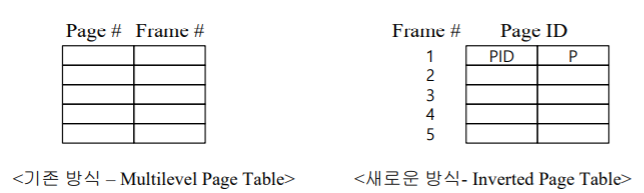](/assets/images/operating-system/11/figure-10.png)

**화살표로 읽기 — 일반 테이블과 역 페이지 테이블**

```text
일반 테이블: Page 번호 → Frame 번호
역 페이지 테이블: Frame 번호 → Page ID [PID | Page 번호]
```
기존의 방식은 Page 번호를 이용하여 Frame을 찾는 것이었다면, 이를 반대로 적용하여 가상 메모리 주소와 PID의 조합으로 Page 번호를 저장하는 것이다. 이는 Frame 내에서 Page ID를 찾는 것이 된다.

Inverted Page Table은 시스템을 통틀어 하나의 페이지 테이블 만을 두도록 한다. 이를 통해, 프로세스가 많아질 수록 페이지 테이블이 점점 많아지던 기존의 문제점을 해결하게 되었으나 테이블의 검색 시간은 오래 걸린다는 단점이 생겼다. 물론 이는 Hash Table을 구성하면 해결될 일이다.

Inverted Page Table을 도식화하면 다음과 같다.

[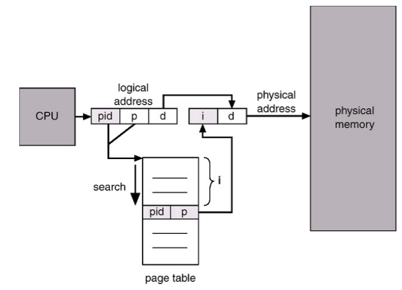](/assets/images/operating-system/11/figure-11.png)

**화살표로 읽기 — 역 페이지 테이블로 주소 변환**

```text
CPU → 논리 주소 [PID | p | d]
                    │      │
           (PID, p)로 검색  │ 오프셋 유지
                    ▼      │
          Inverted Page Table
                    │      │
          일치하는 항목 i   │
                    ▼      ▼
               물리 주소 [i | d] → Physical Memory
```

<!-- section -->

## Demand Paging

프로세스 실행을 위한 모든 페이지를 메모리에 올리지 않고, 필요한 페이지의 요청이 발생할 때 메모리에 올리는 기법을 말한다. 다시 말하면 프로세스 동작에 필요한 페이지만 필요할 때마다 메모리에 올려두고, 남은 페이지들은 Disk에 올려두는 방식이다. 즉, Disk와 메모리 간의 Swap이 일어나는 페이징 기법이다.

이를 구현하기 위해서는 페이지가 물리 메모리에 적재 되어있는 지를 나타낼 Valid, 페이지가 물리 메모리에 적재되어 있지 않음을 나타낼 Invalid를 표현할 수 있어야 한다. 따라서, 페이지 테이블에 다음 그림과 같은 추가적인 정보가 담겨야 한다.

[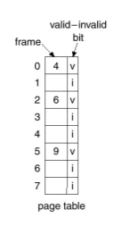](/assets/images/operating-system/11/figure-12.png)
페이지 테이블을 참고하여 Valid이면 정상적으로 물리 메모리를 참조하면 되고, Invalid이면 페이지가 현재 물리 메모리가 적재되지 않은 Page Fault가 발생한 것이므로, 별도의 Handler를 통해 처리해야 한다.

Page Fault란 프로세스가 페이지를 참조하였을 때, 해당 페이지가 할당 받은 프레임이 없는 경우이다. (즉, 페이지가 물리 메모리에 적재되지 않은 경우이다.) 이런 경우, 새로운 프레임을 할당 받아야 하는데 이는 Page Fault Handler가 담당한다.

Page Fault Handling

1. 새로운 Frame을 할당 받는다.
2. Disk에서 Page의 내용을 찾아서 할당 받은 Frame에 불러들인다.
3. Page Table을 재구성한다.
4. Process의 작업을 다시 시작한다.

위 과정을 도식화하면 다음과 같다.

[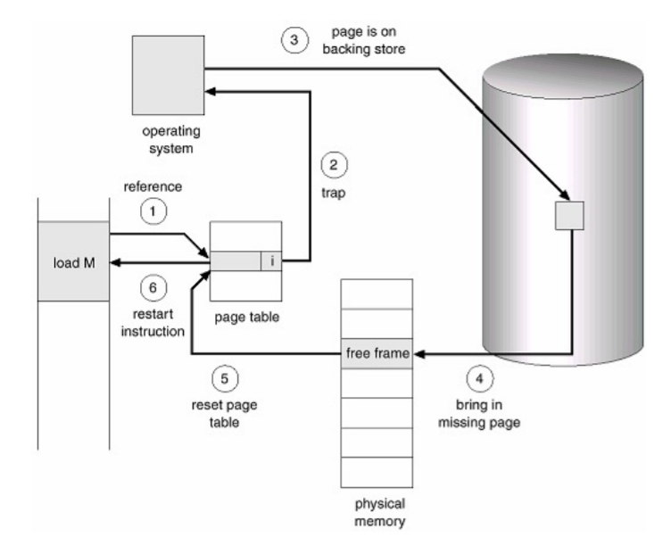](/assets/images/operating-system/11/figure-13.png)

**화살표로 읽기 — Page Fault 처리 순서**

```text
① 명령어가 페이지 참조 → Page Table의 Invalid 확인
② Trap → Operating System의 Page Fault Handler
③ Backing Store에서 페이지 위치 확인
④ 페이지 → Physical Memory의 Free Frame으로 적재
⑤ Page Table 갱신 (프레임·유효 상태 반영)
⑥ 중단했던 명령어 재시작
```
