<!-- section -->

## 1. Page Replacement

Multi Programming System에서 메모리 내에 적재된 Application의 수가 증가함에 따라 메모리의 공간이 부족해지는 (초과되는 상황)이 발생하게 되었다. 즉, Page 수보다 물리 메모리의 Frame의 수가 훨씬 적은 상황이 발생하게 된 것이다.

이럴 경우, Page Fault Handling(Trap)에 Page Replacement를 추가하면 쉽게 해결할 수 있다.

Page Replacement란 물리 메모리에 위치한 Page를 Disk에 저장하고, (임시적인 저장) 요구된 페이지가 해당 프레임을 할당 받도록 하는 방법을 말한다.

그렇다면, Page Fault Handler에선 어떠한 처리를 해주어야 하는가? 먼저, Disk를 탐색하여 요구된 페이지의 위치를 찾아준다. 이후 물리 메모리에 접근하여 할당되지 않은 프레임을 찾는다. 할당되지 않은 프레임이 있다면 그대로 사용하면 되고, 찾지 못했다면 Page Replacement Algorithm을 사용하여 교체될 프레임(Victim Frame)을 선택한다. 이후로는 교체할 프레임의 내용을 Disk에 저장하고, Page Table에서 해당 프레임의 내용을 갱신해준다. 이후로는 Application을 재시작한다.

다음은 Page Replacement의 고려 사항이다.

- 각각의 User Process에게 어떻게 Frame을 분배할 것인가? (공평하게 분배해줄 것인가? 아니면 메모리를 많이 사용하는 프로세스를 위주로 분배해줄 것인가?)
- 페이지 교체가 필요할 때, 어떻게 교체할 페이지를 선정할 것인가? (희생될 Frame은 어떻게 고를 것인가?)

위와 같은 고려사항은 모두 페이지 교체에 따른 I/O 작업 수행의 횟수를 최대한으로 줄이려는 목적을갖고 있으며, 이러한 목적을 가진 Page Replacement Algorithm을 소개하기에 앞서 몇 가지 환경을 가정하도록 한다.

- 세 개의 Frame이 할당된다.
- Page를 참조하는 순서는 총 20회로, 그 순서는 다음과 같다.
    - 7, 0, 1, 2, 0, 3, 0, 4, 2, 3, 0, 3, 2, 1, 2, 0, 1, 7, 0, 1
- 한번 참조된 Page는 교체가 일어나기 전까지 물리 메모리에 그대로 위치한다.

1. Frist In Frist Out Algorithm

    먼저 Frame이 할당된 Page를 먼저 교체하는 방식의 알고리즘이다. 가장 단순한 알고리즘이며, FIFO Queue로 구현이 가능하다. 멀티미디어 데이터를 처리하는 데에 특화되어 있다.

    [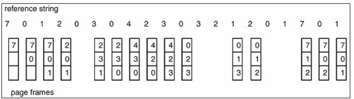](/assets/images/operating-system/12/figure-01.png)
    앞서 정의한 상황에서는 FIFO 알고리즘은 Page Fault가 15번 발생한다.

    1. Second Change Replacement Algorithm

        FIFO 알고리즘을 보완하여 Reference Bit를 추가하여 오랜 시간동안 메모리에 상주하는 페이지 중에 자주 사용되는 페이지가 교체되는 것을 방지하기 위한 알고리즘이다.

        참조 비트의 역할은 최초로 프레임에 적재될 때와 페이지가 참조될 때마다 값을 1로 설정해두었다가 주기적으로 참조 비트를 0으로 초기화해준다.

        이후, 페이지 교체를 수행할 때 참조 비트를 확인하여 값이 1 이라면 최근에 사용된 페이지인 것이므로 교체 대신 참조 비트 값만 0으로 바꾸고 다른 페이지를 교체한다.


    1. Clock Algorithm

        SCR Algorithm의 발전된 형태이다. 환형 Queue를 사용하여 프레임을 관리한다. 다음에 교체될 페이지를 가리키는 포인터 'Hand' 를 두고, Hand는 Queue를 따라 순차적으로 1칸씩 이동하며 페이지를 교체한다. 이 때, Hand가 가리키는 페이지의 참조 비트가 1이면 최근에 사용된 페이지로 보고 교체 대신 참조 Bit만 0으로 초기화한다. (해당 알고리즘도 마찬가지로 주기적으로 참조 Bit를 0으로 초기화한다.)

        [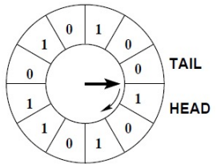](/assets/images/operating-system/12/figure-02.png)

        **Clock 알고리즘의 순환**

        ```text
        Hand → 현재 페이지의 Reference Bit 확인
                  ├─1 → 0으로 변경 → 다음 페이지로 Hand 이동 ─┐
                  └─0 → 교체 대상 선택                       │
                         ↑                                  │
                         └────원형 Queue를 따라 반복─────────┘
        ```
    1. Least Frequently Used Algorithm

        사용 빈도가 낮은 페이지를 교체하는 기법. 지금까지 가장 적게 참조된 페이지가 교체 대상으로 선택되는 것이다.

        [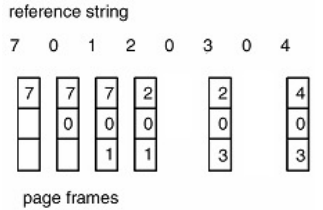](/assets/images/operating-system/12/figure-03.png)
        단, 프로그램 실행 초기에 많이 사용된 페이지는 그 이후에 사용되지 않음에도 사용 빈도가 높은 것으로 기록되어 교체되지 않고 계속 프레임을 차지하는 문제가 발생한다.


    1. Not Recently Used Algorithm

        최근에 사용하지 않은 페이지를 교체하는 기법이다. 페이지마다 참조 비트와 변형 비트(Modified Bit)를 두어 관리한다.


    변형 비트는 페이지 내의 데이터가 수정되면 해당 페이지를 다시 사용될 것으로 기대하여 관리하는 비트이다.  최초로 프레임이 적재될 때에는 값을 0으로 해두었다가, 페이지의 내용이 바뀔 때 값을 1로 바꾼다.

    페이지 교체가 필요한 시점에는 참조 비트와 변형 비트의 값을 비교하며 교체의 대상을 결정한다. (두 비트 값이 0 이면 가장 높은 교체 순위를 가짐.)

    [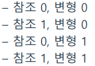](/assets/images/operating-system/12/figure-04.png)
    1. Least Recently Used Algorithm

        가장 오랜 시간동안 참조되지 않은 페이지부터 먼저 교체하는 기법이다. 가장 이상적인 페이지 교체 알고리즘이며, 구체적은 구현 방법은 다음과 같다.


    - Counter : 카운터를 사용하여 참조된 시간을 기록한다.
    - Queue : 한번 사용한 페이지를 Queue의 가장 위로 이동 시킨다. 이렇게 되면 Queue에 가장 위에 위치한 페이지는 가장 최근에 사용한 페이지이고, Queue의 가장 아래에 위치한 페이지는 가장 오래 전에 사용된 페이지가 된다.

        [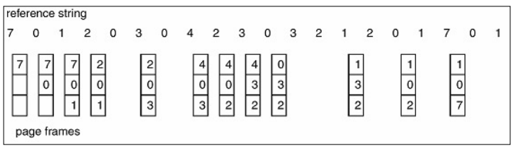](/assets/images/operating-system/12/figure-05.png)
        앞선 상황에서 LRU Algorithm의 Page Fault는 총 12번 발생한다.

<!-- section -->

## 2. Swapping

페이지 교체만으로도 메모리 부족을 해결하지 못할 경우에 필요한 기법이다. 대상이 되는 프로세스 전체를 Disk로 이동시켜 두었다가, 다시 필요할 때에 불러오는 기법이며 이 때 사용되는 Disk 영역을 Swap 영역이라고 한다. 다음은 그림은 물리 메모리 부족에 따라 Swapping이 일어나는 모습을 보여준다.

[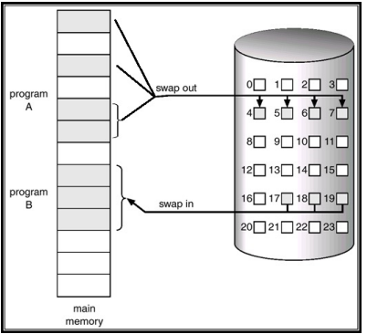](/assets/images/operating-system/12/figure-06.png)

**Swap Out과 Swap In의 방향**

```text
Main Memory의 Program A ──swap out──→ Disk의 Swap 영역
Main Memory의 Program B ←──swap in─── Disk의 Swap 영역
```
[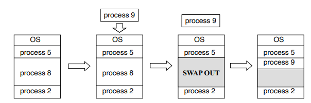](/assets/images/operating-system/12/figure-07.png)

**새 프로세스를 위한 공간 확보**

```text
[OS | Process 5 | Process 8 | Process 2]
                      │ Process 9 적재 요청
                      ▼
             Process 8 ──swap out──→ Disk
                      │
                      ▼
[OS | Process 5 | 빈 공간 | Process 2]
                      │ Process 9 적재
                      ▼
[OS | Process 5 | Process 9 | 여유 공간 | Process 2]
```

<!-- section -->

## 3. Contiguous Memory Allocation

다음은 물리 메모리의 영역을 User Process가 어떻게 나누어 쓰는 지에 관한 내용이다.

[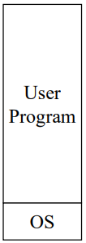](/assets/images/operating-system/12/figure-08.png)
Single Partition Allocation :

가장 단순하게 메모리를 사용하는 방법이다. User Process의 영역을 한 번에 하나만 적재하는 방식이다.

[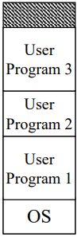](/assets/images/operating-system/12/figure-09.png)
Multiple Partition Allocation :

Multi programming 개념을 도입하여 User Process의 영역에 여러 개의 User Process가 적재될 수 있도록 영역을 나누는 방식이다.

[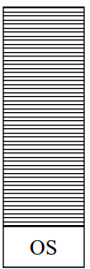](/assets/images/operating-system/12/figure-10.png)
No Partition :

각 User Process가 필요에 따라 메모리 영역을 구분 없이 사용하는 방식이다.이 경우, Page/Swap Out 시에 Garbage Collection이 필요하다.

<!-- section -->

## 4. Fragmentation

User process가 메모리에 적재될 때, 물리 메모리의 운영체제 영역을 제외한 User Process 영역에 배치된다. 수 많은 프로세스들이 배치되다보면 전체 여유 공간은 새로운 프로세스를 할당하기 충분하지만 아래 사진처럼 단편적으로 나눠지는 문제가 발생한다.

[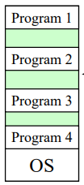](/assets/images/operating-system/12/figure-11.png)
이 때, 새로운 프로세스가 할당되어 메모리의 빈 공간 중에 어딘가로 배치되어야 한다면 이를 어떻게할 것인지에 대한 고민이 필요하다. 이러한 문제를 단편화(Fragmentation)라고 하며, 이를 다시 외부적(External)인 지, 내부적(Internal)인 지로 나눌 수 있다.

External Fragmentation : 프로세스에게 할당 후 남은 메모리의 전체 공간이 새로운 프로세스를 할당하기에는 충분하지만, 그 공간이 연속적이지 않은 경우를 말한다. Paging(가상 메모리의 사용)은 이러한 문제를 해결하기 위한 방법이다.

Internal Fragmentation : 프로세스가 메모리를 필요로 하는것보다 많이 할당받은 경우이다. 예를 들면, 페이지 하나가 4KB인 시스템에서 어떤 프로세스를 동작시키기 위해 4KB를 할당하였더니 해당 프로세스가 1KB 밖에 사용하지 않은 경우, 남은 3KB는 비어있는 채로 낭비하게 되는 경우이다.
