<!-- section -->

## 1. File Concept

파일이란 단순하게 생각해서 Byte들의 집합이라 할 수 있다. 이는 언뜻보면 주소 공간과도 유사해보이지만 다음과 같은 차이가 있다. 둘은 영구적이냐, 영구적이지 않느냐가 가장 큰 차이점이라고도 볼 수 있다.

[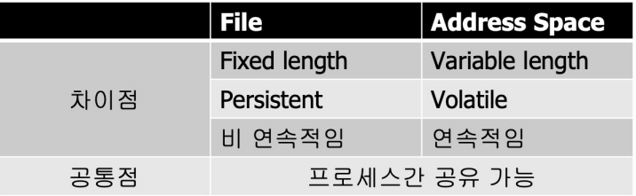](/assets/images/operating-system/13/figure-01.png)
파일이 갖는 속성은 다음과 같다.

[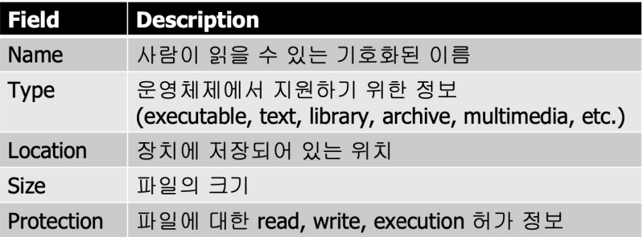](/assets/images/operating-system/13/figure-02.png)
이 외에도 Time, Date, User Information 등의 메타 데이터가 존재한다.

다음은 파일이 가질 수 있는 (파일로 할 수 있는) 연산이다.

[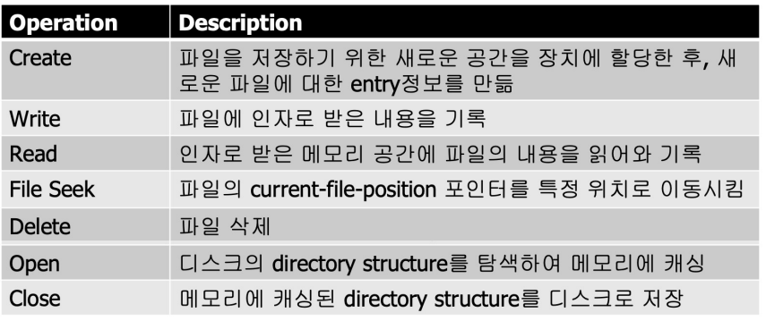](/assets/images/operating-system/13/figure-03.png)
File Seek 연산의 current-file-position이란 File을 읽고 쓸 때마다 현재 파일의 어느 위치에 있는 지를가리키는 포인터이다.

파일은 여러 개의 프로세스가 공유하여 사용할 수 있다. 그렇다면 파일도 프로세스마다 관리되어야 할 필요가 있는데, 이 때 사용하는 것이 OFT(Open File Table)이다.

파일을 접근하는 방법으로는 다음과 같이 두 가지로 존재한다.

- 순차 접근 : File에 대한 정보 접근을 Record 순서대로 접근 하는 것이다.
- 임의 접근 : File의 어떠한 위치라도 바로 접근하여 Read, Write 연산을 수행하는 것이다.

File System이란 파일과 물리적인 저장장치(Disk) 간의 Mapping을 제공하는 장치이다. 파일이 디스크의 어디에 어떻게 저장할 지를 담당하는 장치로 사용자는 파일이 저장된 위치를 알 필요 없게 해준다. 간단하게 생각해서 디스크에 위치해있는 파일 전체를 총칭하기도 한다.

다음은 전형적인 파일 시스템의 모습을 보여준다.

[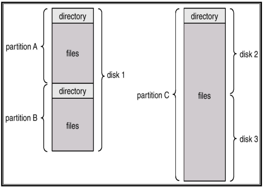](/assets/images/operating-system/13/figure-04.png)

**디스크와 파티션의 구성**

```text
Disk 1
 ├→ Partition A [directory / files]
 └→ Partition B [directory / files]

Disk 2 + Disk 3 → Partition C [directory / files]
```
파일 시스템은 다음과 같이 계층적으로 구성된다.

[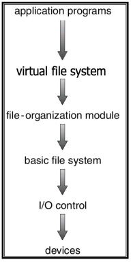](/assets/images/operating-system/13/figure-05.png)

**파일 시스템의 계층**

```text
Application Programs
    ↓
Virtual File System
    ↓
File-organization Module
    ↓
Basic File System
    ↓
I/O Control
    ↓
Devices
```
이렇게 계층적으로 나뉘는 이유는 파일 시스템을 구현하려는 장치가 다양할 수 있다는 점과 하나의시스템에서 여러 개의 파일 시스템을 사용하기 위함과 계층화된 구성을 통해 유연성을 제공하기 위함이다.

파일 시스템을 사용하려면 (= 물리적인 장치에 접근하려면) 'Mount' 라는 명령을 수행해야 한다. 이는 디렉터리와 임의의 Device를 연결하는 명령이며, 분산된 파일 시스템을 구현하기에 아주 용이한 명령이다. 다음은 디스크 하나를 특정 디렉터리에 연결 시키는 과정을 보여준다.

[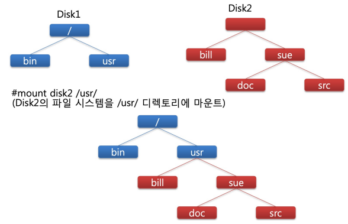](/assets/images/operating-system/13/figure-06.png)

**디렉터리에 파일 시스템 마운트**

```text
Disk 2의 파일 시스템 ──mount disk2 /usr/──→ Disk 1의 /usr/

/
├→ bin
└→ usr  [Disk 2의 마운트 지점]
    ├→ bill
    └→ sue
        ├→ doc
        └→ src
```

<!-- section -->

## 2. Directory Structure Concept

[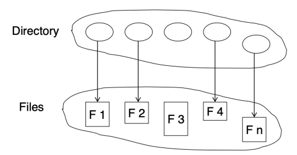](/assets/images/operating-system/13/figure-07.png)

**디렉터리 엔트리와 파일 연결**

```text
Directory
 ├→ Entry 1 → File F1
 ├→ Entry 2 → File F2
 ├→ Entry 3 → File F3
 ├→ Entry 4 → File F4
 └→ Entry n → File Fn
```
디렉터리란 소속된 파일에 대한 정보를 가진 집합이다. 둘 다 모두 디스크 안에 존재한다.

디렉터리 구조는 다음과 같이 다양하게 존재한다.

- Single-level Directory : 모든 사용자가 하나의 단일 디렉터리만을 갖는 구조

    [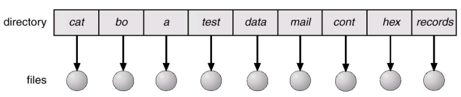](/assets/images/operating-system/13/figure-08.png)

    **단일 디렉터리**

    ```text
    하나의 Directory
     ├→ cat   ├→ bo    ├→ a       ├→ test
     ├→ data  ├→ mail  ├→ cont    ├→ hex    └→ records

    각 엔트리 → 대응하는 파일
    ```
- Two-level Directory : 사용자마다 여러 디렉터리를 갖도록 분리시킨 구조

    [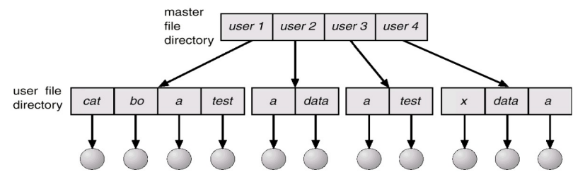](/assets/images/operating-system/13/figure-09.png)

    **사용자별 디렉터리**

    ```text
    Master File Directory
     ├→ user 1 → [cat / bo / a / test] → 각 파일
     ├→ user 2 → [a / data]           → 각 파일
     ├→ user 3 → [a / test]           → 각 파일
     └→ user 4 → [x / data / a]       → 각 파일
    ```
- Tree-Structured Directories : 사용자가 계층적인 트리 형태의 디렉터리를 갖는 구조이며, 현재 대부분의 운영체제는 Tree 구조의 디렉터리를 사용하고 있다. 효율적인 탐색과 그룹핑 특성을 갖기 때문이다

    [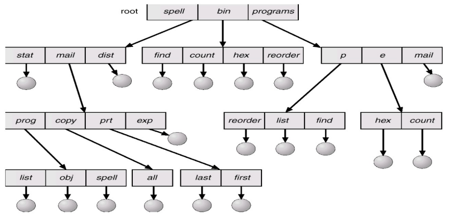](/assets/images/operating-system/13/figure-10.png)

    **트리 디렉터리의 경로**

    ```text
    root
     ├→ spell
     │   ├→ stat
     │   ├→ mail
     │   │   ├→ prog → [list / obj / spell]
     │   │   ├→ copy → [all]
     │   │   ├→ prt  → [last / first]
     │   │   └→ exp
     │   └→ dist
     ├→ bin → [find / count / hex / reorder]
     └→ programs
         ├→ p → [reorder / list / find]
         ├→ e → [hex / count]
         └→ mail
    ```

<!-- section -->

## 3. File의 구현

파일을 구현하는 데에 있어, 파일의 내용을 담고 있는 Data Block의 위치 정보를 어떻게 저장할 지를 고려해야 한다. 운영체제는 다음과 같은 방식으로 Data Block 정보를 관리하고 있다.

- Contiguous Allocation : 파일을 물리적으로 연속된 Disk Block에 저장하는 것이다. 구현이 간단하고 전체 파일을 읽는 경우에 성능이 매우 뛰어난 방식이지만 파일은 반드시 한번에 끝까지 기록되어야 하고, 운영체제에서 파일의 끝에 예비용 Block을 남기는 경우에는 Disk의 공간을 낭비하게 된다.

    [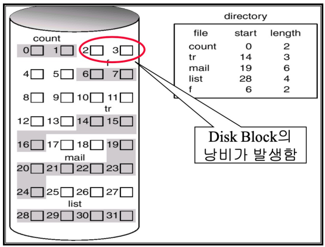](/assets/images/operating-system/13/figure-11.png)

    **연속 할당된 파일 블록**

    ```text
    Directory [file, start, length]
     count → start 0,  length 2 → Block 0 ~ 1
     tr    → start 14, length 3 → Block 14 ~ 16
     mail  → start 19, length 6 → Block 19 ~ 24
     list  → start 28, length 4 → Block 28 ~ 31
     f     → start 6,  length 2 → Block 6 ~ 7

    그림에서 Block 2 ~ 3은 비어 있는 공간으로 표시된다.
    ```
- Linked List Allocation : Disk Block을 Linked list로 구현하여, 파일의 데이터를 저장하는 방식이다.공간의 낭비가 없고, 어느 위치든 접근할 수 있다는 장점이 있지만 무조건 순차적인 탐색을 수행해야한다. 또, Data Block 안에 다음 Data Block이 저장될 포인터를 저장해야 하므로, Data Block의 크기가 2의 배수가 아닐 수 있게 되는데 이는 read/write 연산의 성능이 떨어질 우려가 있다. (대부분의 read/write 연산이 2의 배수 크기의 Data를 다루기 때문)

    [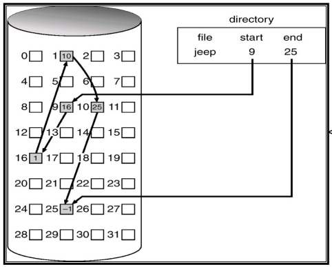](/assets/images/operating-system/13/figure-12.png)

    **연결 리스트의 블록 순서**

    ```text
    Directory: jeep [start = 9, end = 25]
                        │
                        ▼
                     Block 9 → Block 16 → Block 1 → Block 10 → Block 25 → -1

    화살표는 각 블록 안에 저장된 다음 블록 포인터이다.
    ```
- Linked List Allocation using an Index : File 내의 데이터 블록 하나를 Index로 사용하여 모든 Data Block의 위치를 Index Block에서 알 수 있도록 한다. 이를 통해 임의 접근이 가능해지게 되지만, 파일의 최대 크기가 고정된다는 단점이 있다.

    [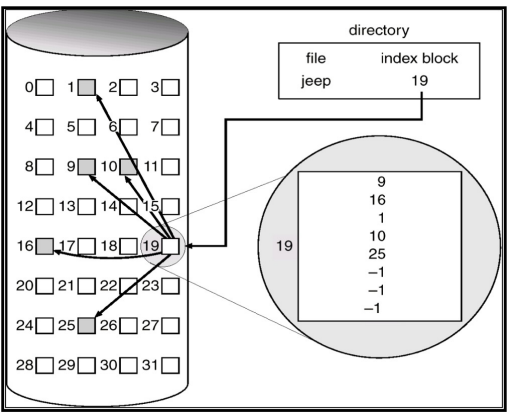](/assets/images/operating-system/13/figure-13.png)

    **인덱스 블록을 통한 데이터 접근**

    ```text
    Directory: jeep → Index Block 19
                          ├→ Data Block 9
                          ├→ Data Block 16
                          ├→ Data Block 1
                          ├→ Data Block 10
                          └→ Data Block 25
    ```
- I-nodes : File에 대한 Data block index들을 테이블 형태로 관리하는 방법이다. 큰 메모리 영역에서 Multi-level paging을 사용하여 관리하는 것과 유사한 방식이다.


    I-node의 구성 요소

    - File에 대한 속성을 나타내는 Field
    - 작은 크기의 파일을 위한 Direct index
    - File의 크기가 커짐에 따라 요구되는 Data Block의 인덱스를 저장하기 위한

        Index Table (Single indirect block, Double indirect block, Triple indirect block)


    [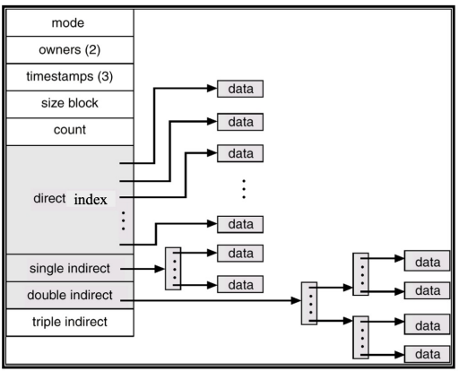](/assets/images/operating-system/13/figure-14.png)

    **I-node의 직접·간접 참조**

    ```text
    I-node [mode / owners / timestamps / size / count]
     ├→ Direct index ──────────────────────────────→ Data
     ├→ Single indirect → Index Table ─────────────→ Data
     ├→ Double indirect → Index Table → Index Table → Data
     └→ Triple indirect → Index Table → Index Table → Index Table → Data
    ```

<!-- section -->

## 4. Directory의 구현

파일 시스템이 파일을 어떻게 구현 하느냐에 따라 디렉터리의 구현도 달라진다. (정확히는 디렉터리Entry를 구성하는 Field가 달라짐) 일반적인 디렉터리 엔트리에는 파일명, 속성과 같은 정보가 포함되어있으나 I-node를 사용하는 파일 시스템에서 디렉터리 엔트리는 파일명, I-node Number만이 저장된다.

- MS-DOS : 파일의 구현이 Linked List Allocation인 MS-DOS에서의 디렉터리 엔트리는 다음과 같다.

    [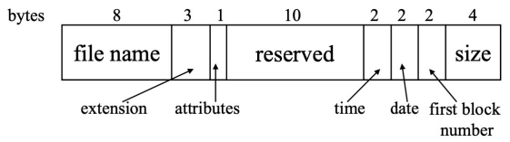](/assets/images/operating-system/13/figure-15.png)
    디렉터리 엔트리의 파일 Block의 번호를 통해 실제 파일의 Data Block이 시작되는 블럭을 알 수 있다. Linked List 방식이기 때문에, Data block의 시작 주소와 크기만 알면 전체 파일의 Data들을 접근할 수 있게 된다.


- Unix : Unix는 파일의 구현으로 I-node를 사용하기 때문에 디렉터리 엔트리가 다음과 같다.

    [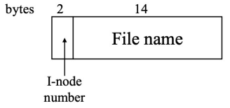](/assets/images/operating-system/13/figure-16.png)
    해당 엔트리를 보고, I-node에 접근하여 다음과 같이 파일에 대한 정보와 파일 내의 데이터에 접근할 수 있게 된다.

    [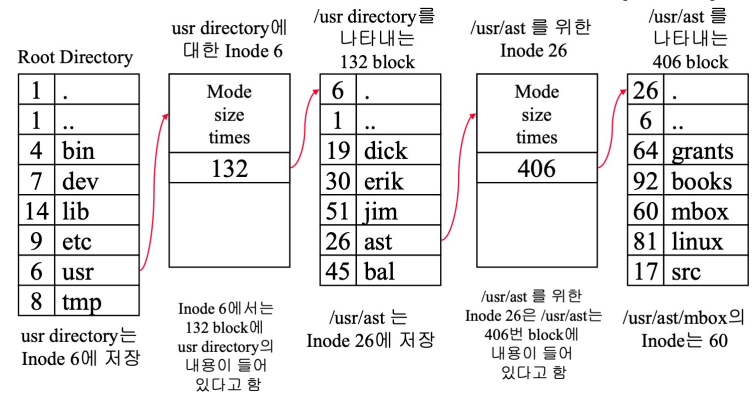](/assets/images/operating-system/13/figure-17.png)

    **경로를 따라 I-node 탐색**

    ```text
    Root Directory의 usr
        → I-node 6
        → Block 132 (/usr 디렉터리 내용)
        → ast 엔트리
        → I-node 26
        → Block 406 (/usr/ast 디렉터리 내용)
        → mbox 엔트리
        → I-node 60 (/usr/ast/mbox)
    ```

<!-- section -->

## 5. Protection

파일 및 디렉터리는 부적절한 접근을 막을 수 있는 보호 기능이 존재한다. 파일의 접근 권한을 두어접근하려는 프로세스를 막는 것이다. 접근 권한으로는 read, write, execute 로 총 세 가지가 있으며 접근하려는 프로세스도 owner, group, public 의 총 세 가지로 나눈다. 이러면 총 아홉 가지의 조합이가능해지는데, 이를 9 Bit로 표현하여 파일 및 디렉터리의 접근 권한을 다음과 같이 나타낸다.

[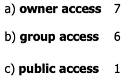](/assets/images/operating-system/13/figure-18.png)
[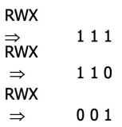](/assets/images/operating-system/13/figure-19.png)
