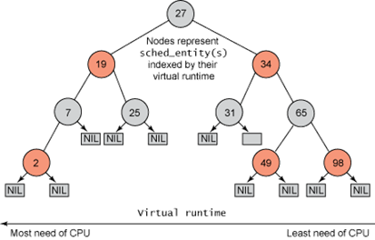

CFS란 Completely Fair Scheduler를 의미하며 Ingo Molnar에 의해 개발되었으며, 리눅스 커널 2.6.23 릴리스에 병합된 스케줄러이다. CFS의 주요 아이디어는, 작업에 processor time을 할당하는 것에 대해 balance를 유지하는 것이다. 이는 프로세스들은 반드시 공평한 양의 프로세서를 받아야 함을 의미한다. 하나 이상의 작업이 다른 작업들에 비해 공정한 양의 시간을 보장받지 못한다면, balance가 무너진 작업들은 실행 시간을 반드시 부여받아야 한다. 이 balance를 결정하기 위해서, CFS는 **virtual runtime(vruntime)**이라 불리는 지정된 작업에게 제공되는 시간의 양을 관리한다.

작업의 virtual runtime(vruntime)은 이상적인 multi-tasking CPU(이상적인 multi-tasking CPU란, CPU가 각각의 작업을 병렬로 정확히 같은 속도로 실행할 수 있는 CPU를 의미한다)에서 해당 작업의 다음 timeslice가 언제 실행될지를 명시한다. 실제 상황에서는, Virtual runtime은 우선순위에 의해 가중치가 부여된 실제 runtime이다.

vruntime += execution time × (default weight/process weight)

작업의 virtual runtime이 작다면, 작업이 프로세스에게 접근할 수 있도록 할당된 시간의 양이 적다는 것을 의미함으로 프로세서의 필요성이 더욱 높다는 것을 의미한다. 따라서 CFS는 vruntime이 가장 작은 프로세스를 선택하게 된다. 오랜 시간 동안 실행되지 못한 프로세스는 상대적으로 vruntime이 작아지게 된다. 따라서 CFS에 의해 선택되게 된다. 이로 인해 starvation은 발생하지 않는다.

CFS는 대기자(sleeper) 공평성이라는 개념 또한 포함하고 있는데, 이는 현재 진행될 수 없는 작업(I/O를 기다리는 작업 등)이 나중에 실제로 그들이 프로세서가 필요해졌을 때 기다렸던 시간과 비슷한 프로세서 시간을 받을 수 있도록 보장한다.

CFS는 작업들은 run queue에 보관하는 대신, 시간 정렬된 red-black tree를 사용한다. Red-black tree는 자가 균형 이진 탐색 트리로서, 트리의 연산이 O(log n) 시간에 발생한다. 따라서 insert와 delete를 빠르고 효율적으로 할 수 있다.

[](/assets/images/kernel/cfs/figure-01.png)

**vruntime에 따른 CFS red-black tree**

```text
vruntime이 작은 작업 ← red-black tree → vruntime이 큰 작업
         ↓
가장 왼쪽 노드 선택 → CPU 실행 → vruntime 갱신
                                    ↓
                          종료되지 않았다면 트리에 재삽입
```

위 그림은 CFS가 사용하는 시간 정렬된 red-black tree의 예시이다. 가장 낮은 vruntime을 갖는 작업은 트리의 왼쪽 부분에 저장되고, 높은 vruntime을 갖는 작업은 트리의 오른쪽 부분에 저장된다. 스케줄러는 공정성을 유지하기 위해 다음으로 실행될 작업으로 트리의 가장 왼쪽 부분에 있는 노드를 선택하게 된다. 작업은 vruntime에 실행 시간을 더하는 방식으로 CPU에서 구동된 시간을 계산하고, 종료되지 않았다면 트리에 다시 insert 된다. 이 방식으로, 트리의 왼쪽 부분에 있는 작업들은 실행되고 트리의 오른쪽에 있는 작업들은 왼쪽 부분으로 옮겨지면서 실행 시간의 balance를 유지하게 된다.

CFS는 group scheduling이라는 개념을 제공한다. Group scheduling은 공평한 scheduling을 제공하는 또 하나의 방법으로 많은 작업들을 생성하는 작업을 다룰 때 유용하다. 모든 작업들이 공평하게 구성되는 대신에 싱글 작업은 고유의 virtual runtime을 유지하는 반면, 여러 작업을 생성하는 프로세스는 그들의 virtual runtime을 그룹 단위로(계층 구조) 공유하게 된다. 이 방법으로 싱글 작업은 그룹과 거의 유사한 스케줄링을 시간을 제공받을 수 있다.
