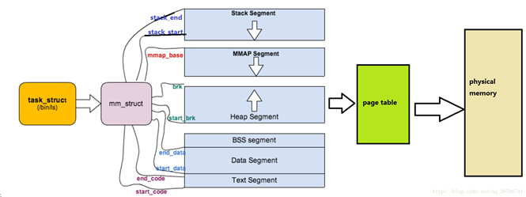

리눅스에선 모든 유저 프로세스는 virtual memory space를 할당 받는다. 다양한 프로세스가 메모리를 사용하기 때문에, 커널은 유저 프로세스의 메모리를 관리할 필요가 있다.  이를 위해 mm_struct라는 memory descriptor가 존재한다. 

mm_struct은 유저 프로세스의 메모리를 관리하기 위한 구조체이다. 리눅스 커널에서는 프로세스가 존재하면, 프로세스를 관리하기 위한 task_struct가 하나 존재하고, 또 그 task가 사용하는 메모리를 관리하기 위한 mm_struct가 존재하고, 이 두 개가 1:1로 매핑이 되어있다. mm_struct에는 프로세스들의 virtual memory area list와 page table, 그리고 메모리 관리와 관련된 다양한 bit들이 들어있다. 멤버가 다양하기에, 모든 멤버에 대한 설명은 하지 않고 몇몇 멤버에 대한 설명을 진행하겠다. mm_struct는 include/linux/mm_types.h에서 확인할 수 있다.

- struct vm_area_struct *mmap: 가상 메모리 영역(VMA)의 리스트이다. VMA 하나하나가, virtual memory area를 관리하고, 이것들이 list로 형태로 구현되어 있고 mmap은 이를 가리키는 포인터이다. vm_area_struct는 가상 메모리 공간의 다양한 영역을 관리하기 위한 구조체이다. 해당 구조체의 멤버로는, VMA의 사이즈를 나타내는 변수(vm_start, vm_end), 이전과 다음 VMA 구조체를 가리키는 포인터(vm_prev, vm_next), 속성을 나타내는 flag(vm_flags), function pointer(vm_ops) 등등이 존재한다.

- struct rb_root mm_rb: mmap의 원소와 동일하지만, red-black tree 구조이다. vm_area_struct 구조체가 수천, 수만이 되는 특수한 앱을 고려하여 도입됐다. 영역의 시작 주소를 나타낸다.

- atomic_t mm_users: mm_struct의 주소 공간을 사용 중인 task의 개수를 나타낸다. Multi-thread의 경우에 적합하다. 예를 들어, 하나의 프로세스 메모리를 공유하는 thread 개수가 5개라면, mm_users는 5가 된다.

- atomic_t mm_count: mm_struct의 참조 카운트이다. 0이 된다면 mm_struct는 free된다.

- atomic_long_t nr_ptes: PTE page table entry

- int map_count: VMA의 개수를 나타낸다.

- pgd_t *pgd: 글로벌 디렉토리의 시작 주소이다. Page global directory는 가상 주소를 물리 주소로 변환하기 위한 최상위 테이블이다.

- unsigned long task_size: task의 VM space 사이즈를 나타낸다.

- spinlock_t page_table_lock: Page table과 몇몇 counter들을 보호한다.

- struct list_head mmlist: Swapped된 mm들의 list이다.

[](/assets/images/kernel/mm-struct/figure-01.png)

**task_struct와 mm_struct, 가상 메모리 및 페이지 테이블**

```text
task_struct → mm_struct → 가상 메모리 영역 → page table → physical memory
                              ├─ Stack (↓)
                              ├─ MMAP  (↓)
                              ├─ Heap  (↑)
                              ├─ BSS
                              ├─ Data
                              └─ Text
```

위 그림은, mm_struct에서 segment들을 나타내는 변수들에 대해 설명한다. Linux-4.4 버전을 기준으로 맨 위의 stack_end와 stack_start를 제외하고는 전부 mm_struct에 존재하는 멤버이다. Stack은 start_stack 멤버가 시작 위치를 나타내는 형태이다.

- unsigned long start code, end_code: Text segment를 가리킨다. 해당 영역은 프로그램 code로 구성된다.

- unsigned long start_data, end_data: Data segment를 가리킨다. 해당 영역은 전역 변수로 구성된다.

- unsigned long start_brk, brk: Heap segment를 가리킨다. 각각 영역의 시작과 끝을 나타낸다.

- unsigned long start_stack: Stack의 시작 위치를 나타낸다.

- unsigned long arg_start, arg_end: arg_start와 arg_end 사이에는 task의 초기화인자인 argv가 들어간다.

- unsigned long env_start, env_end: env_start와 env_end 사이에는 환경변수인 env가 들어간다.
