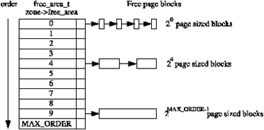
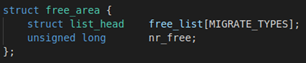
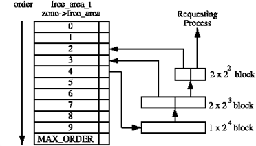
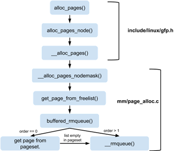
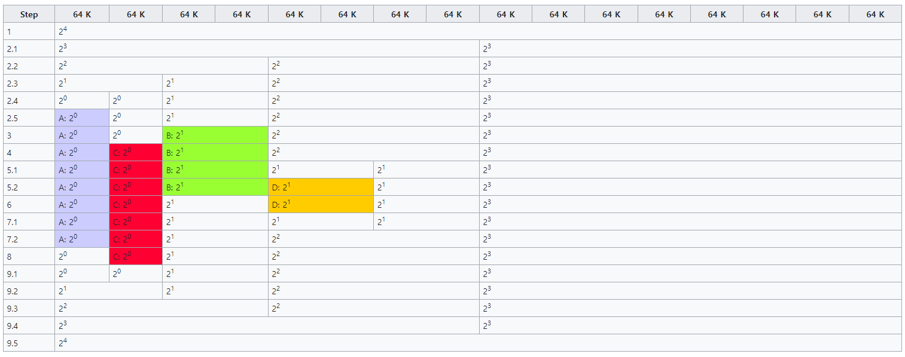
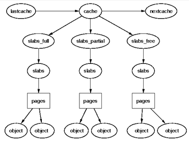

[Buddy Allocation](#buddy-allocation)

[Slab Allocation](#slab-allocation)

## Buddy Allocation

Linux 커널에서는 physical memory를 page단위로 관리한다. 그런데, 서로 다른 크기의 연속적인 페이지들을 빈번하게 할당 및 해제하는 경우에는 외부 단편화(External fragmentation)가 생기는 단점이 있다. 이는, 남은 공간은 충분해 보이지만 실제 커널이 요청한 사이즈를 처리할 수 있는 연속된 페이지가 없는 상황을 의미한다. Buddy allocation system은 이런 외부 단편화를 줄이기 위해 탄생하였고, 이를 통해 연속적인 페이지 단위로 관리가 가능하다.

Buddy allocation system에서, 메모리는 페이지들로 구성된 큰 block들로 쪼개지는데, 각각의 block은 page 수의 2의 거듭제곱 값이다. 만약 요구되는 사이즈의 block이 가능하지 않다면, 큰 block은 2개로 반반 나누어지고 쪼개진 2 block은 buddy가 된다. 하나는 allocation에 사용되고, 나머지 하나는 free block이 된다. Block은 원하는 크기의 block이 가능해질 때까지 계속 반으로 준다. Block이 후에 free된다면, buddy를 검사하여 free라면, buddy 두 개를 병합한다.

### 1. Managing Free Blocks

[](/assets/images/kernel/physical-page-allocation/figure-01.png)

**order별 free_area와 free page block 연결 리스트**

```text
zone → free_area[order] → free page block → free page block → …
                ├─ order 0 : 블록당 2^0 pages
                ├─ order 4 : 블록당 2^4 pages
                └─ order MAX_ORDER-1 : 블록당 2^(MAX_ORDER-1) pages
```

Buddy allocator는 free page들의 block을 유지하는데, 각각의 block은 page 수의 2의 거듭제곱 값을 갖는다. 여기서, 지수 부분을 우리는 order라고 표현한다. 예를 들어 order가 3인 경우, 하나의 block은   free page로 구성 된다. Buddy system은 free되어 있는 order page들을 free_area라는 구조체로 관리한다. 각각의 order에 대해서, free_area구조체의 array가 유지되며, free 상태인 page들로 구성된 block들의 linked list를 가리키는 형태이다. 

위의 그림을 통해 이를 확인할 수 있다. 0번째 원소의 경우 array는 block의 크기가   2^0page인 free page block들의 list을 가리킨다. 1번째 원소의 경우  2^1이 되고, 최대 값은 2^MAX_ORDER 개수의 페이지들이 된다. 이 방식은, 작은 block들로 충분한 요청을 충족하기 위해 큰 block들이 분할될 가능성을 제거한다. 이렇게 각각의 사이즈에 대해서 free block들의 list를 유지하면서, 요구되는 사이즈의 block을 찾기가 쉬워진다. Page block들은 단방향 연결 리스트로 연결되어 있다. X86에서는 MAX_ORDER가 11로 설정된다.

각각의 zone은 free_area 구조체의 array인 free_area[MAX_ORDER]를 갖는다. free_area의 구조는 다음과 같다.

[](/assets/images/kernel/physical-page-allocation/figure-02.png)

멤버 중 free_list란, free상태인 page block들의 linked list이다. nr_free는 현재 Order_page에 free되어 있는 페이지들의 개수가 담겨있다.

### 2. Allocation Pages

리눅스는 page 할당을 위해 다양한 API들을 제공한다. API들은 gfp_mask를 인자로 가지며, 이는 어떻게 allocator가 행동해야 할 지 결정해주는 flag들의 집합이다.

할당은 항상 특정 order로 이루어진다. 예를 들어, order가 0인 경우에는 페이지 하나만이 요구되는 경우이다. 요청된 order에서 free block을 찾을 수 없다면, 높은 order block은 2개의 buddy로 나눠지게 된다. 하나는 할당되고, 나머지 하나는 낮은 order의 free list에 추가된다. 다음 그림은, 2^4 block이 요청된 사이즈까지 나누어지며, buddy들이 free list에 추가되는 과정을 보인다.

[](/assets/images/kernel/physical-page-allocation/figure-03.png)

**큰 블록을 분할하여 요청에 할당하는 과정**

```text
order 4: 2^4 pages
         ↓ 분할
order 3: 2^3 pages + 2^3 pages → order 3 free list
         ↓ 분할
order 2: 2^2 pages + 2^2 pages → order 2 free list
         ↓
    요청한 프로세스에 할당
```

Block이 후에 free된다면, buddy가 체크되고, buddy마저 free라면 높은 order의 block으로 합쳐지고, free list에서 더 높은 order 쪽으로 붙게 된다. 그리고 다시 buddy를 check하고, free라면 위 과정을 계속 반복한다. List를 재구성 하는 과정 동안에는, interrupt들은 list가 inconsistent state가 되는 것을 방지하기 위해 disable 되어야 한다.

[](/assets/images/kernel/physical-page-allocation/figure-04.png)

**alloc_pages부터 buddy allocator까지의 함수 호출 흐름**

```text
alloc_pages()
  ↓
alloc_pages_node()
  ↓
__alloc_pages()
  ↓
__alloc_pages_nodemask()
  ↓
get_page_from_freelist()
  ↓
buffered_rmqueue()
  ├─ order == 0 → get page from pageset
  │                         └─ pageset이 비어 있음 → __rmqueue()
  └─ order > 1 ──────────────────────────────────→ __rmqueue()
```

위 그림은 alloc_page함수 call에서 buddy를 다루는 과정까지의 함수들의 call flow를 나타낸 것이다. __alloc_pages_nodemask는 메모리 할당에 있어서 핵심 부분이다.

### 3. Free pages

Buddy가 free되면, linux는 가능하다면 즉시 buddy들을 합치려고 한다. 이는 동일한 block에 대해 분할을 한 직후 많은 병합이 일어나는 최악의 경우 때문에 optimal 하지는 않다. 과거 커널 버전(2.6)에서는, free_area 구조체에 nr_free 대신 unsigned long pointer 타입의 map 변수(bitmap)가 존재했고, 해당 변수를 통해서 buddy가 merge될 수 있는지 없는지 감지했다. 

하지만, 본 과제에서 사용하는 커널 버전 4.4에서는 해당 변수가 삭제되고, order에 속한 page들의 개수를 의미하는 nr_free 멤버가 사용된다. 최신 커널을 분석한 글을 찾아본 결과, 

buddy를 &lt;page number&gt; + 2^order로 찾는다고 되어있다. 이를 통해 map 없이도, buddy의 상태를 파악할 수 있을 것이다. Wiki의 설명에 따른다면, 인접한 block의 free여부를 체크하고, free라면 두 개를 병합하며 인접 block이 non-free일 때까지 병합을 반복한다 되어있다.

결론적으로, 과거의 방식과 현재의 방식 모두 한 block이 free됐을 때 그 block의 buddy도 free 상태라면 두 개를 merge하는 것을 동일하다.

### 4. Example

예시를 들어 buddy allocation의 과정을 설명하겠다. Wiki의 예시를 통해 설명하겠다. 먼저, 시스템이 갖는 가장 작은 block(page가 1개로 구성된 block)은 64K라는 가정이다. Order의 최대값은 4이다. 따라서 할당 가능한 가장 큰 block은 16 X 64K = 1024K가 된다. 다음의 그림은, 단계별로 메모리의 상태를 나타낸다.

[](/assets/images/kernel/physical-page-allocation/figure-05.png)

1. 초기 상태이다. Block은 16개의 page로 구성되어있다.
2. Program A가 34K 메모리 할당을 요청했다. 가장 작은 block의 크기가 64K이니, 해당 경우에서order는 0이 된다. 다음의 시나리오를 통해 A에게 block이 할당된다.
    1. 4 page로 구성된 block이 2개로 나누어져 order가 3인 block이 된다. 하나는 order 3의 free list에 추가된다.
    2. 여전히 order 0 block이 없기에 order 3 block을 2개로 나누어 order가 2인 block을 얻는다.
    3. 여전히 order 0 block이 없기에 order 2 block을 2개로 나누어 order가 1인 block을 얻는다.
    4. 여전히 order 0 block이 없기에 order 1 block을 2개로 나누어 order가 0인 block을 얻는다.
    5. 이제 order 0 block 하나를 A에게 할당한다.
3. Program B가 66K 메모리 할당을 요청했다. 이는 order가 1인 경우이다. Order 1의 free list에 block이 하나 있기에, 이를 B에 할당한다.
4. Program C가 35K 메모리 할당을 요청했다. 이는 order가 0인 경우이다 Order 0의 free list에 block이 하나 있기에, 이를 C에 할당한다.
5. Program D가 67K 메모리 할당을 요청했다. 이는 order가 1인 경우이다.
    1. Order 1 block이 없기에, order 2 block을 2개로 나누어 order가 1인 block을 얻는다.
    2. Order가 1인 block 하나를 D에게 할당한다.
6. Program B가 메모리를 해제했다. 사용하던 order 1 block을 free한다. Buddy를 살펴봤지만, allocate 됐기에 병합하지 않는다.
7. Program D가 메모리를 해제했다.
    1. 사용하던 order 1 block을 free한다. Buddy를 살펴봤는데, buddy역시 free인 상태이다.
    2. 따라서 해당 block과 buddy block을 병합한다. 이는 order 2 block이된다..
8. Program A가 메모리를 해제했다. 사용하던 order 0 block을 free한다. Buddy를 살펴봤지만, allocate 됐기에 병합하지 않는다.
9. Program C가 메모리를 해제했다.
    1. 사용하던 order 0 block을 free한다. Buddy를 살펴봤는데, buddy 역시 free인 상태이다.
    2. 따라서 해당 block과 buddy block을 병합한다. 이는 order 1 block이 된다.
    3. 병합된 order 1 block의 buddy block을 보니 이것 또한 free상태이다. 따라서 두 block을 병합하여 order 2 block을 만든다.
    4. 병합된 order 2 block의 buddy block을 보니 이것 또한 free 상태이다. 따라서 두 block을 병합하여 order 3 block을 만든다.
    5. 병합된 order 3 block의 buddy block을 보니 이것 또한 free 상태이다. 따라서 두 block을 병합하여 order 4 block을 만든다.

최종 상태는, 모든 program들이 memory 할당을 해제하여 다시 16page 크기의 block만이 남은 모습이다.

### 5. Fragmentation

Dynamic allocation과 비교해본다면, buddy system은 external fragmentation이 거의 없다. 하지만 Internal fragmentation은 발생 가능하다. internal fragmentation이란, 큰 block이 작은 request를 수행하기 위해 할당 됐을 때 공간이 낭비되는 현상이다. 이를 피하기 위해서 페이지들을 작은 메모리 block들로 나누기 위해 slab allocator를 사용한다.

[https://www.kernel.org/doc/gorman/html/understand/understand009.html](https://www.kernel.org/doc/gorman/html/understand/understand009.html)

[https://www.win.tue.nl/~aeb/linux/lk/lk-9.html](https://www.win.tue.nl/~aeb/linux/lk/lk-9.html)

[https://wogh8732.tistory.com/402](https://wogh8732.tistory.com/402)

[https://woodz.tistory.com/57](https://woodz.tistory.com/57)

[https://en.wikipedia.org/wiki/Buddy_memory_allocation](https://en.wikipedia.org/wiki/Buddy_memory_allocation)

Image: [https://woodz.tistory.com/58?category=356363](https://woodz.tistory.com/58?category=356363), [https://www.kernel.org/doc/gorman/html/understand/understand009.html](https://www.kernel.org/doc/gorman/html/understand/understand009.html),  [https://en.wikipedia.org/wiki/Buddy_memory_allocation](https://en.wikipedia.org/wiki/Buddy_memory_allocation)

## Slab Allocation

Kernel memory를 할당하기 위해 사용하는 두 번째 전략은 slab allocation이다. 이는 allocation과 deallocation 과정으로부터 야기되는 단편화(fragmentation) 억제한다.

Slab allocator의 기본 아이디어는, 흔히 사용되는 object들의 cache를 kernel에서 사용할 수 있도록 초기화된 상태로 유지하는 것이다. Slab allocator에 의해 할당된 object가 사용 이후에 release 된다면, slab allocation system은 일반적으로 파괴 작업을 수행하는 대신에 다음번에 해당 type의 object가 필요할 때 재사용 할 수 있도록 해당 object를 cache된 상태로 유지한다. 이 작업이 없다면, 같은 object를 할당하고, 초기화하고, 해제하는데 많은 시간을 사용해야 할 것이다.

Slab allocator는 3가지 주요 목표를 갖는다.

1. Buddy system에 의해 유발되었던 내부 단편화를 줄이기 위해, 메모리의 작은 block을 할당한다.
2. 자주 사용되는 object들을 caching한다. 따라서 system이 해당 object들을 할당하거나, 초기화 하거나 파괴하는 대 있어 시간을 낭비하지 않는다.
3. L1 또는 L2 cache에 object를 aligning하여 하드웨어 cache를 좀 더 잘 사용한다.

Buddy allocator에 의해 발생했던 내부 단편화를 줄이기 위해서, 2^5~2^17byte 범위의 작은 메모리 buffer를 갖는 cache들의 두 집합이 유지된다. 한 cache 집합은 DMA 장치를 이용할 때 사용된다. 작은 메모리가 할당되어야 할 때(예: 32byte) buddy allocator에서는 최소 할당 단위가 1page였기에 (일반 시스템 기준) 4KB를 무조건 할당해야 했다. 하지만 slab allocator는 2^5~2^17byte 범위의 작은 메모리들을 cache에 유지하며, 사용자의 요구가 들어왔을 때 요구 사항과 가장 가까운 메모리를 할당한다. 이로써 내부 단편화 문제가 해결되어 시스템의 성능이 향상된다.

Slab allocator의 2번째 임무는, 자주 사용되는 object들에 대한 cache를 유지하는 것이다. Kernel에서 사용되는 많은 구조체들은 해당 object를 초기화 하는데 필요한 시간이, 그것들을 위한 공간을 할당하는 시간을 초과한다. 새로운 slab이 만들어질 때, 많은 object들은 해당 slab으로 들어가고, constructor를 사용하여 초기화된다. Object가 free될 때는 object 할당을 빠르게 하기 위해서 초기 상태로 남겨진다.

Slab allocator의 마지막 임무는 하드웨어 cache의 활용이다. 이를 위해 slab에 object가 부여된 이후에도 공간이 남아있다면, 남아있는 공간을 slab coloring에 사용한다. Slab coloring은 서로 다른 slab에 있는 object가 cache의 다른 line을 사용하도록 하는 scheme이다. 다른 slab에서 동일한 offset에 있는 object는 같은 cache line으로 mapping될 가능성이 높고, 이는 memory cycle이 낭비될 가능성이 높아지게 된다. 이를 막기 위해 남아있는 공간의 byte를 사용하여 slab에 color를 부여한다. 

이는, slab이 생성될 때마다 버퍼의 시작 주소를 조금씩 다르게 하는 것을 의미한다.  예를 들어 200byte의 object 크기를 갖고, 8byte를 기준으로 aligning하는 cache가 있다면, 첫 번째 slab에서는 버퍼의 주소가 0, 200, 400이 되고, 두 번째 slab에서는 8, 208, 408이 되는 형태이다.

Slab allocation을 사용하면, 특정 type 또는 크기에 대한 object의 cache가 pre-allocate 된 많은 slab을 갖는다. 각 slab에는 object에 적합한 고정 크기의 메모리 chunk들이 존재한다. Slab allocator는 이러한 chunk를 계속 파악하고 있으므로, 특정 타입 data object를 위한 memory 할당을 요청 받으면, 존재하는 slab의 free chunk를 통하여 요청을 처리할 수 있다. 

Allocator가 object의 메모리를 free하도록 요청 받으면, 해당 chunk를, 이를 포함하는 slab의 free chunk 목록에 추가하면 된다. 동일한 type의 object를 만들거나, 같은 크기의 메모리를 할당하는 요청이 다음에 온다면 이전에 free chunk에 추가했던 memory slot을 반환하고 이를 free chunk 목록에서 제거하는 방식으로 간단하게 해결 가능하다. 이러한 방식을 통해 적합한 메모리 공간을 찾는 탐색 시간을 줄일 수 있고, 내부 단편화 문제를 해결할 수 있다.

Slab allocator는 다양한 cache 수로 구성되며, cache들은 cache chain이라 불리는 doubly linked circular link 형태로 묶여있다. Slab allocator 관점에서의 cache는 특정 type의 여러 object들의 관리자이다. 각각의 cache는 slab이라 불리는, 메모리에서 연속된 페이지들의 block들을 유지하고 있으며, slab은 cache가 관리하는 data structure나 object들을 위해 작은 chunk들로 조각나 있다. 구조를 표현하자면 다음 그림과 같다.

[](/assets/images/kernel/physical-page-allocation/figure-06.png)

**cache와 slab 상태별 페이지 및 object 구조**

```text
lastcache → cache → nextcache
              ├─ slabs_full    → slabs → pages → objects
              ├─ slabs_partial → slabs → pages → objects
              └─ slabs_free    → slabs → pages → objects
```

Slab과 cache에 대해 정리하자면 다음과 같다.

- Cache: Cache는 빠른 메모리의 작은 양을 나타낸다. Cache는 semaphore, process descriptor, file object와 같은 특정 type의 object의 저장소이다. Cache는 하나 이상의 slab으로 구성된다. 각각의 kernel 데이터 구조체에 대해 single cache가 존재한다.
- Slab: Slab은 물리적으로 연속된 하나 이상의 page들로 구성된다. Slab은 object와 연관된 데이터의 실제 container이다.

프로그램이 cache를 설정할 때, 해당 cache와 연관된 다양한 object들을 slab에 할당한다. 개수는 연관된 slab의 크기에 따라 결정된다. Slab은 empty, partial, full 상태로 존재할 수 있다.

- Empty(free): Slab상의 모든 object들이 free 상태이다.
- Partial: Slab은 사용되는 object와 free인 object 둘 다 포함하는 상태이다.
- Full: Slab 상의 모든 object가 사용되는 상태이다.

처음엔 시스템은 각각의 slab을 empty 상태로 표기한다. 만약 프로세스가 새로운 kernel object를 호출한다면, 시스템은 해당 object type의 cache 안의 partial slab에서 free 공간의 위치를 찾는다. 만약 그러한 위치가 존재하지 않는다면, 시스템은 연속된 물리 page들로부터 새로운 slab을 할당하고, cache에 부여한다. 새로운 object는 해당 slab에 할당되고, 해당 위치는 partial로 표기된다. 할당 과정은 시스템이 사전에 slab으로부터 object들을 할당하기에 빠르게 이루어진다.

Ref

[https://goodtogreate.tistory.com/8](https://goodtogreate.tistory.com/8)

[https://hyeyoo.com/124](https://hyeyoo.com/124)

[https://wogh8732.tistory.com/418](https://wogh8732.tistory.com/418)

[https://en.wikipedia.org/wiki/Slab_allocation](https://en.wikipedia.org/wiki/Slab_allocation)

[https://www.geeksforgeeks.org/operating-system-allocating-kernel-memory-buddy-system-slab-system/](https://www.geeksforgeeks.org/operating-system-allocating-kernel-memory-buddy-system-slab-system/)

[https://www.kernel.org/doc/gorman/html/understand/understand011.html](https://www.kernel.org/doc/gorman/html/understand/understand011.html)
