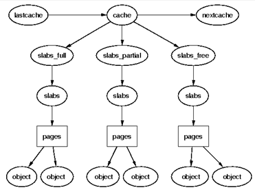

Kernel memory를 할당하기 위해 사용하는 두 번째 전략은 slab allocation이다. 이는 allocation과 deallocation 과정으로부터 야기되는 단편화(fragmentation) 억제한다.

Slab allocator의 기본 아이디어는, 흔히 사용되는 object들의 cache를 kernel에서 사용할 수 있도록 초기화된 상태로 유지하는 것이다. Slab allocator에 의해 할당된 object가 사용 이후에 release 된다면, slab allocation system은 일반적으로 파괴 작업을 수행하는 대신에 다음번에 해당 type의 object가 필요할 때 재사용 할 수 있도록 해당 object를 cache된 상태로 유지한다. 이 작업이 없다면, 같은 object를 할당하고, 초기화하고, 해제하는데 많은 시간을 사용해야 할 것이다.

Slab allocator는 3가지 주요 목표를 갖는다.

1. Buddy system에 의해 유발되었던 내부 단편화를 줄이기 위해, 메모리의 작은 block을 할당한다.
2. 자주 사용되는 object들을 caching한다. 따라서 system이 해당 object들을 할당하거나, 초기화 하거나 파괴하는 대 있어 시간을 낭비하지 않는다.
3. L1 또는 L2 cache에 object를 aligning하여 하드웨어 cache를 좀 더 잘 사용한다.

Buddy allocator에 의해 발생했던 내부 단편화를 줄이기 위해서, 2^5~2^17byte 범위의 작은 메모리 buffer를 갖는 cache들의 두 집합이 유지된다. 한 cache 집합은 DMA 장치를 이용할 때 사용된다. 작은 메모리가 할당되어야 할 때(예: 32byte) buddy allocator에서는 최소 할당 단위가 1page였기에 (일반 시스템 기준) 4KB를 무조건 할당해야 했다. 하지만 slab allocator는 2^5~2^17byte 범위의 작은 메모리들을 cache에 유지하며, 사용자의 요구가 들어왔을 때 요구 사항과 가장 가까운 메모리를 할당한다. 이로써 내부 단편화 문제가 해결되어 시스템의 성능이 향상된다.

Slab allocator의 2번째 임무는, 자주 사용되는 object들에 대한 cache를 유지하는 것이다. Kernel에서 사용되는 많은 구조체들은 해당 object를 초기화 하는데 필요한 시간이, 그것들을 위한 공간을 할당하는 시간을 초과한다. 새로운 slab이 만들어질 때, 많은 object들은 해당 slab으로 들어가고, constructor를 사용하여 초기화된다. Object가 free될 때는 object 할당을 빠르게 하기 위해서 초기 상태로 남겨진다.

Slab allocator의 마지막 임무는 하드웨어 cache의 활용이다. 이를 위해 slab에 object가 부여된 이후에도 공간이 남아있다면, 남아있는 공간을 slab coloring에 사용한다. Slab coloring은 서로 다른 slab에 있는 object가 cache의 다른 line을 사용하도록 하는 scheme이다. 다른 slab에서 동일한 offset에 있는 object는 같은 cache line으로 mapping될 가능성이 높고, 이는 memory cycle이 낭비될 가능성이 높아지게 된다. 이를 막기 위해 남아있는 공간의 byte를 사용하여 slab에 color를 부여한다. 

이는, slab이 생성될 때마다 버퍼의 시작 주소를 조금씩 다르게 하는 것을 의미한다.  예를 들어 200byte의 object 크기를 갖고, 8byte를 기준으로 aligning하는 cache가 있다면, 첫 번째 slab에서는 버퍼의 주소가 0, 200, 400이 되고, 두 번째 slab에서는 8, 208, 408이 되는 형태이다.

Slab allocation을 사용하면, 특정 type 또는 크기에 대한 object의 cache가 pre-allocate 된 많은 slab을 갖는다. 각 slab에는 object에 적합한 고정 크기의 메모리 chunk들이 존재한다. Slab allocator는 이러한 chunk를 계속 파악하고 있으므로, 특정 타입 data object를 위한 memory 할당을 요청 받으면, 존재하는 slab의 free chunk를 통하여 요청을 처리할 수 있다. 

Allocator가 object의 메모리를 free하도록 요청 받으면, 해당 chunk를, 이를 포함하는 slab의 free chunk 목록에 추가하면 된다. 동일한 type의 object를 만들거나, 같은 크기의 메모리를 할당하는 요청이 다음에 온다면 이전에 free chunk에 추가했던 memory slot을 반환하고 이를 free chunk 목록에서 제거하는 방식으로 간단하게 해결 가능하다. 이러한 방식을 통해 적합한 메모리 공간을 찾는 탐색 시간을 줄일 수 있고, 내부 단편화 문제를 해결할 수 있다.

Slab allocator는 다양한 cache 수로 구성되며, cache들은 cache chain이라 불리는 doubly linked circular link 형태로 묶여있다. Slab allocator 관점에서의 cache는 특정 type의 여러 object들의 관리자이다. 각각의 cache는 slab이라 불리는, 메모리에서 연속된 페이지들의 block들을 유지하고 있으며, slab은 cache가 관리하는 data structure나 object들을 위해 작은 chunk들로 조각나 있다. 구조를 표현하자면 다음 그림과 같다.

[](/assets/images/kernel/physical-page-allocation/figure-06.png)

**cache와 slab 상태별 페이지 및 object 구조**

```text
lastcache → cache → nextcache
              ├─ slabs_full    → slabs → pages → objects
              ├─ slabs_partial → slabs → pages → objects
              └─ slabs_free    → slabs → pages → objects
```

Slab과 cache에 대해 정리하자면 다음과 같다.

- Cache: Cache는 빠른 메모리의 작은 양을 나타낸다. Cache는 semaphore, process descriptor, file object와 같은 특정 type의 object의 저장소이다. Cache는 하나 이상의 slab으로 구성된다. 각각의 kernel 데이터 구조체에 대해 single cache가 존재한다.
- Slab: Slab은 물리적으로 연속된 하나 이상의 page들로 구성된다. Slab은 object와 연관된 데이터의 실제 container이다.

프로그램이 cache를 설정할 때, 해당 cache와 연관된 다양한 object들을 slab에 할당한다. 개수는 연관된 slab의 크기에 따라 결정된다. Slab은 empty, partial, full 상태로 존재할 수 있다.

- Empty(free): Slab상의 모든 object들이 free 상태이다.
- Partial: Slab은 사용되는 object와 free인 object 둘 다 포함하는 상태이다.
- Full: Slab 상의 모든 object가 사용되는 상태이다.

처음엔 시스템은 각각의 slab을 empty 상태로 표기한다. 만약 프로세스가 새로운 kernel object를 호출한다면, 시스템은 해당 object type의 cache 안의 partial slab에서 free 공간의 위치를 찾는다. 만약 그러한 위치가 존재하지 않는다면, 시스템은 연속된 물리 page들로부터 새로운 slab을 할당하고, cache에 부여한다. 새로운 object는 해당 slab에 할당되고, 해당 위치는 partial로 표기된다. 할당 과정은 시스템이 사전에 slab으로부터 object들을 할당하기에 빠르게 이루어진다.
