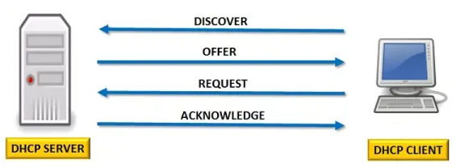

## Domain, DNS

호스트의 3계층 주소는 사람이 기억하기 쉽지 않다. 이에 사람이 쉽게 기억할 수 있는 주소 체계가 바로 7계층 주소(= <u>HTTP 프로토콜을 사용하는 주소</u>)인데, 이를 **Domain**이라 부른다. 

즉, 어떤 호스트가 외부의 호스트와 통신하기 위해 3계층 주소를 알고 있을 필요는 없고, 사람이 이해하기 쉬운(= **www.naver.com**, **www.google.com**와 같은) 주소만 알고 있으면 통신이 가능해진다.

그리고 7계층 주소인 도메인을 다시 3계층 주소로 바꾸어주는 역할을 하는 것이 **DNS(Domain Name Server)**이다. 만약 어떤 호스트가 도메인을 통해 외부의 호스트와 통신한다면 DNS에 요청 패킷을 전송하고, 그에 대한 응답으로 3계층 주소를 받는다.

이후, 호스트는 DNS 서버의 응답을 받아 **DNS Cache Table**에 응답 받은 내용을 추가하여 추후에 DNS에 다시 요청하지 않고, <u>Cache Table의 내용을 바탕으로 외부의 호스트에 대한 정보를 알 수 있게</u> <u>된다.</u>

## DHCP(Dynamic Host Configuration Protocol)

DHCP는 3계층에 필요한 파라미터들을 자동으로 설정하는 프로토콜이다. 이 프로토콜은 네트워크 상에 새로운 호스트가 연결되면 사전에 설정한 내용을 바탕으로 새로운 호스트에 자동으로 3계층에 필요한 정보들(= **IP 주소, 서브넷 마스크, 디폴트 게이트웨이, DNS 서버 주소** 등)을 할당한다.

DHCP의 역할을 하는 서버가 가져야 할 정보는 다음과 같다.

- DNS 서버 주소
- Default gateway(= 해당 Network의 Router)의 IP 주소
- Subnet Mask
- IP Pool (IP 대역, 할당 영역)

이렇게 설정하였다면, IP 할당 과정에서 해당 네트워크에서 <u>이미 사용중인 Default gateway의 IP 주소와 DHCP 서버의 주소를 제외</u>하면 모두 할당이 가능해진다.

이후, 호스트가 DHCP를 이용하게 되는 과정은 다음과 같다. 

- Discover
    
    클라이언트가 DHCP 서버를 찾기 위한 요청을 보낸다. (같은 네트워크 안에 있다는 전제하에 **ARP는 발생하지 않고, 브로드 캐스트가 발생**한다.)
    

- Offer
    
    DHCP 서버가 클라이언트에게 할당 가능한 정보(= IP 주소, 디폴트 게이트웨이, 서브넷 마스크, DNS 주소)들을 응답한다.
    

- Request
    
    할당받은 IP 주소를 사용할 수 있는 지를 검사하기 위해 클라이언트는 **ARP 패킷을 사용**한다. <u>만약 이에 대한 응답 패킷이 온다면 이미 할당된 IP 주소라면 다시 DHCP 요청을 보내고</u>, ARP 패킷에 대한 응답이 오지 않았다면 할당 받은 IP 주소를 사용하기 위한 **리퀘스트**를 보낸다.
    

- Ack
    
    DHCP 서버가 클라이언트에게 IP 관련 파라미터들을 최종 할당하고, 해당 정보를 IP Pool에서 제거한다.
