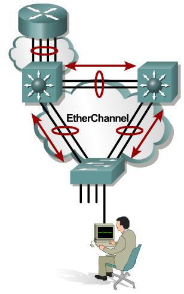
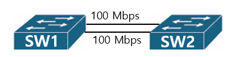
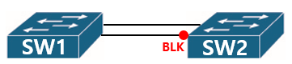
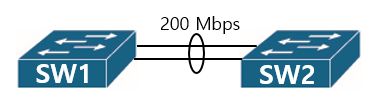

이더 채널(EtherChannel)이란 아래와 같이 두 개의 링크를 논리적으로 하나의 링크처럼 사용하는 기술이다.



네트워크의 대역폭(Bandwidth)을 늘리기 위해 시도할 수 있는 방법 중에 가장 간단한 방법은 두 장치 간에 링크를 하나 더 연결하는 것이다.



그러나 이렇게 연결하여도 스위치끼리는 스위칭 Loop를 방지하기 위한 STP 프로토콜이 동작하기 때문에 하나의 링크는 사용하지 못하는 상태(= Blocking)가 된다.



이 문제를 해결하기 위해 사용하는 것이 이더 채널이다. 이 기술은 두 개의 물리적인 회선을 하나의 회선인 것처럼 받아들이게 하여 하나의 회선만 연결되어 있다고 판단하므로, STP 프로토콜이 동작하지 않게 된다. 즉, 아래의 그림과 같은 상황이 된다.



이더 채널은 다음과 같은 명령으로 적용한다.

```
/*
	SW1을 기준으로 SW2로 향하는 포트에 대한 이더채널 설정
*/
SW1(Config)# interface fastethernet 0/1
SW1(Config-if)# **channel-group 1 mode on**
SW1(Config)# interface fastethernet 0/2
SW1(Config-if)# **channel-group 1 mode on**

/*
	SW2을 기준으로 SW1로 향하는 포트에 대한 이더채널 설정
*/
SW1(Config)# interface fastethernet 0/1
SW1(Config-if)# **channel-group 1 mode on**
SW1(Config)# interface fastethernet 0/2
SW1(Config-if)# **channel-group 1 mode on**
```

여기서 사용하는 숫자 ‘1’은 채널에 대한 그룹 번호이다. **여러 스위치끼리 여러 이더 채널 그룹을 형성하는 경우**에 이를 식별하기 위한 번호라고 생각하면 된다.
