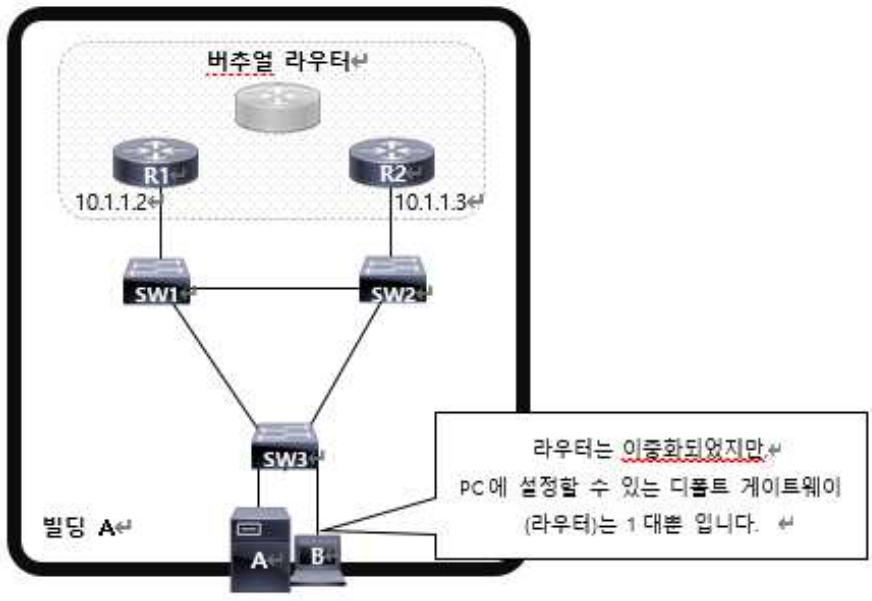

FHRP(First Hop Redundancy Protocol)은 2대 이상의 라우터를 1대의 라우터로 만드는 기술이다. 이 기술은 이중화된 라우터를 대상으로 한 대는 **Active 라우터**(= 상시 가용이 가능한 라우터)로 만들고 또 다른 한 대를 **Standby 라우터**(= Active 라우터에 대한 보조 라우터)로 설정하여 **라우터의 장애를 대비**하는 기술이다.



위 그림처럼 한 대의 단말에 기본 게이트웨이를 입력해주어야 하는데, 무조건 한 대만을 입력해주어야 한다. 그런데 이중화된 라우터 중에 한 대를 디폴트 게이트웨이로 설정했는데 그 라우터에 장애가 발생하면 또 다른 라우터를 디폴트 게이트웨이로 설정해야 한다. 

단말이 수백 대에 이른다면 이는 상당히 번거로운 작업이지만 FHRP를 적용하면 이중화된 라우터를 하나의 라우터처럼 사용할 수 있게 되므로, **논리적인 디폴트 게이트웨이 한 대**를 사용할 수 있게 된다.

이 기술이 적용되면 두 라우터는 **논리적으로 하나**의 라우터가 되는데, 구체적으로는 두 대의 라우터에 대해 **하나의 IP 주소와 MAC 주소를 부여**하여 접근을 가능하도록 하게 한다.

액티브 라우터와 스탠바이 라우터는 서로 Hello 패킷을 주고 받는다. 이 때, 액티브 라우터가 <u>몇 초 이상 신호를 주지 않으면 스탠바이 라우터는 액티브 라우터에 장애가 일어난 것으로 판단</u>하여 본인이 액티브 라우터의 역할을 한다.

이를 설정하는 방법은 다음과 같다.

```
R1(config)# interface fastethernet 0/0
R1(config-if)# standby [vlan 번호] [ip 주소] 
R1(config-if)# standby [vlan 번호] priority [우선순위]
```

VLAN에 적용하는 것을 볼 수 있는데, 이는 **라우터의 가용성을 높이기 위해**(= Standby 라우터의 가용성을 높이기 위해)  두 개의 라우터마다 VLAN을 대상으로 FHRP를 적용한다.
