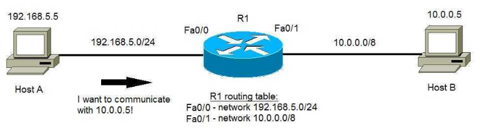
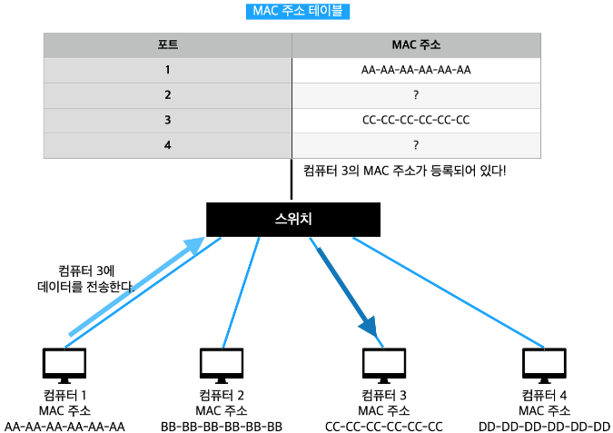
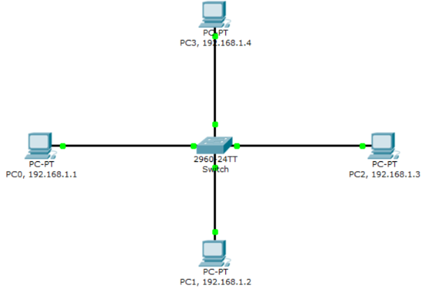

## 주소(Address)

네트워크를 구성하고, 통신하기 위해서는 주소를 가져야 한다. 네트워크 상에서 사용하는 주소는 다음과 같은 것들이 있다.

- MAC 주소
    
    기기가 갖는(= NIC가 갖는) 고유한 주소(= **장비가 생산될 때부터 영구적으로 부여받는 주소**)이다. 이 주소는 2계층에서 사용하는 주소이며, 주소 체계는 16진수 형태로 다음과 같다.
    
    ```
    0000.0000.0000.0000 ~ FFFF.FFFF.FFFF.FFFF
    ```
    
    송수신이 일어날 때의 MAC 주소 특징은 다음과 같다.
    
    - FFFF.FFFF.FFFF.FFFF는 브로드 캐스트 시에 사용하는 주소이다.
    - Physical Address라고도 말한다.
    - Flat한 주소 체계이다. (길이가 긴 주소이다.)
    - 네트워크를 통과할 때마다 변하는 주소이다.
    
- IP 주소
    
    IP 주소는 3계층에서 사용하는 주소 체계이다. 10진수 형태로 한 자리에 최대 2^8 - 1(= 255)까지의 값을 갖는 네 자리로 구성되며, 각각의 자리는 옥텟(Octet)이라 부른다.
    
    ```
    0.0.0.0 ~ 255.255.255.255
    ```
    
    IP 주소는 Network 영역과 Host 영역으로 나누어진다. 이 때, <u>Host 영역은 Network 영역보다 하위에 있는 주소이다.</u> 이렇게 주소 체계에 영역을 나누고, 계급 체계를 갖도록 하는 주소에 대해 **Hierarchical address**라고 한다.  
    
    ```
    **192.168.0.3
    
    192.168.0 -> Network 영역
    3 -> Host 영역**
    
    192.168.0.3 ****-> 네트워크 영역에서 Host 3을 의미하는 주소.
    ```
    
    송수신이 일어날 때의 IP 주소의 특징은 다음과 같다.
    
    - 255.255.255.255는 브로드 캐스트 시에 사용하는 주소이다.
    - Logical Address라고도 말한다.
    - Hierarchical 주소 체계이다. (길이가 짧아질 수 있는 주소이다.)
    - 네트워크를 통과해도 주소가 바뀌지 않는다.
    

## 서브넷 마스크(Subnetmask)

서브넷 마스크란 앞서 말한 IPv4 주소 체계의 네트워크 영역을 구분해주는 것을 말한다. 경우에 따라 아래와 같은 세 가지 마스크가 존재할 수 있다.

```
255.255.255.0 / 24
255.255.0.0 / 16
255.0.0.0 / 8
```

상위 24bit를 네트워크 영역으로 사용한다면 호스트 자리에는 256가지의 디바이스 기기를 연결할 수 있고, 네트워크 영역이 10.0.0.* 인 IP주소가 할당할 수 있는 호스트 주소는 10.0.0.1 ~ 10.255.255.254가 된다. 

## IP 주소 디자인

네트워크에 IP 주소를 할당하기 위해 다음과 같은 두 가지 사항을 고려해야 한다.

- 서브넷 마스크
    
    네트워크 영역을 나누기 위해 다음과 같은 서브넷 마스크를 주로 사용한다.
    
    ```
    255.255.0.0 / 16
    255.255.255.0 / 24
    ```
    

- IP 주소 체계
    
    현재 IPv4의 공인 주소는 고갈되고 있는 상황이므로, 다음 두 가지 중에 하나 고려하여 설계해야 한다.
    
    - IPv6
        
         IP 주소가 고갈될 걱정 없이 쓸 수는 있으나, 기존의 IPv4 체계와 호환할 수 있도록 하는 작업이 필요하므로 번거로울 수 있다.
        
    - IPv4의 사설 주소
        
         아래와 같은 영역을 갖는 사설 IP 주소를 사용하는 방식이다. 공인 아이피 하나만 발급 받으면 아래와 같은 대역의 사설 IP 주소로 기기에 할당이 가능해진다.
        
        ```
        10.0.0.0 ~ 10.255.255.255
        172.16.0.0 ~ 172.16.255.255
        192.168.0.0 ~ 192.168.255.255
        ```
        

## 라우팅 테이블

네트워크 상에서 어떤 장치가 목적지까지 갈 때, 라우터와 스위치의 도움을 받아 목적지까지의 경로를 안내받는다. 이 때, 라우터는 목적지에 도달하기 위해 출발지에 따른 목적지 정보를 저장하는 테이블이 별도로 존재한다.

아래는 라우팅 테이블을 그림으로 나타낸 것이다.



이 상황은 Host A(= 192.168.5.5)가 Host B(10.0.0.5)와 통신하기 위해 R1의 라우팅 테이블에서 Host B의 주소를 찾는 상황이다. R1은 해당 주소가 있으면 그 주소를 Host A에게 반환하고, 없으면 Host B의 주소를 찾고, 라우팅 테이블에 저장한 뒤에 Host A에게 반환하는 작업을 수행한다. 

보다시피, 라우팅 테이블은 <u>라우터의 포트와 연결된 부분이 어느 네트워크 영역으로 가는 지를 기록</u>하고 있다.

## 스위칭 테이블

앞서 본 라우팅 테이블과 마찬가지로, 스위치도 네트워크 상에서 경로를 안내하는 역할을 한다. 이 경우에는 전송하는 장치의 MAC 주소에 따라 어느 방향으로 내보내는 지에 대한 포트 번호가 담긴 테이블이 다음과 같이 존재한다.



위 상황은 컴퓨터 1(= AA-AA-AA-AA-AA-AA)가 컴퓨터 3(CC-CC-CC-CC-CC-CC)에게 데이터를 보내는 상황에서, 스위치에게 컴퓨터 3의 MAC 주소를 조회하는 상황이다.

보다시피, 스위칭 테이블은 <u>스위치와 연결된 포트가 어떤 장치와 연결되어 있는 지를 MAC 주소를 기록</u>하여 나타낸다.

## ARP(Address Resolution Protocol)

ARP란 IP 주소를 MAC 주소와 매칭시키기 위한 프로토콜이다. IP 주소는 통신 과정에서 끊임없이 변할 수 있다. 그에 반해 MAC 주소는 영구적인 주소이다. 따라서, 네트워크 상에서의 통신을 위해서라면 반드시 MAC 주소를 필요로 하게 된다. 

그런데 목적지의 IP 주소만 알고 MAC 주소를 모르게 되는 경우가 있다. 이런 경우에 사용하는 프로토콜이 바로 ARP이다. 이 프로토콜은 IP 주소와 MAC 주소를 1:1로 매칭하여 LAN에서 목적지를 바로 찾아갈 수 있도록 해준다.

ARP Table이 생성되는 과정은 다음과 같다.



1. PC 0은 PC2에게 데이터를 전송하려고 한다. IP 주소는 알지만 MAC 주소는 모르는 상황이므로, 같은 네트워크 상의 모든 단말에 ARP Request를 요청한다. (= 브로드 캐스트)
2. PC 0의 ARP Requst를 수신받은 PC2는 이에 대한 응답으로 ARP Response(PC 2의 MAC 주소가 담겨있음)을 PC 0에게 보낸다. (= 유니 캐스트)
3. PC 0는 PC 2가 보낸 ARP Response를 받고, ARP Table에 PC 2의 IP와 MAC 주소를 적는다. 그 후에 데이터를 전송할 때에는 ARP Table을 참조하여 MAC 주소를 확인하고 데이터를 전송하게 된다.

스위치의 스위칭 테이블과 ARP 테이블은 전혀 다른 테이블이다. **스위칭 테이블**은 <u>스위치의 포트와 출발지의 MAC 주소를 매칭하는 테이블</u>이고, **ARP 테이블**은 <u>MAC 주소와 IP 주소를 매칭하는 테이블</u>이다.
