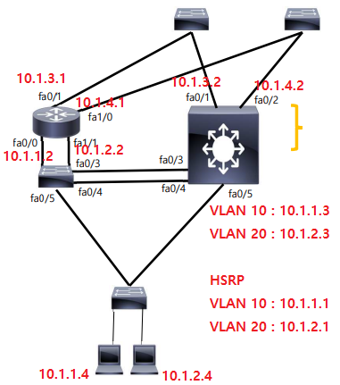

L3 Switch란 Layer 3 계층에서 동작하는 스위치를 말한다. 3계층에서 동작하기 때문에 라우터의 기능(= IP 주소에 대한 스위칭)과 스위치의 기능(= MAC 주소에 대한 스위칭)이 동시에 가능한 장비이다.



위 그림은 Core와 Distibution를 이중화하고, End to End VLAN을 적용한 T3 Model이다. VLAN을 적용함에 따라, 왼쪽 부분에 라우터 한 대와 스위치 한 대가 이중으로 연결되어 있고, 오른쪽 부분은 L3 스위치 한 대로 왼쪽 부분처럼 배치한 것과 같은 효과를 낼 수 있다. **한 대의 장비로 두 대의 장비를 대신**하게 된 것이다.

L3 Switch는 한 대의 장비가 두 가지 역할을 해야하는 만큼 두 장비에 맞는 설정을 해주어야 한다. 우선, 라우터의 기능을 수행하기 위해 아래와 같이 설정해준다.

```
in fa 0/1
no switchport
ip address 10.1.3.2 255.255.255.0
```

L3 Switch의 모든 포트는 기본적으로 Switch 포트로 동작한다. 그러므로, 라우터의 인터페이스처럼 사용하기 위한 명령인 **no switchport**를 입력해준다. 이 명령을 입력하면 **가상의 라우터 인터페이스**가 만들어진다. 그 후에는 **라우터의 인터페이스에 IP를 할당하듯이** IP를 할당해주면 된다. 참고로 다시 스위치 포트로 변경하는 명령은 **switchport**이다.

```
interface vlan 10
ip address 10.1.1.3 255.255.255.0
standby 10 ip 10.1.1.1
standby 10 priority 50

interface vlan 20
ip address 10.1.2.3 255.255.255.0
standby 20 ip 10.1.2.1
standby 20 priority 150
```

가상의 인터페이스를 생성하고 나면 VLAN에 접근하여 해당 VLAN 대역의 IP를 입력해주어야 한다.  이후에는 VLAN마다 Default gateway 역할을 수행하기 위해 HSRP를 이용하여 **두 VLAN마다 각각 하나의 가상 IP 주소를 할당**해주었다.

다음으로 라우팅 프로토콜을 동작시키기 위해 다음과 같이 입력해준다.

```
ip routing
router eigrp 100
network 10.0.0.0
```

이제 스위치 부분을 다음과 같이 설정해준다.

```
vlan 10
vlan 20
in range fa 0/3-5
switchport trunk encapsulation dot1q
switchport mode trunk
```

두 개의 VLAN을 생성해주고, 0/3 부터 0/5 포트에게 모두 Trunk를 적용한다. 이 때, 스위치에는 VLAN을 구분하기 위해 프레임의 네 번째 헤더에 VLAN을 식별할 번호를 넣게 되는데 이를 가능하게 하는 프로토콜이 **dot1q**이고, 이를 L3 Switch에 적용해주어야 한다.

위와 같은 과정을 거치면 L3 Switch를 라우터와 스위치의 역할을 모두 수행하도록 할 수 있다.
