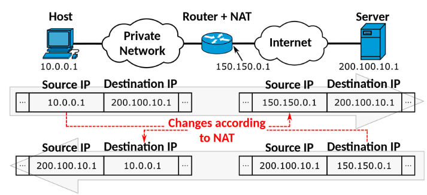
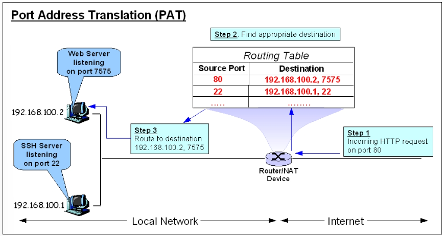

NAT(Network Address Translation)이란 공인 IP 주소와 사설 IP 주소에 대한 변환 기술을 말한다. 이 기술이 등장한 배경은 IPv4의 주소 고갈에 대비하기 위함이다. 

IPv4 기반의 주소는 약 42억 개 정도를 할당할 수 있다. 그러나 현재는 할당해야 하는 기기가 점점 늘어나면서 고갈될 위기에 있다. 이를 위한 해결책은 사설 IP 주소를 사용하는 것이다.    

아래 그림은 LAN 네트워크(= 회사 내에서 자체적으로 구축한 네트워크) 안에 있는 호스트가 인터넷에 위치한 어느 서버에 패킷을 전송할 때, 패킷의 내용을 나타낸 그림이다.

위 그림처럼 라우터는 LAN 네트워크가 가진 사설 IP 주소를 인터넷에서 사용할 수 있는 공인 IP 주소로 바꾸어 주는 역할을 하고 있다. 만약 이러한 IP 주소 변환없이 웹 서버에 접근한다면(= **사설 IP 주소를 출발지의 IP 주소로** 전송한다면)  웹 서버는 자신이 받은 패킷이 어느 네트워크의 사설 IP 주소인 지를 알 수 없게 된다.

구체적인 변환 방식은 아래와 같이 라우팅 내에 별도의 테이블을 두고, 그 테이블 안에서 **공인 IP 주소 하나에 사설 IP 주소 여러 개를 매칭**하여 필요할 때마다 테이블 내용에 따라 주소 변환 및 라우팅을 하는 방식이다. 

특히, 사설 네트워크 내의 각 호스트에 임의의 포트 번호를 지정하게 되는데 이는 외부 인터넷에서 들어오는 패킷을 내부 네트워크 안에 있는 호스트에게 올바르게 전달해주기 위함이다.
