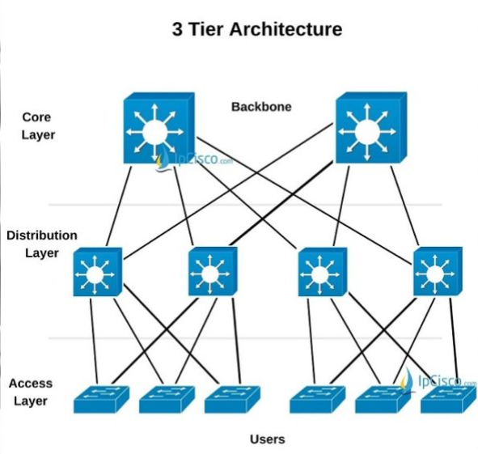
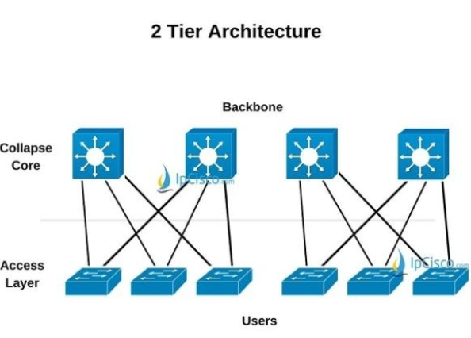
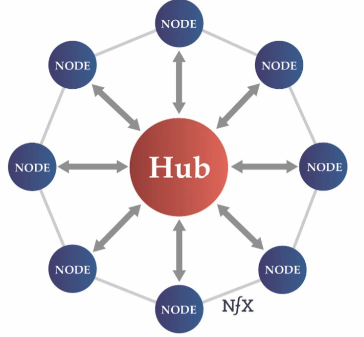
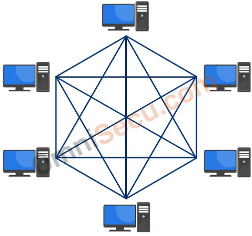
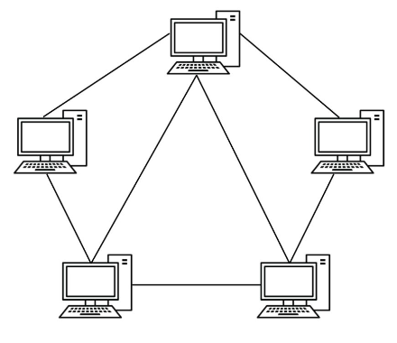

## Networks?

정보와 장치를 공유하기 위해서 단말(컴퓨터 장치)간의 연결하는 것을 말한다. 또, 네트워크를 구성하는 핵심적인 장치는 라우터(Router)와 스위치(Switch)이다. 

두 장치는 목적지에 대해 스위칭(경로 안내)을 한다는 공통점이 있으나, 처리 방식에 큰 차이가 있는 장치이다.

## LAN, WAN

- LAN
    
    회사와 같은 **지역(Local)에** **직접 구축**하는 네트워크 환경을 말한다.
    
    앞서 본 Tiered2, 3 모델은 LAN을 구축할 때에 사용하는 네트워크 모델이다.
    

- WAN
    
    지역과 같은 **광범위한 지역(Wide area)에 구축된** 네트워크 환경을 말한다.
    

## 네트워크 설계 및 구축

네트워크를 설계 및 구축하는 과정은 잘 구축된 모델을 적절하게 따라하는 것에 있다.  잘 구축된 네트워크 모델이란 다음과 같은 모델을 말한다.

### LAN 구축 모델

- Tiered 3 Layer Model
    
    
    
    각 계층의 역할을 다음과 같다.
    
    - Distribution
        
        액세스 계층의 장치들을 연결한다.
        
        라우터를 각 건물마다 최소 1대씩 배치한다.
        
    - Access
        
        단말들을 연결한다.
        
        스위치를 각 층마다 최소 1대씩 배치한다.
        
    - Core
        
        디스트리뷰션 계층의 장치들을 연결한다.
        
        스위치를 각 건물마다 최소 1대씩 배치한다.
        

- Tiered 2 Layer Model
    
    
    
    Tiered 3 Layer Model과 비교했을 때, <u>**Distribution 계층에서 하나의 라우터가 Core 계층의 역할을 수행한다.**</u> 
    

- 두 가지 모델의 비교
    
    두 모델의 차이는 다음과 같다.
    
    - Cost
        
        Tiered 3의 경우, Core에 의해 비싼 편이다. 반면 Tiered 2는 보다 저렴하다.
        
    - Availability
        
        가용성(Availability)이란, 네트워크를 항상 가용할 수 있는 지에 대한 속성을 말한다. 
        
        Tiered 3의 경우, Core에 의해 가용성이 좋은 편이다. 반면 Tiered 2는 보다 가용성이 좋지 않은 편이다. (Core에 문제가 생겼을 경우, Tiered 3는 연결된 Distribution 계층에만 문제가 생기지만 Tiered 2는 전체 네트워크에 문제가 생길 수 있다.)
        
    - Speed
        
        Tiered 3 모델의 경우, Core에 의해 속도가 좋은 편이다. 반면 Tiered 2는 보다 속도가 좋지 않은 편이다.
        
    

### WAN 구축 모델

- Hub & Spoke
    
    
    
    중앙에 Hub를 두고, 각각의 Node를 Hub에 연결하는 방식이다. Hub에 문제가 생긴다면 전체 네트워크에 문제가 생길 수 있다.
    

- Full Mesh
    
    
    
    모든 Node를 자신을 제외한 또 다른 노드들에 연결하는 방식이다. 비용이 많이 들긴 하지만 Backup route가 많다는 점(= 통신 시에 여러 경로로 통신이 가능하다, 우회 경로가 많다)과 Load balancing(= 트래픽 분산에 좋다)이 가능하다는 점이 장점이다.
    

- Partial Mesh
    
    
    
    Full Mesh 방식에서 주요한 일부 노드들만 연결하는 방식이다.
    

- 세 가지 모델의 비교
    - Cost
        
        Full Mesh 모델이 가장 비싸고, Hub & spoke가 가장 저렴하다.
        
    
    - Availability
        
        우회 경로가 많고, 트래픽 분산에 좋은 Full Mesh 모델이 가장 가용성이 좋다. 그 다음으로 Partial 모델이 가용성이 좋다.
        
    
    - Speed
        
        다양한 경로를 가진 Full Mesh 모델이 빠른 속도를 보장할 수 있으며, 그 다음으로 Partial 모델이 빠른 속도를 보장한다.
