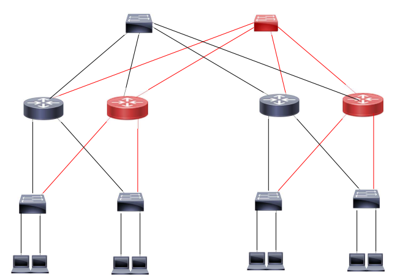

이중화란 스위치, 라우터와 같은 물리 장치가 사용이 불가능한 상황을 대비하여, 아래와 같이 추가적으로 장비를 배치하는 것을 말한다. 

이중화를 하면 다음과 같은 이점이 있다.

- Backup route(또 다른 우회 경로)가 추가적으로 생겨나 가용성이 증가한다.
- Load balancing(여러 개의 전송 경로)가 생겨나므로, 성능이 좋아진다. (= 최적의 전송 경로를 찾을 수 있으므로, 전송 속도가 증가한다고 볼 수 있다.)

반대로 다음과 같은 단점이 있다.

- 네트워크 공격 경로가 늘어나 보안에 취약하다.
- 구성이 복잡해지면서 관리하기 어려워진다.
