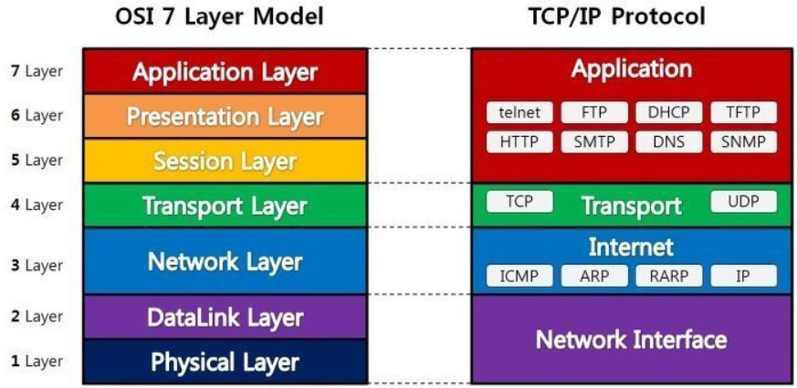
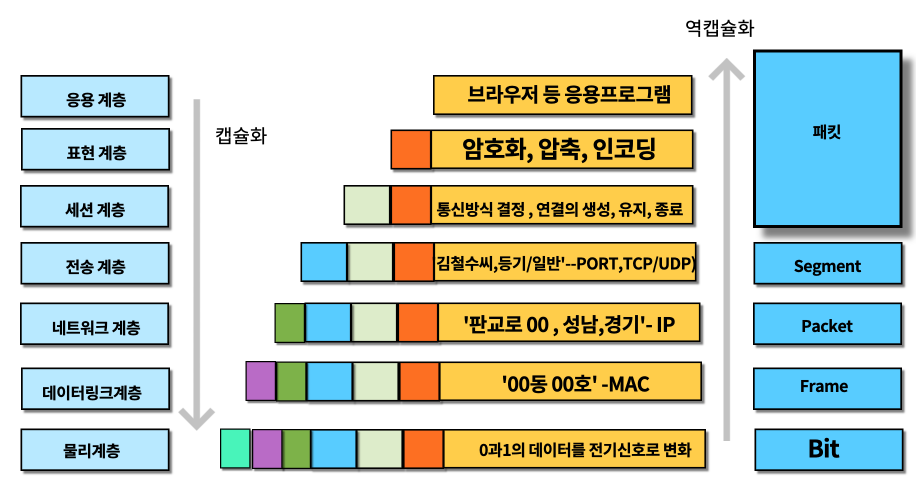

## <u></u>

통신 모델을 수직적인 계층으로 모델링한 것을 OSI 7계층, TCP/IP 프로토콜이라 한다.  통신 단계를 분업화, 전문화한 모델이라 할 수 있다. 

수직적인 계층이기 때문에, 어느 하나의 계층에 문제가 생긴다면 상위 계층에 문제가 생길 수 있다. 또, 다르게 이야기하면 어느 하나의 계층이 올바르게 동작한다면 하위 계층도 올바르게 동작한다고 보장할 수 있다.

앞에서 Tiered 3 Layer Model에서 각 계층마다 배치해야 하는 장치에 대해 설명하였다. 사실 스위치나 라우터는 <u>**패킷을 스위칭(Switching, 패킷을 목적지까지 이동하도록 경로를 결정)하는 역할**</u>을 하므로, 각 계층마다 전부 동일한 장비를 배치해도 상관없다.

두 장치의 차이는 스위치는 2계층에서 동작하는 장치이고, 라우터는 3계층에서 동작하는 장치라는 것이다. 

이를 이해하기 위해서 Packet은 어떻게 구성되는 지를 이해해야 한다. 패킷은 OSI 7계층에서 아래와 같이 캡슐화되거나, 역캡슐화 된다.

특히, Packet은 캡슐화 과정에서 아래와 같은 Header 정보를 갖는다.

- 2계층 주소
    
    <u></u> 혹은 이더넷에 의해 네트워크 인터페이스 카드가 가진 기기의 고유 주소(MAC)를 헤더 값으로 갖는다. (PPP는 주소를 갖지 않는 단계에서 사용하는 프로토콜이다.)
    

- 3계층 주소
    
    이더넷에 의해 IP 주소를 헤더 값으로 갖는다.
    

- 4계층 주소
    
    TCP/UDP에 의해 Port 번호를 헤더 값으로 갖는다.
    

즉, 스위치는 2계층 주소인 <u>MAC 주소를 보고 스위칭을 하는 장치</u>이고, 라우터는 3계층 주소인 <u>IP 주소를 보고 스위칭을 하는 장치</u>이다.

이를 다르게 말하면, 스위치는 1계층이 원활하게 동작해야 한다는 의미이고, 라우터는 2계층과 1계층이 원활하게 동작해야 한다는 의미이다.

## Congestion

혼잡(Congestion)이란 데이터 송수신이 과도하여 Packet의 유실이 나는 상황을 말한다. 이 상황은 다음과 같은 경우에 발생한다.

- CPU 사용이 불가능해진 경우
    
    CPU를 과도하게 사용하여 데이터를 처리할 수 없게 되는 경우이다.
    

- Connection Pool의 여유가 없을 경우
    
    통신을 위한 Connection Pool을 과도하게 사용하여 더 이상 또 다른 요청을 받을 수 없게 되는 경우이다.
    

이를 방지하는 프로토콜로는 <u></u>가 있다. (단, 패킷 유실이 일어나지는 않으나, 패킷 전송의 Delay을 겪게 될 수도 있다.) 

스위치와 라우터의 또 다른 차이는 브로드 캐스트(= 연결된 모든 기기에 데이터 전송)의 차단 유무이다. 스위치는 브로드 캐스트를 차단하지 못하는 장치이며, 라우터는 브로드 캐스트를 차단할 수 있는 장치이다.

따라서, 2계층에 라우터를 사용하는 이유는 브로드 캐스트가 **3계층의 기기로 전송되는 것을 차단**하기 위함이다. 브로드 캐스트를 송신 및 수신 받는 행동이 CPU를 사용하는 행동이므로, <u>모든 장치가 스위치로 구성된다면 그 네트워크에서는 Congestion을 제어할 방법이 존재하지 않게 된다.</u>
