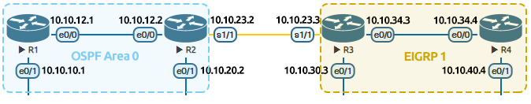

AS(= Autonomous System, **하나의 인터넷 회선 사업자가 가지고 있는 모든 라우터들의 그룹**) 안에 존재하는 다양한 라우터들끼리 경로를 정하는 프로토콜을 IGP라고 하였다. 이와는 반대로 AS 간의 라우팅을 담당하는 프로토콜은 **BGP**이다.

BGP는 서로 다른 조직의 네트워크를 연결할 때 사용하는 라우팅 프로토콜이다. 기업체 또는 정부 기관 등이 2개 이상의 ISP와 연결하는 경우에 사용한다. 그리고 ISP 간의 연결 시에도 BGP를 사용한다.

BGP를 설정할 때에는 **동일한 AS에 있는** 라우터끼리는 아래와 같이 **동일한 IGP가 동작**해야 한다.

위는 R1과 R2에는 OSPF 라우팅 프로토콜을, R3과 R4에는 EIGRP 라우팅 프로토콜을 각각 설정한 모습이다. 이 때, <u>R2와 R3가 연결되는 구간은 BGP DMZ</u>라고 한다.

참고 :
