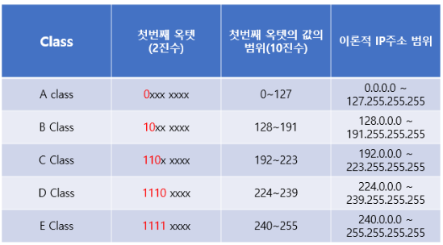
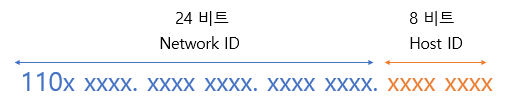
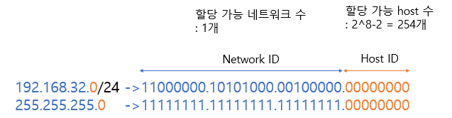
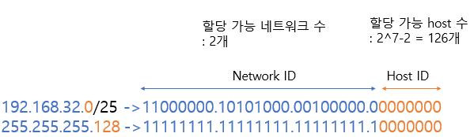
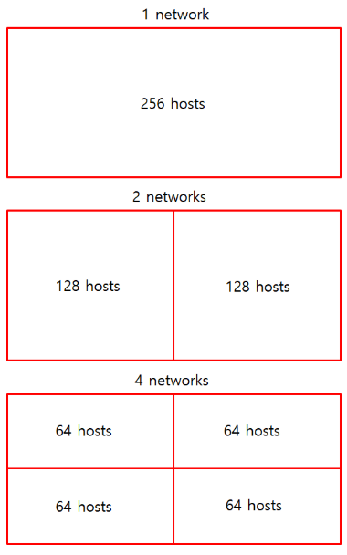
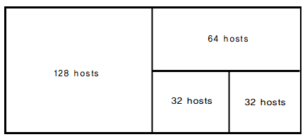

- Subnet mask
    
    IPv4 주소 체계는 아래와 같이 클래스를 나누어 IP를 할당한다. 
    
    
    
    하지만 이 방식은 매우 비효율적이다. 예를 들어, 어떤 기관에 A 클래스를 할당한다고 하면 16,777,214개의 호스트를 할당할 수 있게 되는데, 이 기관이 100개의 호스트를 할당한다고 하더라도 16,777,114개의 호스트를 할당할 수 있을만큼 IP 주소가 남게 된다. 
    
    이러한 비효율성을 해결하기 위해 네트워크 장치들의 수에 따라 효율적으로 사용할 수 있도록 하는 **서브넷(subnet)**이 등장하게 되었다.
    
    서브넷은 IP 주소에서 네트워크 영역을 부분적으로 나눈 부분 네트워크를 뜻한다. 이러한 ****서브넷을 만들 때 사용되는 것이 바로 **서브넷 마스크**이다. 즉, **서브넷 마스크**는 IP 주소 체계의 Network ID와 Host ID를 분리하는 역할을 한다.
    
    
    
    C 클래스는 기본적으로 상위 24비트는 Network ID, 하위 8비트는 Host ID를 나타낸다. 이 때, 서브넷 마스크를 이용하면 원본 네트워크를 여러 개의 네트워크로 분리할 수 있다. 이러한 과정을 **서브넷팅(subneting)**이라고 한다.
    

- Subnetting
    
    서브넷팅은 IP 주소 낭비를 방지하기 위해 원본 네트워크를 여러개의 서브넷으로 분리하는 과정을 뜻한다. 서브넷팅은 서브넷 마스크의 bit 수를 증가시키는 것이라고 생각하면 이해가 편하다. 서브넷 마스크의 bit를 한 자리씩 증가시키면 할당할 수 있는 네트워크가 2배로 증가하고 호스트 수는 2배로 감소한다.
    
    예를 들어, C 클래스인 **192.168.32.0/24**를 서브넷 마스크의 bit를 하나 증가시켜서 **192.168.32.0/25**로 변경한다고 하자.
    
    
    
    이 결과는 다음과 같아진다.
    
    
    
    **192.168.32.0/24**는 원래 하나의 네트워크였다. 이 때, 할당 가능한 host의 수는 254개이다. 여기서 두 개의 호스트는 할당할 수 없다. **192.168.32.0**은 <u>Network Address</u>로 쓰이고 마지막 주소인 **192.168.32.255**는 <u>Broadcast</u>로 쓰이기 때문에 호스트에 할당할 수 없기 때문이다.
    
    간단한 예시를 몇 개 더 들어보자.
    
    ```
    Q) 
    **211.100.10.0/26** 네트워크를 각 서브넷당 55개의 Host를 할당할 수 있도록 서브네팅해야 한다. 
    이 때, 각 네트워크 영역마다 설정해야 하는 서브넷 마스크는?
    
    A)
    전체 32개의 비트 중에서 상위 26개의 비트를 Network ID로 사용하면 6개의 비트는 Host ID로 
    사용하는데, 이는 2^6(= 64)개의 Host를 할당할 수 있다. 따라서 서브넷 마스크를 다음과
    같이 표현할 수 있다.
    
    11111111 11111111 11111111 11000000
    -> 255.255.255.192
    ```
    

- FLSM, VLSM
    
    ### FLSM (**Fixed Length Subnet Mask)**
    
    서브넷의 길이를 고정하여 사용하는 방식을 말한다. 한 대역을 동일한 크기로 나누는 경우에 해당한다.
    
    
    
    ### **VLSM (Variable Length Subnet Mask)**
    
    서브넷의 길이를 가변적으로 사용하는 방식을 말한다. 한 대역을 다양한 크기로 나누는 경우에 해당한다. <u>크기가 큰 네트워크부터 서브네팅 하는 것이 좋다.</u>
    
    
