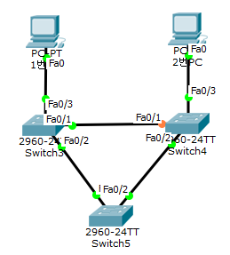
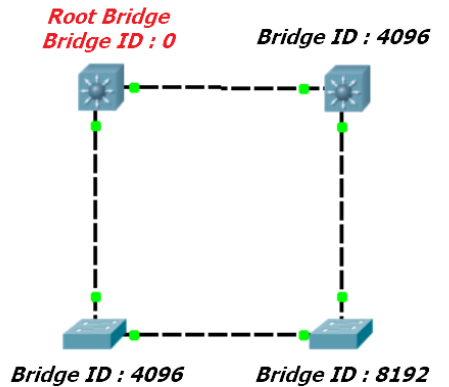
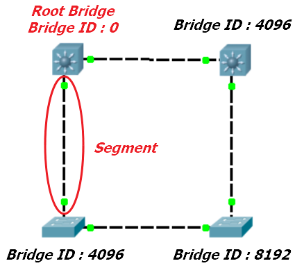
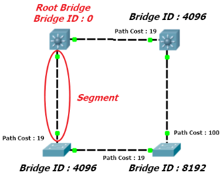
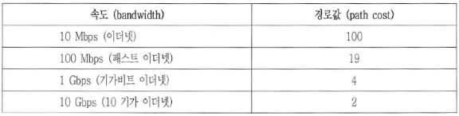
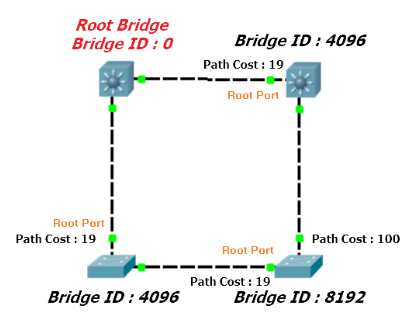
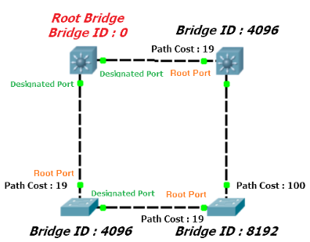
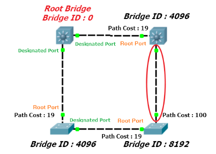

STP(Spanning Tree Protocol)이란 스위치의 특정 포트를 블로킹(Blocking)하는 프로토콜이다. 스위치 의 특정 포트를 차단해야 하는 이유는 다음과 같은 상황에서 필요하다.

위와 같이 스위치가 연결된 상황에서 1번 PC가 2번 PC로 통신을 한다고 가정해보자. 

1번 PC가 2번 PC의 MAC 주소를 알아내기 위해 APR Request가 3번 Switch로 보내지면 현재 APR 테이블에 2번 PC에 대한 정보가 없으므로, Flooding이 일어나게 된다. 

그렇게 전달된 ARP Request가 4번 Switch에 도달했을 때 ARP 테이블에 2번 PC에 대한 내용이 없으므로 또 Flooding이 일어나게 되며, 5번 Switch에 APR Request가 전달된다. 

이와 같이 APR Request에 대한 Loop가 반복되면서 네트워크에 장애가 발생하게 된다. 꼭 ARP Request가 아니더라도, 브로드 캐스트 및 유니 캐스트에 대한 Flooding이 일어나면 이와 같은 Loop가 형성될 수 있다.

이러한 현상을 스위칭 루프(Switching Loop)라 부르며, 이를 해결하는 프로토콜이 **STP(Spanning Tree Protocol)**이다. STP는 크게 다음과 같은 두 가지 과정을 수행한다.

- Root Switch, Non-Root Switch 선정
- Root Port, Designated Port, Alternated Port 선정

위 과정을 위해 사용되는 프레임이 **BPDU(Bridge Protocol Data Unit)**인데, 이를 통해 **루트 스위치**(<u>루프를 형성하는 스위치들 중에 기준이 되는 스위치</u>)를 결정하고, **차단할 스위치의 포트**와 **어떻게 포워딩할 것인 지**를 결정하게 된다.

해당 프레임에는 다음과 같은 정보가 포함되어 있다.

- Root Switch ID
- Path Cost
- 방금 통과한 Switch의 ID
- 방금 통과한 Switch의 Port ID

## 루트 스위치 선정하기

초기에 스위치들은 **자신이 루트 스위치라 생각하여** 다른 스위치들에게 BPDU를 보내게 된다. 그러다가 **자신보다 더 낮은 ID 값이 담긴 스위치 ID를 수신 받으면, 더 이상 자신이 루트 스위치가 아님**을 알게되어 **자신이 받은 루트 스위치의 ID를 담은 BPDU를 다른 스위치들에게 보낸다.** 이 과정을 통해 아래 그림과 같이 특정 스위치가 Root Switch로 선정된다.

## Root Port, Designated Port, Alternated Port 선정

앞선 과정이 <u>**스위치들끼리 경쟁**</u>하는 것이었다면, 이 과정은 <u>**하나의 스위치의 여러 Port들끼리**</u> 경쟁하는 과정이라 할 수 있다. 이 과정은 **루트 스위치가 아닌 스위치에서 루트 스위치까지의 최적의 경로(= 대역폭이 넓은 경로)를 선정하고, 차단할 경로를 선정하는 것**이라 볼 수 있다.

아래와 같이 스위치들끼리 연결될 때, 하나의 **세그먼트**가 맺어진다고 표현한다. 아래 그림은 네 개의 세그먼트가 맺어지게 된다.

그리고 하나의 세그먼트에는 아래와 같이 **Path** **Cost**가 부여된다.

이 Cost의 의미는 아래와 같다. 만약, Cost가 19라면 해당 세그먼트는 100 Mbps의 데이터를 처리할 수 있는 링크라는 의미가 된다. **Cost가 낮을 수록 더 고성능의 대역폭**이라는 의미가 되기도 한다.

### Root Port 선정하기

하나의 스위치가 루트 스위치로 향하기 위한 경로를 **Root Port**라 하는데, 이를 선정하는 기준은 다음과 같다.

1. 가장 작은 Path Cost를 가지는 포트
2. 인접한 스위치 중에서 브릿지 ID가 가장 낮은 포트
3. 인접한 스위치의 포트 ID(= 포트 번호)가 가장 낮은 포트

위 기준에 따라, 각각의 스위치들은 아래와 같이 Root Port를 선정하게 된다.

### Designated Port 선정하기

지정 포트(Designated Port)는 **루트 포트도 아니고, 블락될 포트도 아닌** 포트를 이르는 말이다. Forwarding Port라고도 부르는데, 이 포트는 **오직 데이터를 전송하는 역할**만을 하는 포트이다.

지정 포트를 선정하는 규칙은 루트 포트를 선출하는 규칙과 동일하다. 또, 하나의 스위치에서 포트를 선정하는 과정은 <u>루트 포트가 **최우선**으로 선정되며</u>, 이후에 지정 포트 혹은 블로킹 포트가 선정된다. 이 과정에서 **반드시 하나의 지정 포트가 선정되어야 하는 점**을 유의해야 한다.

이 규칙에 따라 모든 스위치는 지정 포트를 아래 그림과 같이 선정하게 된다.

### Alternated Port 선정하기

Alternated Port는 Blocking  혹은 Not-Designated Port라고도 불리는데, 데이터를 전송하는 일 없이 오직 수신만 하는 역할을 하는 포트이다. 앞서 루트 포트와 지정 포트가 선정되고 나서 **마지막에 남은 포트는 Alternated Port가 된다.**

이에 따라, 마지막에 남은 Port는 아래 그림처럼 Alternated Port가 된다.

참고 :
