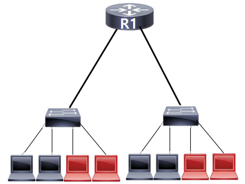
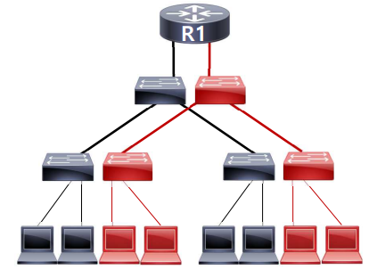
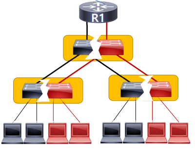
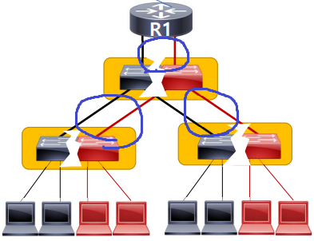
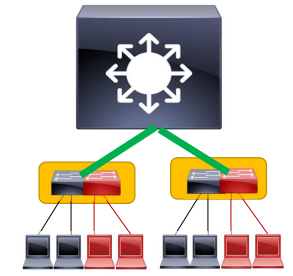
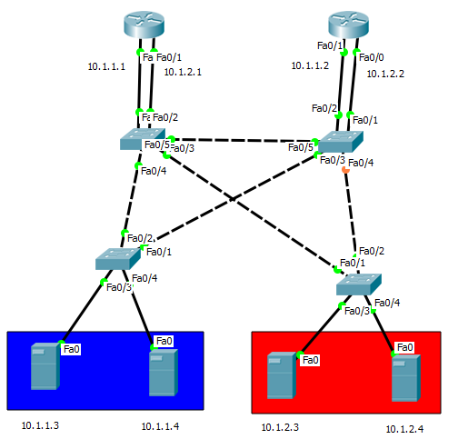
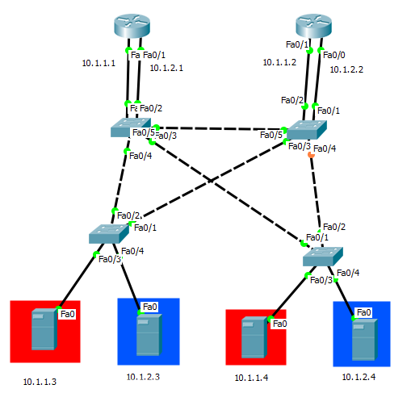

네트워크를 구성하는 과정에서 다음과 같은 요구사항이 있을 수 있다.

- 같은 네트워크 안에서 추가로 브로드 캐스트 도메인을 나누어야 하는 경우

이 상황은 아래 그림과 같이 검은색 단말은 검은색 단말끼리 브로드 캐스트가 되어야 하고, 빨간색 단말은 빨간색 단말끼리 브로드 캐스트가 되어야 하는 상황이다.

위와 같은 요구사항을 지키는 방법은 가장 단순하게 아래처럼 추가로 스위치를 배치하는 것이다.

그러나 이는 스위치를 추가하는 만큼(= 추가로 나누어야 하는 브로드 캐스트 도메인만큼) 비용이 발생한다. 따라서 다른 방법이 필요하다.

이러한 경우에 적용할 수 있는 해결책(Solution)이 바로 VLAN이다. VLAN은 하나의 스위치를 논리적으로 여러 대로 나누어 사용하는 기술이다. 그림으로 나타내면 다음과 같다.

VLAN을 적용하면 하나의 스위치만으로 여러 대의 스위치를 사용하여 브로드 캐스트를 나누는 효과를 얻을 수 있다.

위 요구사항을 지키는 과정에서 VLAN을 이용하여 스위치를 적게 사용하여 비용을 절감한 것은 좋았으나, 한 가지 더 문제가 있다. 그것은 바로 아래와 같이 연결하는 링크의 수가 많다는 점이다.

위의 배치는 스위치는 사실상 한 대씩 배치하였지만, 스위치 간의 연결은 2개씩 연결되어 있는 상황이다. 이를 해결하기 위해서는 **트렁크(TRUNK)**를 적용해야 한다. 

트렁크는 **VLAN이 통과하는 링크**를 말하며, 이를 적용하면 하나의 링크로 모든 VLAN을 통과시킬 수 있게 한다. 그리고 통과하는 과정에서 어느 VLAN으로 갈 것인 지를 **프레임의 네 번째 헤더**를 보고 통과시킨다.

따라서, VLAN과 트렁크를 적절히 사용하면 다음과 같은 네트워크 구성을 기대할 수 있다. (아래 구성은 L3 Switch를 배치한 모델이기도 하다.)

## Local VLAN

Local VLAN이란 아래와 같이 지역적으로 VLAN을 구성한 모델이다.

이렇게 VLAN을 구성하는 경우는 **하나의 층에 하나의 독립적인** 네트워크를 두는 경우이다. 예를 들어 3층 건물의 1층에는 사무실, 2층에는 연구실, 3층에는 전산실만을 두는 경우에 위와 같이 구성한다.

## End to End VLAN

End To End VLNA이란 아래와 같이 장소에 구애받지 않고 구축한 VLAN 모델을 말한다.

이렇게 VLAN을 구성하는 경우는 **하나의 층마다 독립적인 여러 네트워크를 두는 경우**이다. 예를 들어 3층 건물의 각각의 층마다 사무실, 연구실, 전산실이 위치하고 있다면 위와 같이 구성하여 사무실은 사무실의 VLAN을 사용하고, 연구실은 연구실의 VLAN을 사용하는 식이다.
