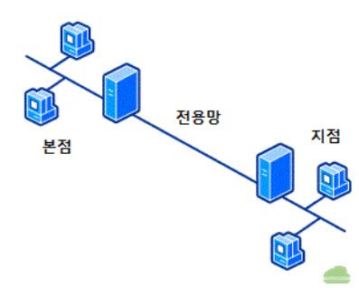
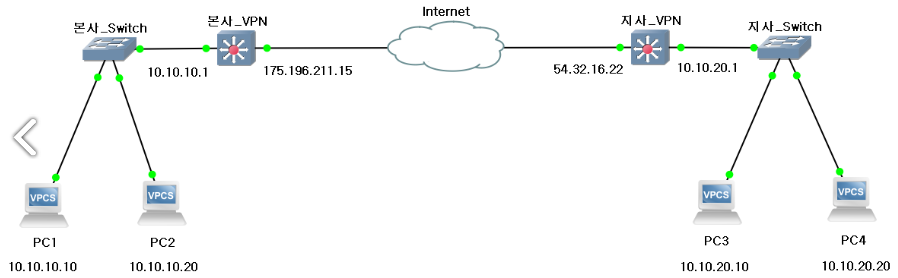
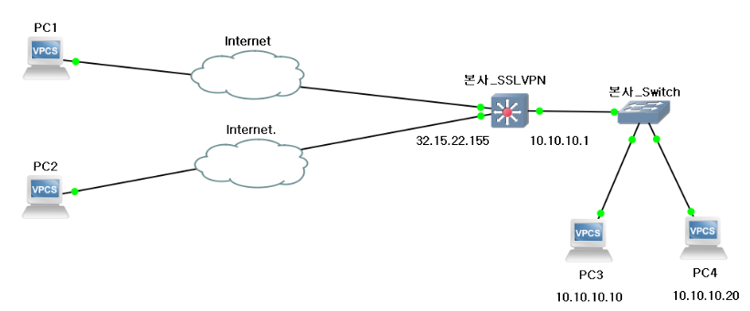

IPv4 체계에서 사설 IP를 사용하면서 NAT를 사용하면, LAN에서 외부 인터넷에서 내부 인터넷으로 접근하는 것을 보호할 수 있다. 이러한 이점을 활용하여 사설 네트워크가 구축된 것은 좋지만 거리가 먼 지점 간의 네트워크를 연결하기 위해서는 아래와 같은 **전용 회선**을 사용해야 한다는 문제가 있다.

기업의 경우, 위처럼 회사 네트워크를 구축하면서 멀리 떨어진 지사 네트워크를 연결하기 위해 전용 회선을 사용해야 한다. 이렇게 전용회선을 사용하면 <u>무조건 회사 간의 내부 트래픽만 오고 가는 것</u>이므로, 데이터를 안전하게 주고 받을 수 있게 된다.

그러나, 전용 회선의 비용이 만만치 않기 때문에 경우에 따라 다른 대안이 필요하다. 그 대안 중에 가장 쉽게 떠오르는 것은 **공인 인터넷 영역(= 인터넷)을 거치면서 사설망 사이를 연결**하는 것이다. 이를 위해서는 <u>패킷이 공인 인터넷 영역을 지나칠 때 안전하게 지나치도록 보장</u>해야 한다는 점이 있다. 

VPN(Virtual Private Network)는 언급된 문제 사항인 **공인 네트워크를 통과할 때, 데이터를 암호화하여 보내는 기술**을 말한다.  즉, 전용 회선을 사용하지 않고도 전용 회선이 있는 것처럼 통신할 수 있는 기술이라고도 볼 수 있다.

VPN은 접속 방식에 따라 다음과 같이 나눌 수 있다.

- Site to Site (LAN to LAN)
    
    LAN과 LAN에 보안이 적용된 전용 채널을 두고 통신하는 방식이다. 채널에 을 적용하여 데이터를 안전하게 전송할 수 있도록 한다.
    
    
    
- Client to Site
    
    Client(= 하나의 장치)가 특정 Site(= LAN, 사설 네트워크)를 보안이 적용된 전용 채널을 두고 통신하는 방식이다. SSL 프로토콜을 사용하며, Transport Layer 계층에서 동작하는 VPN 방식이다. 
    
    
