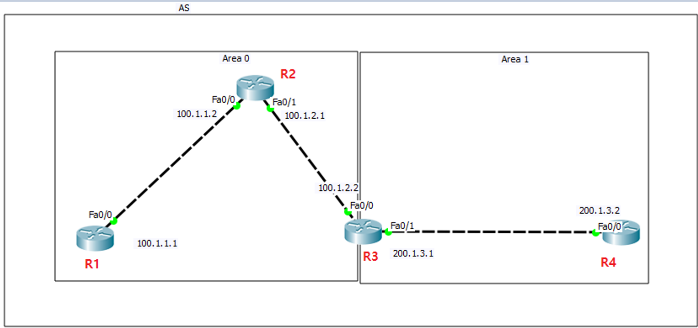
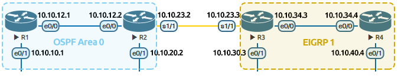

라우터는 간접적인 네트워크 영역에 대한 정보를 수집하기 위해 라우팅 프로토콜을 사용한다. 이 때, 라우팅 프로토콜은 적용 범위에 따라 IGP 혹은 BGP로 나눈다. 

**IGP**(Inter domain Routing Protocol)는 <u>**AS(Autonomous System) 안에서 동작하는 라우팅 프로토콜**</u>을 말하며 다음과 같은 세 가지 종류로 나눌 수 있다.

-  (RIP)
    
    라우팅 테이블 전체를 주기적으로 반복 전달하는 방식이다. Bandwidth 소모량이 많고, 긴 시간을 주기로 테이블 내용을 전파하기 때문에 Convergence Time(= 네트워크의 라우팅 테이블 갱신 시간)이 느린 편에 속한다. 단순한 알고리즘을 사용하기 때문에 CPU 소모량이 적다
    
-  (OSPF)
    
    라우터의 변화를 감지하여 그 정보만을 전달하는 방식이다. Bandwidth 소모가 적으며, 변화를 감지하는 즉시 그 정보를 전달하기 때문에 Convergence Time이 빠른 편이다. 알고리즘이 복잡하여 CPU 소모량이 많다. 이 문제는 네트워크 영역을 다음과 같이 분할하는 것으로 극복할 수 있다.
    
    
    

- Hybrid (EIGRP)
    
    Distance Vector와 Link State의 장점을 수용하는 방식으로 변화된 네트워크 정보만을 전달하여 Bandwidth 소모가 적고, Convergence Time이 빠르다. 또, 알고리즘은 Distance Vector 방식이기 때문에 CPU 소모량도 적다. 단, 표준이 아닌 시스코 프로토콜이기 때문에 장비 의존성이 강하다.

AS(= Autonomous System, **하나의 인터넷 회선 사업자가 가지고 있는 모든 라우터들의 그룹**) 안에 존재하는 다양한 라우터들끼리 경로를 정하는 프로토콜을 IGP라고 하였다. 이와는 반대로 AS 간의 라우팅을 담당하는 프로토콜은 **BGP**이다.

BGP는 서로 다른 조직의 네트워크를 연결할 때 사용하는 라우팅 프로토콜이다. 기업체 또는 정부 기관 등이 2개 이상의 ISP와 연결하는 경우에 사용한다. 그리고 ISP 간의 연결 시에도 BGP를 사용한다.

BGP를 설정할 때에는 **동일한 AS에 있는** 라우터끼리는 아래와 같이 **동일한 IGP가 동작**해야 한다.

위는 R1과 R2에는 OSPF 라우팅 프로토콜을, R3과 R4에는 EIGRP 라우팅 프로토콜을 각각 설정한 모습이다. 이 때, <u>R2와 R3가 연결되는 구간은 BGP DMZ</u>라고 한다.
