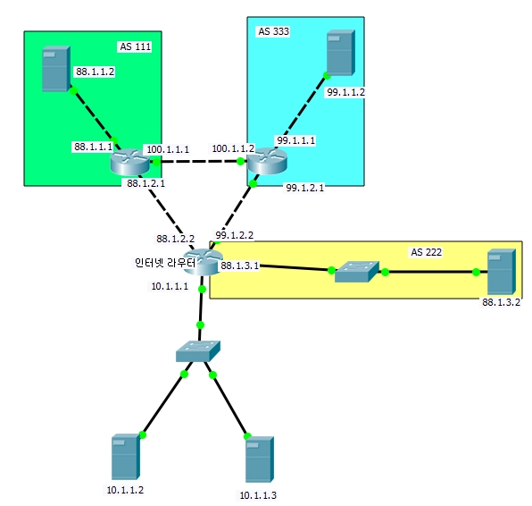

아래와 같이 세 가지 영역 간에 BGP를 설정해보자.



각 라우터마다 IP를 할당해주고, 다음과 같이 콘솔에 명령을 입력해준다.

```
router bgp 111
neighbor 88.1.2.2 remote-as 222
neighbor 100.1.1.2 remote-as 333
redistribute connected
```

```
router bgp 333
neighbor 99.1.2.2 remote-as 222
neighbor 100.1.1.1 remote-as 333
redistribute connected
```

```
router bgp 222
neighbor 88.1.2.1 remote-as 111
neighbor 99.1.2.1 remote-as 333
/* 
	자신의 사설 영역 정보는 라우팅 테이블에 올리지 않고, 
	DMZ 네트워크 영역만 라우팅 테이블에 올린다.
*/
network 88.1.3.0 mask 255.255.255.0

/*
	내부 네트워크에는 ospf 라우팅 알고리즘을 가동시킨다.
*/
router ospf 100
network 10.0.0.0 0.255.255.255 area 0
```
