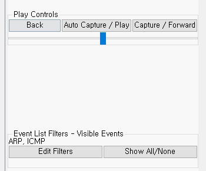
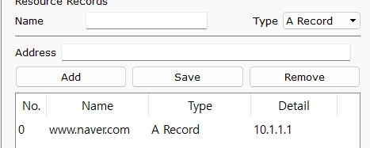
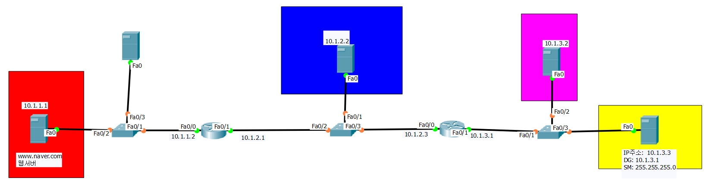

이 글의 실습은 Cisco Packet Tracer로 진행한다.

## 패킷 추적하기

Simulation을 클릭하고 Edit Filters에서 추적할 프로토콜을 필터링한다. Capture / Forward를 클릭해 패킷 이동을 한 단계씩 진행하고, 편지 봉투를 클릭해 OSI 계층별 패킷 정보를 확인한다.

## DNS 서버 설정하기

파란색 영역의 단말에서 Service - DNS를 클릭해 DNS Service를 구동한다. Domain Name과 IP 주소를 입력해 `www.naver.com`과 매칭할 IP 주소를 도메인 주소 테이블에 추가한다.

## DHCP 서버 설정하기

분홍색 영역의 단말에서 Service - DHCP를 클릭해 DHCP를 구동한다. IP 주소, Default Gateway, DNS 서버 주소, 서브넷 마스크를 입력하고 저장한다. DHCP 서버에 접근하는 호스트는 Offer를 받아 IP 주소를 할당받는다. 모든 Default Gateway에서 인터페이스별로 DHCP 서버에 대한 유니캐스트를 허용해야 한다.

## 실습 화면

