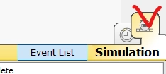
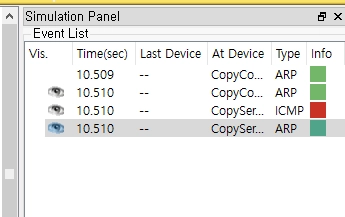
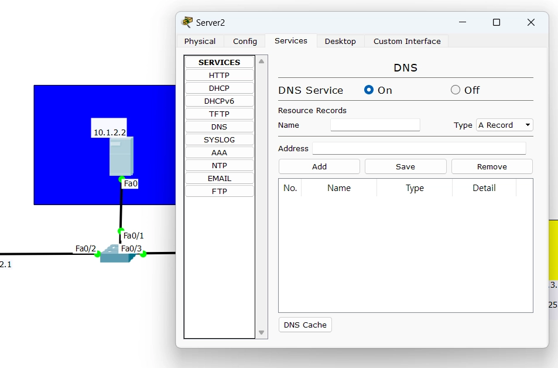
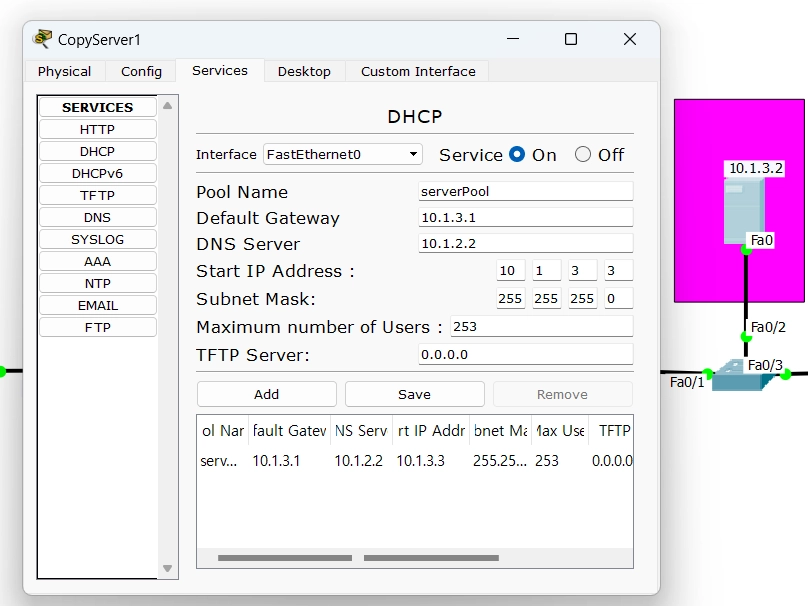
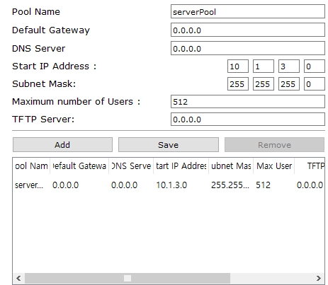
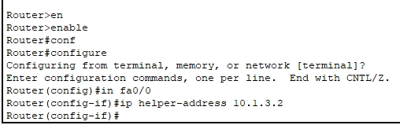

이번 실습은 아래와 같은 환경을 구축하여 시작한다.

- 패킷 추적하기
    
    위와 같이 네트워크를 구축한 상태에서 오른쪽의 Simulation을 클릭한다.
    
    
    
    Edit Filters에서는 추적하려는 프로토콜에 대한 필터링이 가능하고, Capture / Forward를 클릭할 때마다 패킷의 이동 과정을 한 단계씩 진행할 수 있다. 
    
    
    
    이제 노란색 영역의 단말(10.1.3.3)에서 빨간색 영역의 단말(10.1.1.1)으로 ping을 보내는 과정에 대해 살펴보면 다음과 같다.
    
    
    
    진행 과정에서 아래와 같은 편지 봉투를 클릭하면 OSI 계층에 따라 어떤 패킷이 오고 가는 지를 상세히 볼 수 있다.
    
    [https://app.notion.com](https://app.notion.com)
    

- DNS 서버 설정하기
    
    파란색 영역을 DNS 서버로 지정해보자.
    
    단말에서 Service - DNS를 클릭하면 아래와 같이 DNS Service를 구동시킬 수 있다.
    
    
    
    Domain Name과 IP 주소를 작성하여 아래에 도메인 주소 테이블에 내용을 추가할 수 있게 된다. 도메인 테이블에 아래와 같이 www.naver.com라는 **도메인 주소에 대해 어떤 IP 주소를 매칭할 지에** 대해 작성해두면 추후에 <u>해당 단말(= 10.1.2.2)을 방문하여 도메인 주소를 확인할 때에 테이블 내용을 바탕으로 도메인 주소에 따른 IP 주소를 응답하게 된다.</u>
    
    
    

- DHCP 서버 설정하기
    
    분홍색 영역의 단말을 DHCP 서버로 설정해보자.
    
    단말에서 Service - DHCP를 클릭하면 아래와 같이 DHCP를 구동시킬 수 있다.
    
    
    
    이후로, 3계층 통신에 필요한 파라미터들(IP 주소, 디폴트 게이트웨이, DNS 서버 주소, 서브넷 마스크 등)을 할당하고 테이블에 그 내용을 저장해준다. 
    
    
    
    이제 DHCP 서버에 접근하는 호스트들은 입력한 정보를 바탕으로 Offer를 받게 되고, IP 주소를 할당하게 된다.
    
    또, DHCP 서버를 적용하기 위해 네트워크의 **모든 디폴트 게이트웨이**에서 **인터페이스** 별로 DHCP 서버에 대한 유니 캐스트를 다음과 같이 허용해주어야 한다. (라우터의 인터페이스 별로 하는 것이 아니라, 라우터 자체적으로 적용해야 한다.)
    
    
