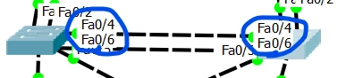

이 글의 실습은 Cisco Packet Tracer로 진행한다. 두 스위치 사이의 링크를 하나 더 추가하고 각각의 스위치에 다음 명령을 입력한다.

```text
Switch> enable
Switch# configure terminal
Switch(config)# interface fastethernet 0/4
Switch(config-if)# channel-group 1 mode on
Switch(config)# interface fastethernet 0/6
Switch(config-if)# channel-group 1 mode on
```

## 실습 화면



