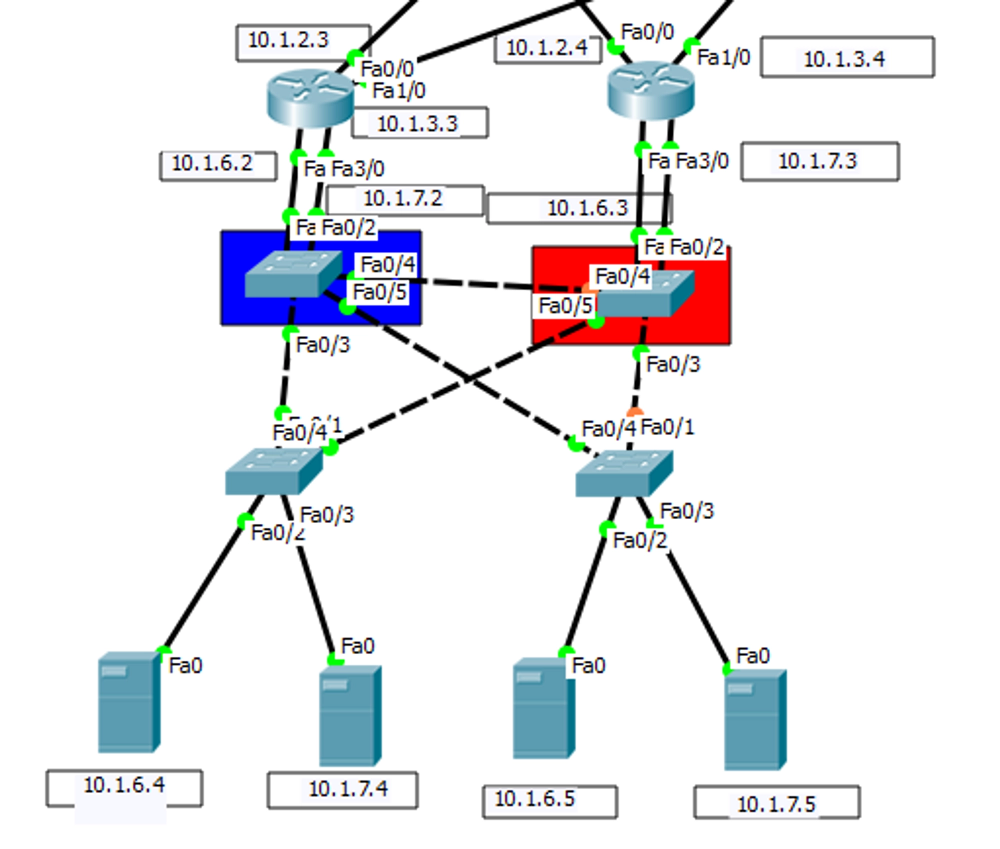

> **실습 목표** · 두 스위치 사이의 물리 포트들을 같은 채널 그룹에 넣어 여러 회선을 하나의 논리 링크로 구성한다.

아래의 두 스위치의 링크를 이중으로 연결하고, 이더 채널을 설정해보자.



우선 두 스위치 간에 링크를 하나 더 추가해준다.


이제 각각의 스위치에 아래와 같이 입력해준다.

```
Switch> enable
Switch# configure terminal
Switch(config)# interface fastethernet 0/4
Switch(config-if)# channel-group 1 mode on
Switch(config)# interface fastethernet 0/6
Switch(config-if)# channel-group 1 mode on
```
