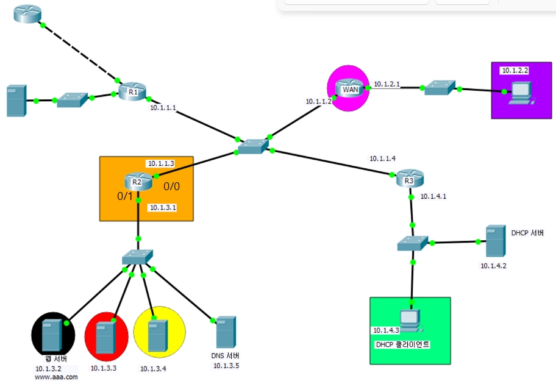

> **실습 목표** · 웹 서버 접근 정책을 ACL로 표현하고, CBAC가 연결 상태를 추적해 응답 트래픽을 허용하는 원리를 익힌다.

**CBAC(Context-Based Access Control)**는 라우터를 통과하는 연결의 상태를 추적하는 Cisco IOS 방화벽 기능이다. 이 실습에서 ACL은 보라색 PC가 웹 서버의 TCP 80번 포트로 요청을 보낼 수 있도록 허용한다. CBAC는 허용된 HTTP 연결을 검사하고, 서버에서 돌아오는 패킷이 그 연결에 속하면 통과할 수 있도록 임시 허용 규칙을 만든다. 연결이 종료되거나 제한 시간이 지나면 이 규칙도 사라진다.

아래와 같은 네트워크 구조에서 보라색 컴퓨터만 웹 서버(www.aaa.com)에 접근할 수 있도록 주황색 라우터에 Access list 및 CBAC 필터를 적용해보자.



주황색 라우터에 다음과 같은 액세스 리스트를 설정하면 된다.

```
access-list  100  permit tcp  host  10.1.2.2  host  10.1.3.2   eq 80
access-list  100  deny tcp  any  host  10.1.3.2   eq 80
access-list  100  permit ip  any   any

in fa 0/0
ip access-group  100 in
```

아래 명령은 HTTP 검사 규칙에 `123`이라는 이름을 붙이고, FastEthernet 1/0으로 들어오는 트래픽에 적용한다.

```
ip inspect name 123 http
in fa 1/0
ip inspect 123 in
```
