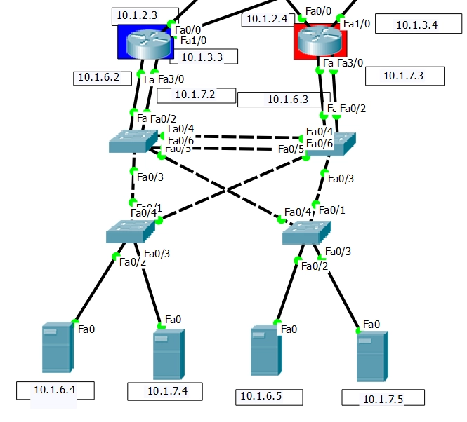

이 글의 실습은 Cisco Packet Tracer로 진행한다. 파란색 라우터와 빨간색 라우터를 각각 VLAN 10과 VLAN 20의 액티브 라우터로 설정한다.

```text
R1(config)# interface fastethernet 2/0
R1(config-if)# standby 10 ip 10.1.6.1
R1(config-if)# standby 10 priority 150
R1(config-if)# standby 10 preempt

R1(config)# interface fastethernet 3/0
R1(config-if)# standby 20 ip 10.1.7.1
R1(config-if)# standby 20 priority 50
```

빨간색 라우터에서는 VLAN 10의 priority를 50, VLAN 20의 priority를 150으로 설정하고 VLAN 20에 `preempt`를 적용한다. 두 라우터에 논리적으로 `10.1.6.1`과 `10.1.7.1` 주소가 각각 하나씩 생긴다.

## 실습 화면


