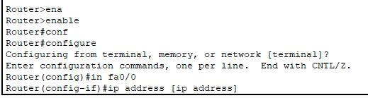
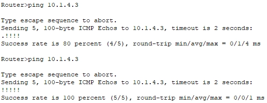
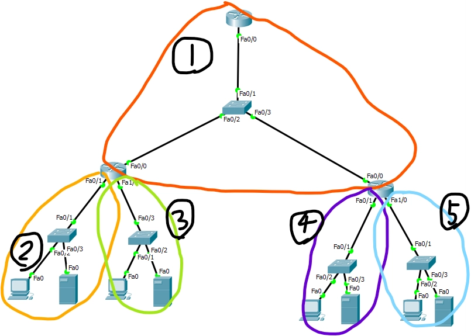

아래와 같이 다섯 개로 나눌 수 있는 네트워크를 구성해보자.



전체 네트워크의 서브넷 마스크는 **255.255.255.0 / 24**를 사용하며, 각 영역마다 다음과 같은 네트워크 주소를 사용한다.

```
1번 영역 -> 10.1.1.1 ~ 10.1.1.3
2번 영역 -> 10.1.2.1 ~ 10.1.2.3
3번 영역 -> 10.1.3.1 ~ 10.1.3.3
4번 영역 -> 10.1.4.1 ~ 10.1.4.3
5번 영역 -> 10.1.5.1 ~ 10.1.5.3
```

IP를 할당해야 하는 장치는 세 개의 라우터와 8개의 디바이스(PC, Server)에 할당해주어야 한다. 할당하는 방법은 다음과 같다.

- 라우터
    
    다음과 같이 라우트의 특정 포트에 접근하여 다음과 같이 입력해주면 된다.
    
    
    
    IP 주소를 할당하는 명령어는 다음과 같다.
    
    ```
    ip address [할당하려는 IP 주소] [Subnetmask]
    ```
    

- 디바이스
    
    단말에서는 아래와 같이 설정해준다. 이 때, Default Gateway는 현재 네트워크에서 바로 위에 있는 라우터를 설정해준다.
    
    
    
    예를 들어, 빨간 디바이스에 IP 주소를 할당할 때에는 파란 라우터의 IP 주소를 입력으로 해준다.
    
    
    

## 라우팅 테이블 조회하기

라우팅 테이블은 다음과 같이 조회할 수 있다.


- 연결되지 않은 라우터까지 조회하기
    
    세 개의 라우터마다 콘솔에서 아래의 명령어를 입력한다.
    
    ```
    Router>enable
    Router#configure
    Router(config)# router eigrp 100
    Router(config)# network 10.0.0.0
    ```
    
    이후, 최상위 라우터에서 라우팅 테이블을 조회하면 다음과 같이 직접적으로 연결되지 않은 라우터까지 연결 결과를 볼 수 있다.
    
    
    
    이제 최상위 라우트에서 간접적으로 연결된 디바이스에 ping을 보내면 다음과 같은 결과를 볼 수 있다.
    
    
    

## 스위칭 테이블 조회하기

스위칭 테이블은 다음과 같은 방법으로 조회한다.


