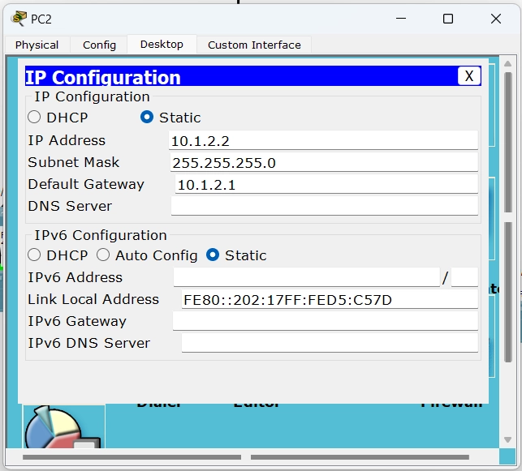
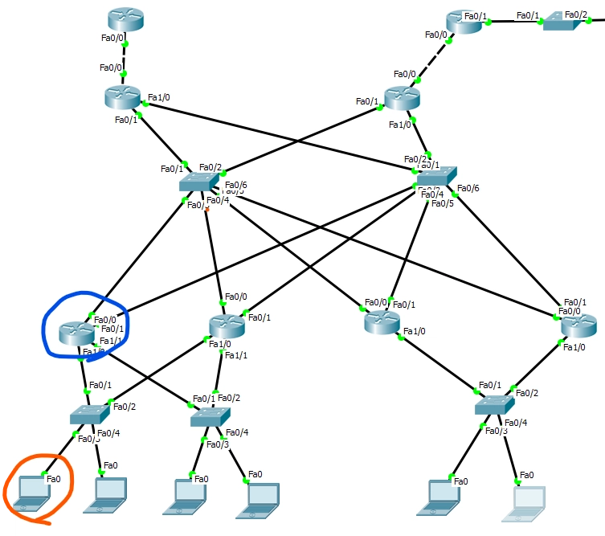
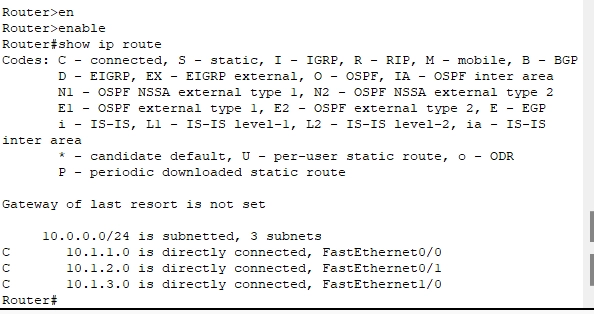
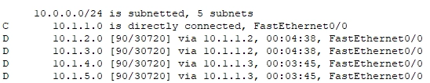
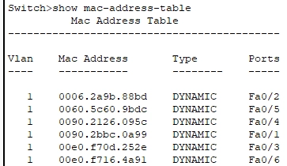

이 글의 실습은 Cisco Packet Tracer로 진행한다. 다섯 개 영역으로 나뉜 네트워크를 구성하고 전체 서브넷 마스크는 `255.255.255.0 / 24`를 사용한다.

```text
1번 영역 -> 10.1.1.1 ~ 10.1.1.3
2번 영역 -> 10.1.2.1 ~ 10.1.2.3
3번 영역 -> 10.1.3.1 ~ 10.1.3.3
4번 영역 -> 10.1.4.1 ~ 10.1.4.3
5번 영역 -> 10.1.5.1 ~ 10.1.5.3
```

세 개의 라우터와 8개의 디바이스(PC, Server)에 IP를 할당한다. 라우터 인터페이스에 `ip address [할당하려는 IP 주소] [Subnetmask]`를 입력하고 단말에는 바로 위 라우터의 주소를 Default Gateway로 설정한다.

## 라우팅 테이블 조회하기

세 라우터의 콘솔에서 다음 명령을 입력하면 연결되지 않은 라우터까지 확인할 수 있다.

```text
Router>enable
Router#configure
Router(config)# router eigrp 100
Router(config)# network 10.0.0.0
```

이후 최상위 라우터에서 라우팅 테이블을 조회하고 간접적으로 연결된 디바이스에 ping을 보낸다. 스위칭 테이블은 스위치의 MAC 주소 학습 결과를 확인하는 방식으로 조회한다.

## 실습 화면












