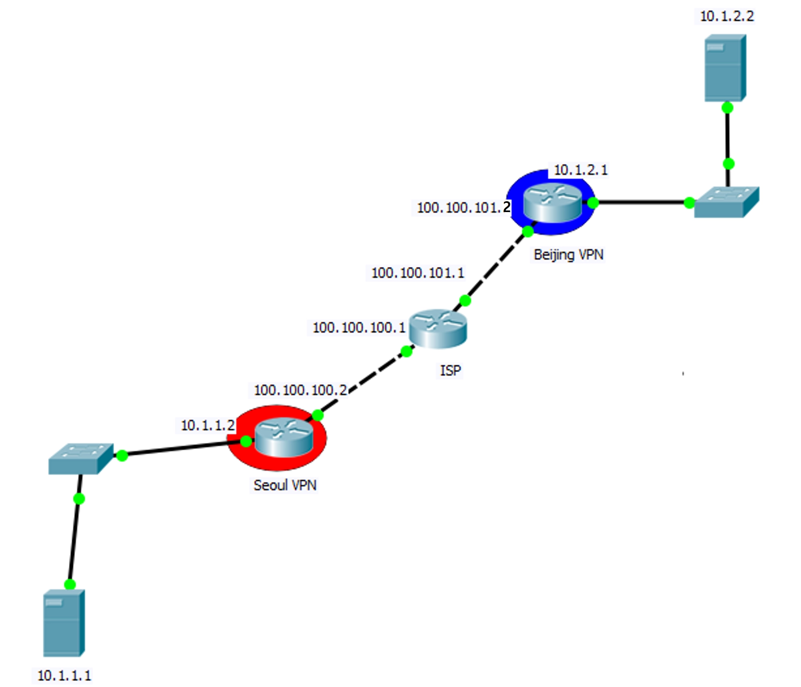

이 글의 실습은 Cisco Packet Tracer로 진행한다.

## Site to Site VPN

서울 라우터와 북경 라우터 사이에 VPN을 적용한다.

```text
crypto isakmp enable
crypto isakmp policy 10
authentication pre-share
encryption aes 128
group 5
hash sha
lifetime 86400
crypto isakmp key 00100 address 100.100.101.2
crypto ipsec transform-set MYSET esp-des esp-md5-hmac
access-list 100 permit ip 10.1.1.0 0.0.0.255 10.1.2.0 0.0.0.255
crypto map MYMAP 10 ipsec-isakmp
match address 100
set peer 100.100.101.2
set transform-set MYSET
interface fa0/0
crypto map MYMAP
```

## Client VPN

원격지 호스트가 내부 영역에 접근하도록 인증, 주소 풀, 동적 crypto map을 설정한다.

```text
crypto isakmp policy 10
authentication pre-share
encryption aes
group 2
hash md5
aaa new-model
aaa authentication login REMOTE local
aaa authorization network REMOTE local
username abcd password dcba
ip local pool MYPOOL 10.1.1.3 10.1.1.254
crypto isakmp client configuration group REMOTE
key 1111
pool MYPOOL
crypto ipsec transform-set MYSET esp-des esp-md5-hmac
crypto dynamic-map DMAP 10
set transform-set MYSET
crypto map CLIENT_MAP 10 ipsec-isakmp dynamic DMAP
interface fa0/0
crypto map CLIENT_MAP
```

## 실습 화면




