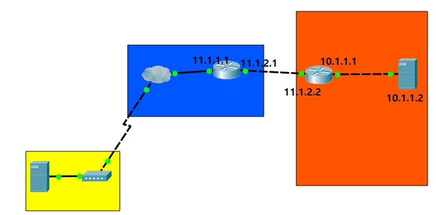
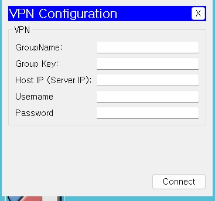

- Site to Site VPN
    
    서울 라우터와 북경 라우터 간에 VPN을 적용하려고 한다.
    
    
    
    서울 라우터에 아래와 같이 입력해준다. (북경에는 인터페이스의 방향이나 IP 주소를 반대로 입력해주면 된다.) 
    
    ```
    /*
    	라우터가 보안 채널에 적용할 정책들을 설정한다.
    */ 
    crypto isakmp enable
    crypto isakmp policy 10
    authentication pre-share
    encryption aes 128
    group 5
    hash sha
    lifetime 86400
    
    /*
    	사용자 인증에 pre-shared key를 사용하기로 하였으므로,
    	북경 라우터와 사전에 협의한 key를 입력해준다.
    */
    crypto isakmp key 00100 address <u>**100.100.101.2**</u>
    
    /*
    	메시지 인증 알고리즘을 설정해준다.
    */
    crypto ipsec transform-set MYSET esp-des esp-md5-hmac
    
    /*
    	IP 프로토콜에 대한 화이트 리스트 작성한다.
    	10.1.1.0/24에서 10.1.2.0/24에 대한 ip 프로토콜을 허용한다.
    */
    access-list 100 permit ip **10.1.1.0** <u>0.0.0.255</u> **10.1.2.0** <u>0.0.0.255</u>
    
    /*
    	보안 정책을 모두 적용하여 북경과의 보안 채널을 개통한다.	
    */
    <u></u>crypto map MYMAP 10 ipsec-isakmp
    match address 100
    set peer <u>**100.100.101.2**</u>
    set transform-set MYSET
    set security-association lifetime seconds 86400
    
    /*
    	보안 채널 정책을 인터넷 영역(= ISP와 연결된 인터페이스)에
    	적용해준다.
    */
    in <u>**fa0/0**</u>
    crypto map MYMAP
    ```
    

- Client VPN
    
    노란색 영역(= 원격지)의 호스트에서 주황색 영역에 접근하려고 한다. 
    
    
    
    주황색 영역의 라우터에 다음과 같이 설정해준다.
    
    ```
    /*
    	보안 채널에 적용할 보안 정책 설정
    */
    crypto isakmp policy 10
    authentication pre-share
    encryption aes
    group 2
    hash md5
    lifetime 21600
    
    /*
    	원격지에서 접근하려는 호스트 정보 등록 및 접근 인가
    */
    aaa new-model
    aaa authentication login REMOTE local
    aaa authenrization network REMOTE local
    
    username abcd passwd dcba
    
    /*
    	내부 네트워크가 접근할 때 부여할 사설 IP 주소 등록
    */
    ip local pool MYPOOL 10.1.1.3 10.1.1.254
    crypto isakmp client configuration group REMOTE
    key 1111
    pool MYPOOL
    
    /*
    	메시지 인증 방식 설정
    */
    crypto ipsec transform-set MYSET esp-des esp-md5-hmac
    crypto dynamic-map DMAP 10
    set transform-set MYSET
    
    /*
    	보안 정책 적용
    */
    crypto map CLIENT_MAP client authentication list REMOTE
    crypto map CLIENT_MAP isakmp authorization list REMOTE
    crypto map CLIENT_MAP client configuration address respond
    crypto map CLIENT_MAP 10 ipsec-isakmp dynamic DMAP
    
    in fa 0/0
    crypto map client_MAP
    ```
    
    이제 노란색 영역의 호스트에 아래와 같은 VPN 설정 정보(= 라우터에서 적용한 정보)를 입력해주면 주황색 영역에서 통신하는 것과 같아진다.
    
    
