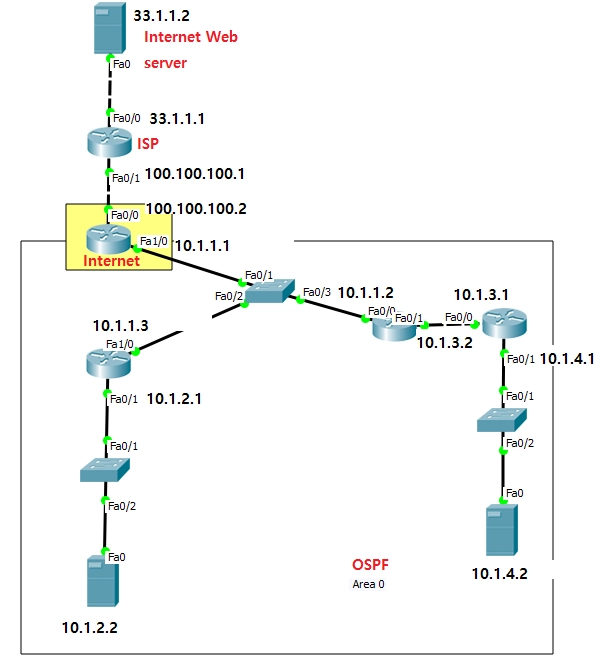
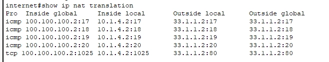

아래 네트워크 환경은 사설 IP 영역과 공인 IP 영역으로 나누어진다. 사설 IP 영역은 라우팅 프로토콜로 OSPF가 사용되고 있으며, 노란색 라우터는 NAT 서비스가 동작하여 사설 IP 주소와 공인 IP 주소 간의 변환을 담당할 것이다. 



위 구성대로 IP 주소를 할당하고, 라우팅 프로토콜을 OSPF로 적용한 상태에서 노란색 라우터(= Internet router)에 NAT 서비스가 동작하도록 해보자. 

Internet 라우터에 접근하여 다음과 같은 명령을 입력해준다.

```
interface fastethernet 0/0
ip nat outside

interface fastethernet 1/0
in nat inside
exit

access-list 88 permit 10.0.0.0 255.255.255.0
ip nat inside source list 88 in fa 0/0 overload
```

위와 같이 입력하면 하나의 공인 주소(= 100.100.100.2)에 대한 NAT를 설정한 것이 된다. 이제 명령에 대해 하나하나 살펴보자.

아래 명령은 라우터의 0/0 인터페이스(= 100.100.100.1)가 외부 인터넷으로 향하는 것이므로, **내부에서 외부로 나가는 것임**을 명시해준다. 즉, <u>0/0 인터페이스로 나갈 때에는 공인 IP로 바뀌어야 함</u>을 설정해준 것이다.

```
interface fastethernet 0/0
ip nat outside
```

아래 명령은 라우터의 1/0 인터페이스(= 10.1.1.1)가 내부 네트워크로 향하는 것이므로, 외부에서 내부로 들어가는 것임을 명시해준다. 즉, <u>1/0 인터페이스로 들어갈 때에는 사설 IP 주소로 바뀌어야 함</u>을 설정해준 것이다.

```
interface fastethernet 1/0
in nat inside
exit
```

아래 명령은 사설 IP 주소 대역 중에 어떤 대역을 공인 IP로 변환할 지에 대해 List로 등록하는 명령이다. 이 때, 수 많은 List 중에 식별하기 위한 번호로 88번을 지정하였다.

```
access-list 88 permit 10.0.0.0 255.255.255.0
```

마지막 명령은 출발지 IP 주소에 임의의 포트 번호(1025 ~ 65535) 중에 하나를 부여하여 외부 네트워크로 나간 사설 IP 주소가 다시 사설 IP 네트워크르 돌아갈 수 있도록 하기 위한 NAT 테이블을 작성하도록 하는 명령이다. 

```
ip nat inside source list 88 in fa 0/0 overload
```

참고로 라우터에서 현재 생성된 NAT을 살펴보려면 다음과 같이 입력하면 된다.


