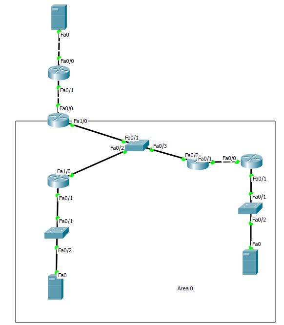

> **실습 목표** · OSPF 설정에서 각 네트워크가 속할 영역(area)을 지정한다. 같은 토폴로지를 여러 영역으로 나눈 구성과 단일 영역에 둔 구성을 비교한다.

OSPF는 알고리즘 특성상 CPU 소모량이 많으므로 아래 그림처럼 영역을 나누어 영역별로 OSPF를 동작시키는 것이 좋다.


R1부터 R4까지 아래와 같은 라우터의 두 가지 기본 명령을 입력하여 IP를 할당해주자.

```
no shutdown
ip address 100.1.1.1 255.255.255.0
```

이제 라우팅 알고리즘을 적용해야 한다. 영역 별로 다른 OSPF를 적용하기 위해 알고리즘의 적용 대역을 라우터마다 다르게 설정할 필요가 있다. 

먼저 R1에는 다음과 같이 적용해준다.

```
router ospf 100
network 100.1.1.1 0.0.0.0 area 0
```

R2에는 다음과 같이 적용한다.

```
router ospf 100
network 100.1.1.2 0.0.0.0 area 0
network 100.1.2.1 0.0.0.0 area 0
```

R3에는 다음과 같이 적용한다.

```
router ospf 100
network 100.1.2.2 0.0.0.0 area 0
network 100.1.3.1 0.0.0.0 area 1
```

마지막으로 R4에 다음과 같이 적용하면 그림과 같이 두 영역에 각각 OSPF가 동작하게 된다.

```
router ospf 100
network 200.1.3.2 0.0.0.0 area 1
```

그러나 요즘 라우터는 CPU가 우수하다보니, 아래와 같이 하나의 영역 내에서 OSPF 알고리즘을 동작시켜도 무난하게 동작한다.


