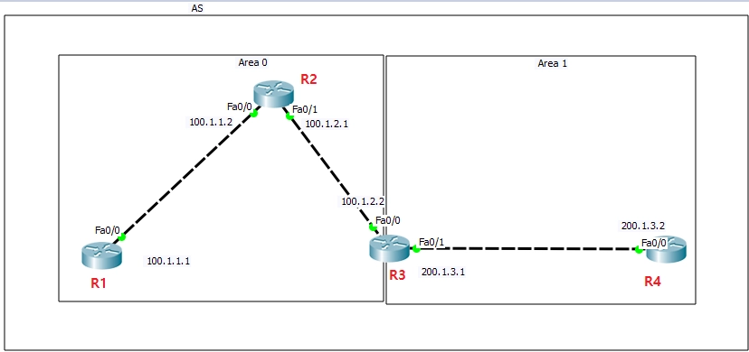

이 글의 실습은 Cisco Packet Tracer로 진행한다. OSPF 영역을 나누어 라우팅 알고리즘을 적용한다.

```text
router ospf 100
network 100.1.1.1 0.0.0.0 area 0
```

```text
router ospf 100
network 100.1.1.2 0.0.0.0 area 0
network 100.1.2.1 0.0.0.0 area 0
```

```text
router ospf 100
network 100.1.2.2 0.0.0.0 area 0
network 100.1.3.1 0.0.0.0 area 1
```

```text
router ospf 100
network 200.1.3.2 0.0.0.0 area 1
```

각 라우터의 인터페이스에는 `no shutdown`과 `ip address 100.1.1.1 255.255.255.0` 형식으로 IP를 할당한다.

## 실습 화면


