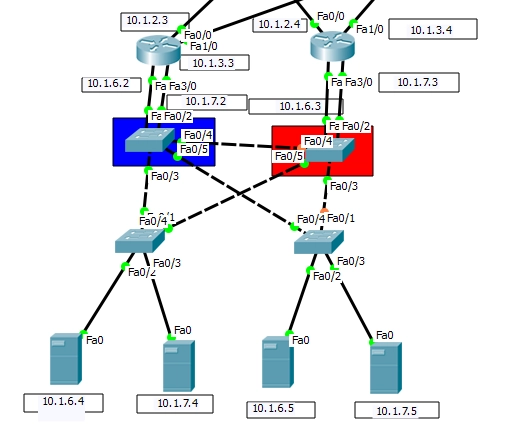

이 글의 실습은 Cisco Packet Tracer로 진행한다. VLAN 10과 VLAN 20이 적용된 두 스위치를 각각 해당 VLAN의 루트 스위치로 설정한다.

파란색 스위치:

```text
Switch> enable
Switch# configure terminal
Switch(config)# spanning-tree vlan 10 priority 4096
```

빨간색 스위치:

```text
Switch> enable
Switch# configure terminal
Switch(config)# spanning-tree vlan 20 priority 4096
```

## 실습 화면


