이 글의 실습은 Cisco Packet Tracer로 진행한다. Router는 2621, Switch는 2960을 사용한다.

## 2621 Router 장비 구조

- 콘솔 포트: 초당 9600bps의 데이터를 처리한다.
- 전원
- Fast Ethernet: 초당 100Mbps의 데이터를 처리한다.
- Network module: 이번 실습에서는 NM-2FE2W 모듈을 사용한다.
- Web Interface Card

## 케이블 사용 유의사항

서로 다른 장치를 연결할 때와 같은 장치를 연결할 때 사용하는 구리 케이블이 다르다. 기기의 콘솔 연결은 콘솔 케이블로 한다.

## Router의 Link pulse 켜기

Router와 연결되는 장비에 빨간 불이 나오는 것은 Link Pulse가 꺼져 있다는 뜻이다. Router는 기본적으로 신호가 꺼져 있으므로 콘솔에서 인터페이스 설정 모드로 진입한 뒤 `no shutdown`을 입력한다. 4/0, 2/0, 3/0 포트의 상태를 켜고 라우터 간 연결에서는 양쪽 라우터에서 각각 실행한다.

## 터미널 접근

Laptop을 클릭하고 Terminal을 선택하면 콘솔에서 명령을 입력할 수 있다. Console Access는 콘솔 케이블과 콘솔 포트로 접근하고, Telnet Access는 Telnet 패킷으로 네트워크에 접근한다. 오탈자로 Telnet Access가 발생하면 `Ctrl + Shift + 6`으로 탈출할 수 있다. `vty 0 4`는 0번부터 4번까지 총 5명의 사용자를 허용하는 가상 인터페이스다.

## Console의 명령어 입력 모드

- 유저 모드 `Router>`: Level 1 명령어 모드다.
- 프리빌리지 모드 `Router#`: Level 15 명령어 모드이며 `enable`로 진입한다.
- 글로벌 컨피규레이션 모드 `Router(config)#`: `configure terminal`로 진입한다.
- 인터페이스 컨피규레이션 모드 `Router(config-if)#`: 인터페이스 설정을 수행한다.

각 모드에서 `exit` 또는 `end`로 빠져나온다. 라우터 이름은 글로벌 컨피규레이션 모드에서 hostname 명령으로 변경한다.

## 실습 화면

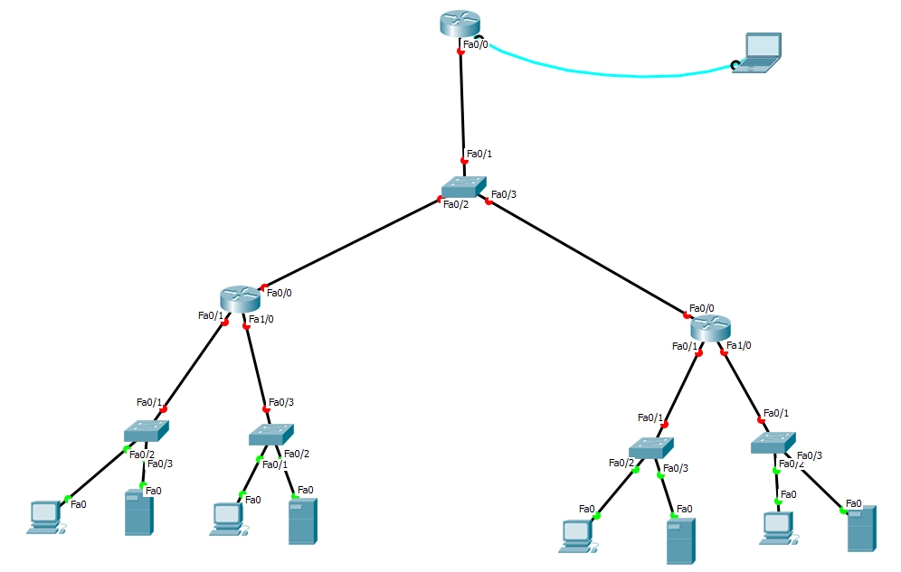

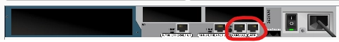

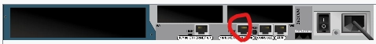

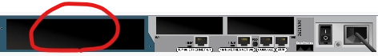

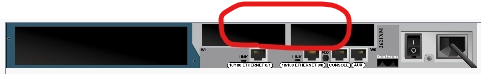

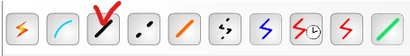

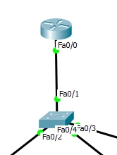

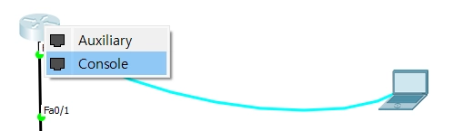

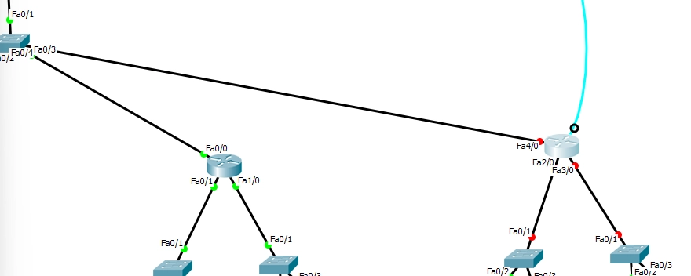

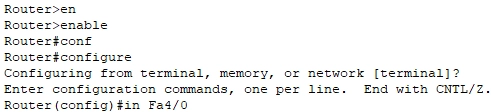

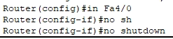

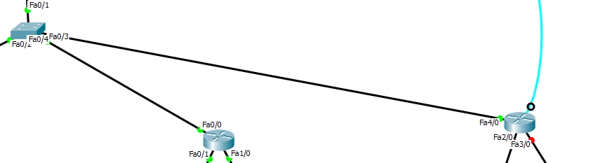

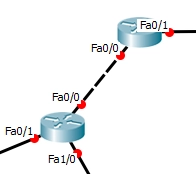

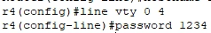

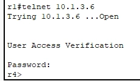

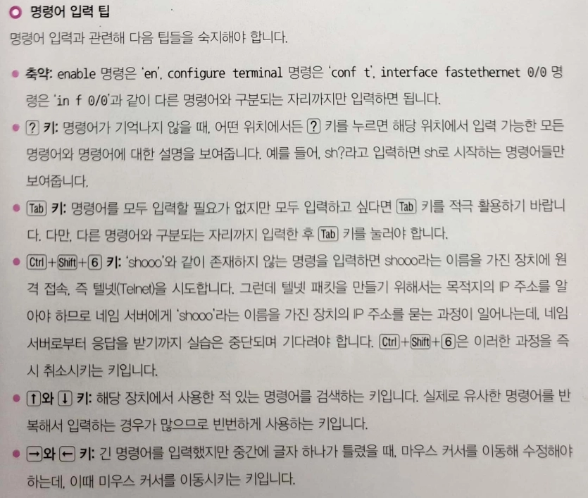

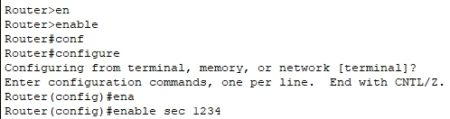

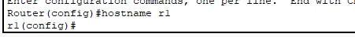

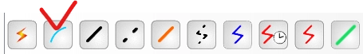
