> **실습 목표** · Packet Tracer에서 장비를 연결하고 PC의 콘솔 터미널로 라우터에 접속한다. 프롬프트의 변화를 보며 사용자 모드에서 특권 모드와 설정 모드로 이동하는 법을 익힌다.

드래그 앤 드랍으로 아래와 같이 장비와 케이블을 배치하여 실습 환경을 구축해보자. (Rotuer는 2621, Switch는 2960 사용한다.)

- 2621 Router 장비 구조
    
    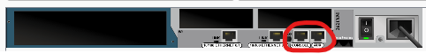
    
    - 콘솔 포트
        
        초당 9600bps의 데이터를 처리함 (매우 느린 편, 명령어 입력 시에만 사용)
        
    
    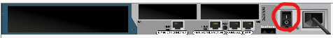
    
    - 전원
    
    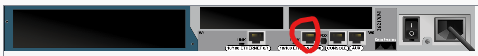
    
    - Fast Ethernet
        
        초당 100mbps의 데이터를 처리함
        
    
    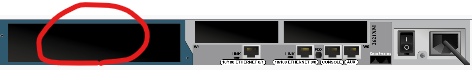
    
    - Network module
        
        이번 실습에서는 NM-2FE2W 모듈을 사용한다.
        
    
    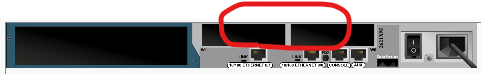
    
    - Web Interface Card
    

- 케이블 사용 유의사항
    
    아래의 케이블은 **서로 다른 장치를 연결**할 때 사용하는 구리 케이블이다.
    
    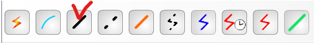
    
    
    
    아래 케이블은 같은 장치를 연결할 때(= Router 간의 연결, Switch 간의 연결) 사용하는 구리 케이블이다.
    
    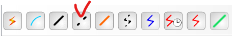
    
    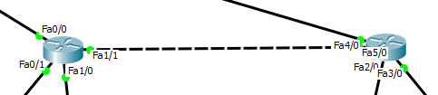
    
    기기의 콘솔 연결 아래의 케이블로 한다.
    
    
    
    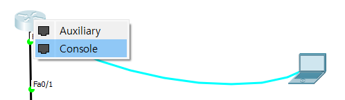
    

- Router의 Link pulse 켜기
    
    잘 살펴보면 Router와 연결되는 장비는 빨간 불이 나오고, 이 외에 장비들은 모두 초록 불이 나오는 것을 볼 수 있다. 
    
    빨간 불인 경우에는 Link Pulse(현재 장비의 Port가 켜져 있는 지를 나타내는 신호)가 꺼져 있다는 뜻이고, 초록 불이면 신호가 켜져 있다는 뜻이다. 
    
    Router는 기본적으로 신호가 꺼져있는 상태이므로, 콘솔에 연결하여 신호를 켜줄 필요가 있다.
    
    아래와 같이 4/0, 2/0, 3/0 포트에 Link pulse가 Off 되어 있는 것을 On으로 바꾸어보자.
    
    
    
    먼저 Console과 연결하고 아래와 같이 인터페이스 컨피규레이션 모드로 진입한다.
    
    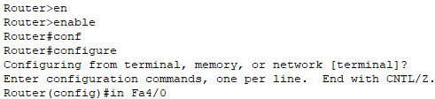
    
    이후, no shutdown 명령을 입력해준다.
    
    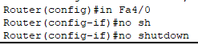
    
    그 결과로 4/0 포트에 초록 불이 들어온 것을 확인할 수 있다.
    
    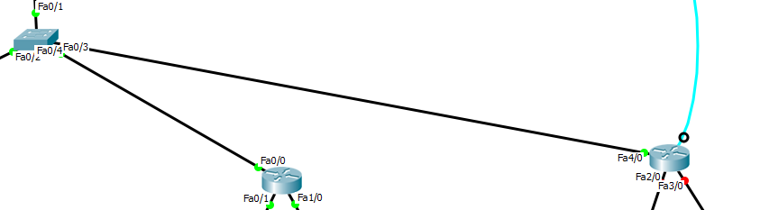
    
    또, 아래와 같이 라우터 간의 연결 후에 On을 시키려면 각각의 라우터 방향에서 no shutdown을 실행해야 한다.
    
    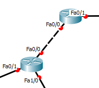
    

- 터미널 접근
    
    콘솔에서 명령을 입력하기 위해서는 Laptop을 좌클릭하고, 아래와 같이 Terminal을 클릭하면 된다.
    
    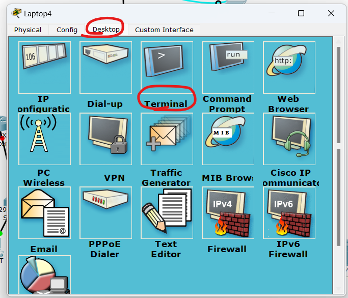
    
    라우터에 접근하는 방식은 크게 두 가지가 존재한다.
    
    1. Console Access 
        
        콘솔 케이블과 콘솔 포트에 연결하는 방식. (위 이미지처럼 터미널로 접근하는 방식이 Console Access이다.)
        
    
    1. Telnet Access, Remote Access
        
        Telnet packet(= 7계층 프로토콜)을 이동하여 네트워크에 접근하는 방식 (실제 패킷 이동)
        
        Console에서 장비의 이름을 입력하면 Telnet Access를 수행하는 것이 된다.
        
        (Console에서 오탈자가 발생하여 Telnet Access가 발생했을 경우, Ctrl + Shift + 6을 눌러서 탈출할 수 있다.)
        
        - Telnet Access에 비밀번호 설정하기
            
            다음과 같이 설정한다.
            
            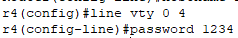
            
            이 때, vty는 가상의 인터페이스를 생성하는 것이고 0 4 라는 옵션은 0번부터 4번까지 총 5명의 유저를 허용하겠다는 의미이다.
            
            이후, 비밀번호를 설정한 네트워크 접근 시에 비밀번호를 묻게 된다.
            
            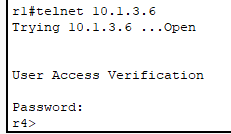
            
        
    

- Console에서의 명령어 입력 모드
    
    Console에는 아래와 같은 네 가지 명령어 입력 모드가 존재한다.
    
    - 유저 모드 Router>
        
        Level 1 명령어 모드라고도 한다.
        
        간단한 조사를 위한 명령 모드이다.
        
    - 프리빌리지 모드 Router#
        
        Level 15 명령어 모드라고도 한다.
        
        자세한 조사를 위한 명령 모드이다.
        
        유저모드에서 “**enable**”을 입력하여 진입할 수 있다.
        
    - 글로벌 컨피규레이션 모드 Router(config)#
        
        인터페이스와 관련없는 설정 명령 모드이다. 
        
        프리빌리지 모드에서 “**configure terminal**”을 입력하여 진입할 수 있다.
        
    
    - 인터페이스 컨피규레이션 모드 Router(config-if)#
        
        인터페이스와 관련있는 설정 명령 모드이다.
        
    
    또, 각 명령 모드 탈출은 “**exit**, **end**”를 입력하면 된다.
    
    기타 상세한 명령어 내용은 다음과 같다.
    
    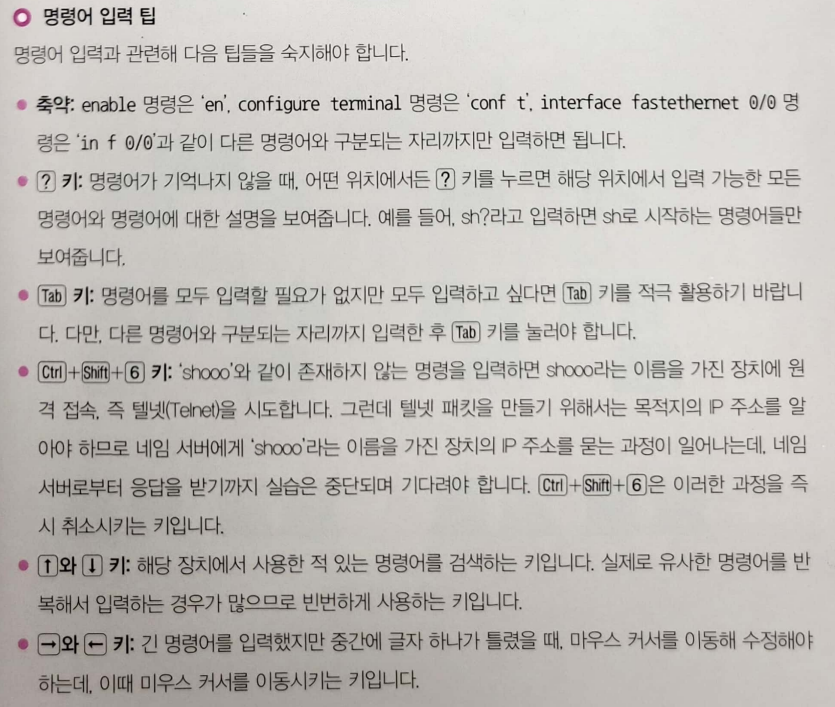
    
    또, 필요에 따라 Level 15 명령어 모드의 진입에 비밀번호를 걸어야 할 수도 있다. 이는 다음과 같이 진행한다.
    
    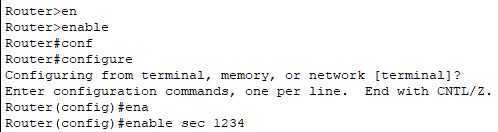
    

- Router 이름 변경
    
    라우터의 이름 변경은 다음과 같이 한다.
    
    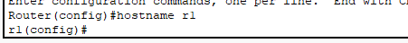
