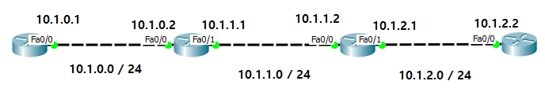

이 글의 실습은 Cisco Packet Tracer로 진행한다. 각 라우터에 다음 기본 명령을 입력한다.

```text
configure terminal
interface fastethernet 0/0
no shutdown
ip address 10.1.0.1 255.255.255.0
```

간접적으로 연결된 라우터의 정보를 정적으로 채우는 형식은 다음과 같다.

```text
ip route [간접 라우터의 대역] [Subnet mask] [간접 라우터로 Forwarding 하기 위한 IP 주소]
```

```text
ip route 10.1.1.0 255.255.255.0 10.1.0.2
ip route 10.1.2.0 255.255.255.0 10.1.0.2
```

이는 두 간접 대역으로 향하는 패킷을 `10.1.0.2`를 통해 Forwarding할 수 있음을 명시한다.

## 실습 화면


